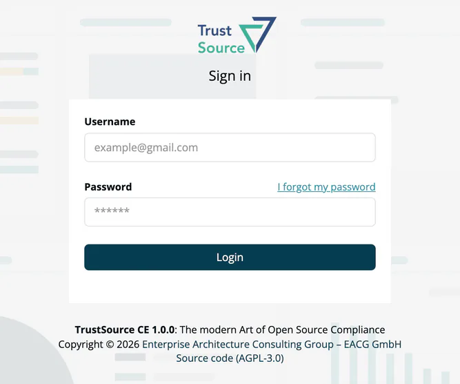
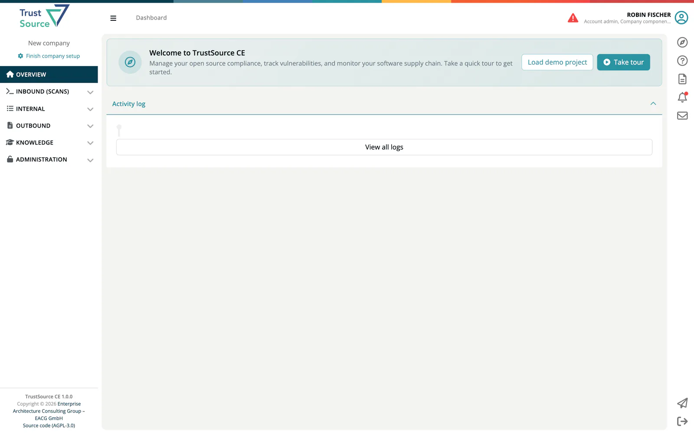
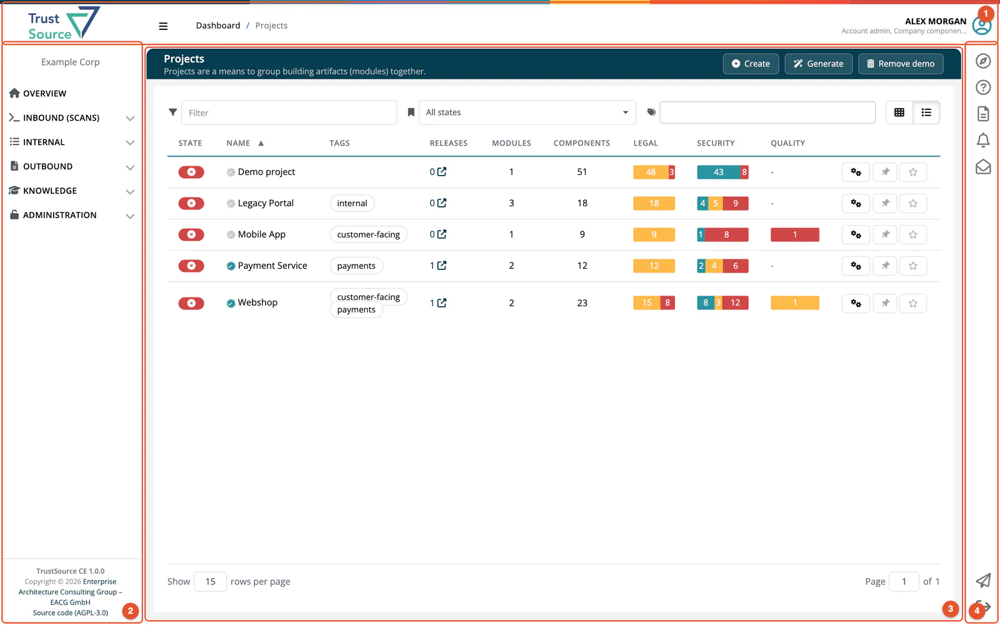

# Your First Login

This page walks you through signing in to ***TrustSource CE*** for the first time and finding your way around the interface.

## How you get an account

There are three ways to get an account in TrustSource CE:

| Way | Who uses it |
|---|---|
| **First administrator** | Created by the operator during installation from the `INITIAL_ADMIN_EMAIL` and `INITIAL_ADMIN_PASSWORD` settings. See [Creating the First Admin User](../01-installation-setup/06-first-admin-user.md). |
| **Invitation** | An account admin invites you under **Administration → User Management**. You receive an invitation email with a link. This is the usual way for a team. |
| **Self sign-up** | Only when the operator has enabled registration (`REGISTRATION_ENABLED=true`). Off by default. |

TrustSource CE signs users in with **email and password only**, optionally with a second factor from an authenticator app. Single sign-on (SSO, OIDC, SAML, LDAP) and GitHub or LinkedIn login are not part of CE; see [CE and SaaS compared](../13-ce-vs-saas.md).

## Signing in

The **Sign in** page has two fields, **Username** (your email address) and **Password**, and the **Login** button.

1. Enter your email address and password.
2. Click **Login**.
3. If two-factor authentication is enabled for your account, a **Two-Factor Authentication** dialog asks you to *Enter the 6-digit code from your authenticator app*. Enter the code and click **Login**.

If the sign-in fails, the page shows *Username/password combination not valid. Please try again*. The same message appears when your email address is not verified yet and when you made too many attempts in a short time; see [Common Errors](../11-troubleshooting-faq/02-common-errors.md).

Your session ends after one day. Click **Logout** in the right bar when you are done, especially on a shared computer.

## Accepting an invitation

1. Open the link in the invitation email. The **Sign Up** page opens with your company name (read-only).
2. Enter your **Name**, a **Password** and **Repeat Password**.
3. Click **Create Account**. You are signed in.

If you already have an account in this installation, the invitation email links to the app instead, and the inviting company appears in your company list after you sign in.

Invited users start with the **Developer** role. The account admin assigns further roles in **User Management**. Ask your account admin if you cannot see a menu you need.

## Password rules

Passwords you set in the app must be at least **12 characters** long and include a capital letter, a special character and a number. This applies to the invitation page, self sign-up, the password reset page and **Change your Password** in your [Profile](../08-personal/03-profile.md).

> [!TIP]
> The first administrator's password comes from the installation settings, which only require 8 characters. If you are the first administrator, set a new password in your Profile after the first sign-in.

## Forgot your password

1. On the **Sign in** page, enter your email address in **Username**.
2. Click **I forgot my password**. A message confirms that an email with reset instructions was sent.
3. Open the link in the email, enter **New Password** and **Repeat new Password**, and confirm.

> [!NOTE]
> In the reference installation, outgoing email is caught by a local mail catcher (Mailpit) instead of being delivered. If no email arrives, ask your operator; see [External Services](../01-installation-setup/04-external-services.md#mail-smtp).

## Self sign-up

When registration is enabled, the **Sign in** page shows **No account yet? Get one for free**.

1. Click it to open **Registration**.
2. Enter **Email Address**, **Repeat Email**, **Password** and **Repeat Password**, and click **Register**.
3. Open the link in the confirmation email. On the **Verify E-Mail** page, enter your password and click **Accept**.

You must verify your email address before you can sign in. Each self sign-up creates a **new, separate company** with the new user as its only member, holding all seven roles. To join an existing company, ask its account admin for an invitation instead.

## Two-factor authentication

You can protect your account with a time-based one-time code (TOTP) from an authenticator app. Enable it under **Enable Two-Factor Authentication** in your [Profile](../08-personal/03-profile.md). From then on, every sign-in asks for the six-digit code.

## What happens on first login

1. **Workspace check.** If your account has no company yet, a *Setting up your workspace* screen appears for a few seconds while a company is created for you.
2. **Dashboard.** You land on the [Dashboard](07-dashboard.md).
3. **Welcome tour.** On your first visit, a short guided tour of the navigation starts by itself. You can cancel it and start it again at any time with **Take tour**; see [Guide, tour and demo project](08-guide-and-demo.md).

> [!WARNING]
> If you hold all seven roles - as the first administrator and every user who signed up themselves do - the header shows *ATTENTION! You are using all roles. This is not intended for production use.* Invite your colleagues with only the roles they need, and work with fewer roles yourself where you can.

An account admin whose company has no name yet sees **Finish company setup** in the sidebar. It opens the company details, where you set the company name.

## Switching companies

You can be a member of more than one company in the same installation, for example when another company's account admin invites you. Your roles are separate in each company.

When you hold roles in more than one company, the company name at the top of the left sidebar becomes a dropdown:

1. Click the company name.
2. Select the company you want to switch to.

Your roles, projects and data change to those of the selected company. With a single company, the name is shown without a dropdown.

## Finding your way around

The interface has four main areas:

| # | Area | Location | Purpose |
|---|---|---|---|
| 1 | **Header** | Top bar | Logo, breadcrumb, the all-roles warning (if it applies), and your name and roles. Click your name to open your Profile. |
| 2 | **Left sidebar** | Left edge | Main navigation: **Overview**, **Inbound (Scans)**, **Internal**, **Outbound**, **Knowledge**, **Administration**. At the bottom: the version (**TrustSource CE 1.0.0**), the copyright line and **Source code (AGPL-3.0)**. |
| 3 | **Content area** | Centre | The current page, list or detail view. |
| 4 | **Right bar** | Right edge | **Guide for this screen**, **Help**, **API documentation**, **Updates**, **Messages**, **Contact Account Admin**, **Logout**. |

> [!TIP]
> The left sidebar is **role-aware**: you only see menu items your roles give you access to. If something seems missing, check the [Roles Cheat Sheet](06-roles-cheatsheet.md).

## Next steps

- Take the [5-Minute Tour](04-quick-tour.md) to see each menu group.
- Read the [Mental Model](05-mental-model.md) to understand Projects, Modules, Components and Products.
- If you are the account admin of a new company, head to [Administration](../06-administration/index.md).

## Related

- [Profile](../08-personal/03-profile.md) - change your password, enable 2FA, set preferences
- [User Management](../06-administration/03-user-management.md) - invite team members
- [Creating the First Admin User](../01-installation-setup/06-first-admin-user.md) - for operators
