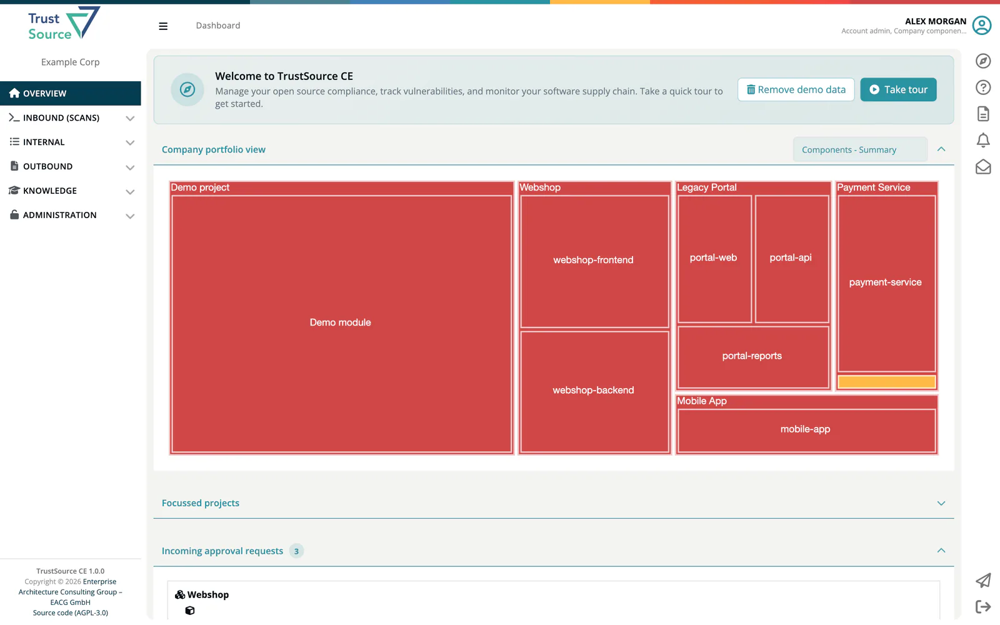
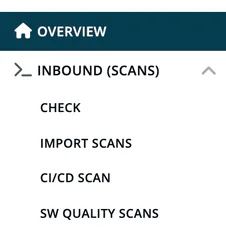
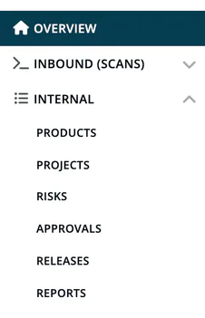
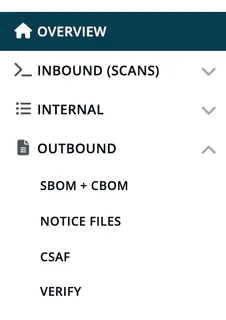
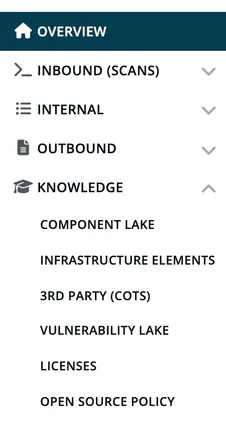
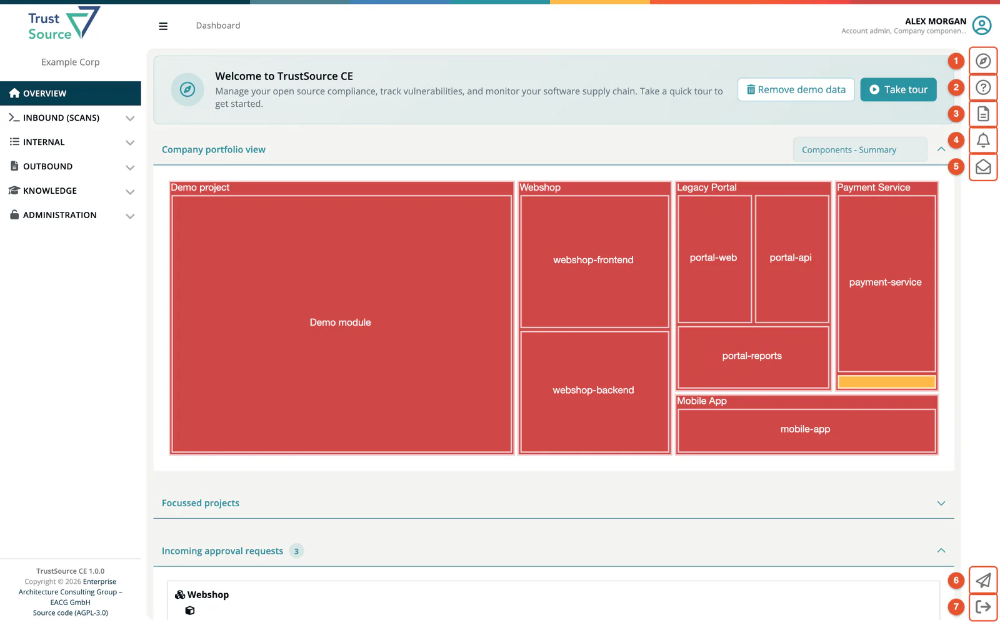

# A 5-Minute Tour

This page takes you through the main navigation groups of ***TrustSource CE***. By the end you will know where to find every major feature.

> [!NOTE]
> What you see in your sidebar depends on your **roles**. This tour shows the full menu as seen by a user who holds all seven roles. Your view may be smaller - that is by design. The "Shown to" columns list the roles that see an entry.

## 1. Overview (Dashboard)

**Overview** opens the dashboard, your landing page after login. Depending on your roles it shows:

- **Company portfolio view** - all projects and modules as a treemap, coloured by status.
- **Focussed projects** - the projects you pinned.
- **Incoming approval requests** - approvals waiting for a compliance manager.
- **Current modules compliance** and history charts - violations, warnings and OK counts over time.
- **Activity log** - the latest actions in your company.

See [The Dashboard](07-dashboard.md) for every widget.

## 2. Inbound (Scans) - bringing data in

Everything that feeds data into TrustSource CE lives here. Shown to Developer, Compliance manager, Manager and Account admin.

| Menu entry | What it does |
|---|---|
| **Check** | Ad-hoc license or component lookup, no scan needed. |
| **Import Scans** | Upload an SPDX or CycloneDX file into a project. |
| **CI/CD Scan** | List of scans received from your CI/CD pipelines through the REST API. |
| **SW Quality Scans** | SARIF test results from code analysis tools. |

## 3. Internal - managing your work

The largest group. This is where you manage the core objects. Shown to Developer, Compliance manager and Manager.

| Menu entry | What it does | Shown to |
|---|---|---|
| **Products** | What you ship to customers, with CRA classification, contacts, documents and photos. | all roles of the group |
| **Projects** | Containers for modules; the module views with their analyses live below them. | all roles of the group |
| **Risks** | Risk register with overview, risk list and tasks. | all roles of the group |
| **Approvals** | Approval requests and their review. | Compliance manager, Manager |
| **Releases** | Approved module releases and their documents. | all roles of the group |
| **Reports** | Hub for analysis reports: licenses, vulnerabilities, versioning, end-of-life, crypto, obligations and more. | all roles of the group |

## 4. Outbound - compliance documents

Documents you generate for others, or verify. Shown to Compliance manager, Manager and Account admin.

| Menu entry | What it does |
|---|---|
| **SBOM + CBOM** | Generate software and crypto bills of materials. |
| **Notice Files** | Generate attribution / notice files. |
| **CSAF** | Create, import and publish CSAF security advisories. |
| **Verify** | Check a signed SBOM, notice or VEX file against its signature. |

## 5. Knowledge - reference data

Reference data shared across all projects. Shown to every role.

| Menu entry | What it does |
|---|---|
| **Component Lake** | All components this installation knows - search, inspect, see where they are used. |
| **Infrastructure Elements** | Catalog of infrastructure such as databases, base images and web servers. |
| **3rd party (COTS)** | Catalog of commercial off-the-shelf components. |
| **Vulnerability Lake** | The vulnerabilities OSV reported for the components this installation analysed. |
| **Licenses** | The license catalog. |
| **Open source policy** | Your company's open source policy. |

## 6. Administration - company settings

Company-wide configuration.

| Menu entry | What it does | Shown to |
|---|---|---|
| **Integrations** | Jira, TFS, GitHub, SCANOSS, LeanIX, webhooks and channels. | Account admin |
| **Settings** | Company details, allow/deny lists, encryption and quality settings, tags, private licenses, legal templates and more. | every role except Developer |
| **User Management** | Invite users, assign roles, remove members. | Account admin |
| **API keys** | API keys, release keys and CSAF feed keys. | Account admin |
| **Policies** | Open source policy, crypto algorithms, component end-of-life. | Account admin, Compliance manager, Company security manager |
| **Audit logs** | Company log and login history. | Account admin |

> [!NOTE]
> Billing, account types, enterprise companies, identity integration (SSO), the AI assistants (OSCAR chat, Threat Model Agent), repository and mass scans and trainings are not part of CE. See [CE and SaaS compared](../13-ce-vs-saas.md).

## The right bar

The narrow icon strip on the right edge of the screen gives you quick access to:

| # | Icon | Action |
|---|---|---|
| 1 | Compass | **Guide for this screen** - opens the guide panel with a tour for the current screen. See [Guide, tour and demo project](08-guide-and-demo.md). |
| 2 | Question mark | **Help** - opens the TrustSource CE README on GitHub. |
| 3 | Document | **API documentation** - the built-in REST API documentation, where you can try the calls. |
| 4 | Bell | **Updates** - the release notes shipped with your version. |
| 5 | Envelope | **Messages** - your inbox. |
| 6 | Paper plane | **Contact Account Admin** - writes an email to your company's account admin. |
| 7 | Exit arrow | **Logout** - sign out. |

On a narrow screen, these entries move into the left sidebar.

## Where to next

- [Mental Model](05-mental-model.md) - understand the data hierarchy before you start.
- [Guide, tour and demo project](08-guide-and-demo.md) - load sample data and click through a real module.
- [Inbound (Scans) chapter](../02-inbound/index.md) - bring your first SBOM in.
- [Roles Cheat Sheet](06-roles-cheatsheet.md) - all roles at a glance.
