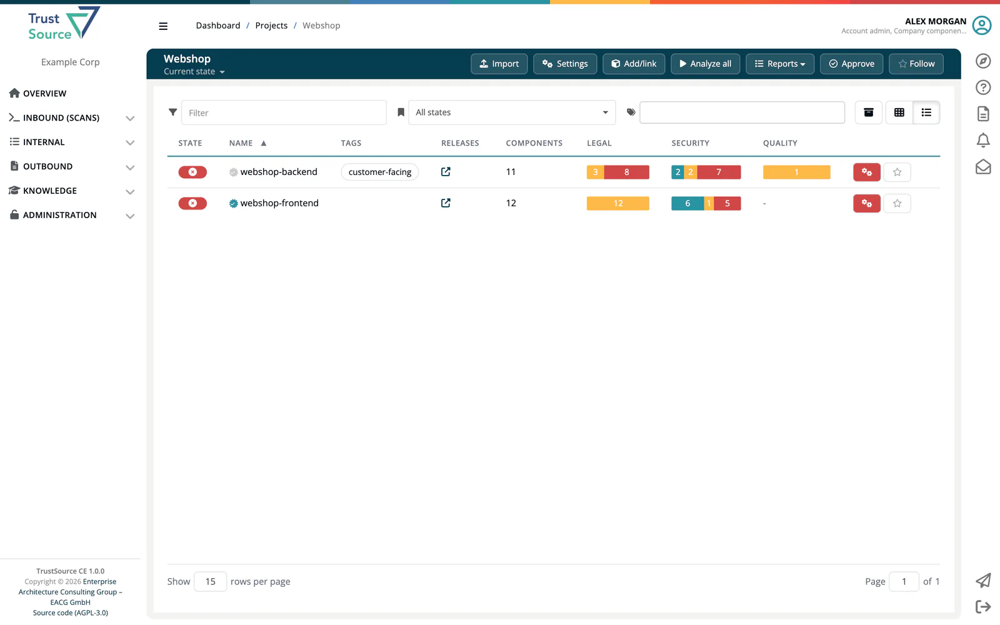
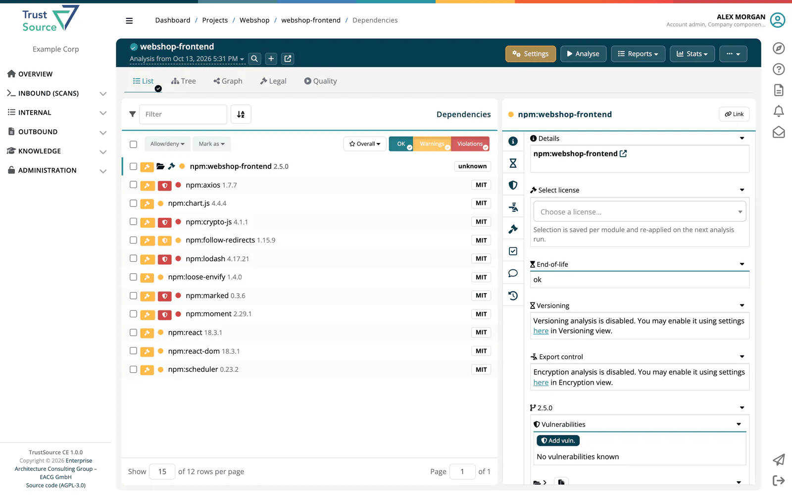
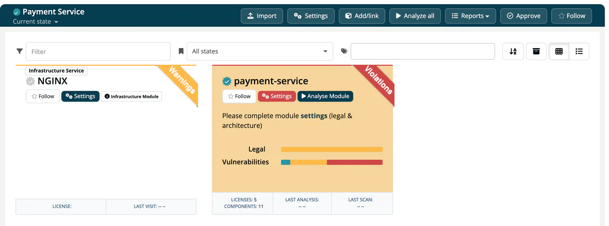
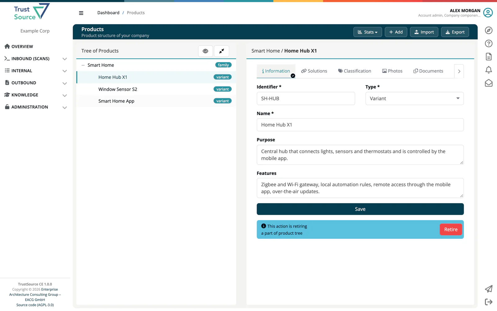

# Mental Model - Projects, Modules, Components, Products

The hardest part of learning a new application is the vocabulary. Once you know what each word means in ***TrustSource CE***, the rest of the manual reads naturally. This page is the **glossary that everything else builds on**.

## The core concepts

```
Company
  └── Project ──┬── Module                ──── Component (┬── Version)
                │   (in-house code)                       ├── License(s)
                │                                         └── Vulnerability(ies)
                ├── Infrastructure Module ──── Catalog entry (┬── Version)
                │   (3rd-party non-code:                      └── License(s)
                │    DB, base image, web server, ...)
                │
                └── Approval / Release

  └── Product ──── Solution ──── Module / Release  (links into the structure above)
```

> [!TIP]
> Read this diagram from top to bottom. **Companies** are tenants, **Projects** are organisational, **Modules** and **Infrastructure Modules** are the two technical units of analysis, **Components** are the building blocks. **Products** sit on the side - they describe what you ship to the customer, not what you build.

### Company

The top-level tenant. All your projects, products, users, policies and integrations live inside one company. One TrustSource CE installation can hold several companies; their data is kept apart. Users who belong to more than one company switch between them with the company dropdown in the sidebar.

A few catalogs are shared by all companies of an installation: the **Component Lake**, the **Licenses** catalog, the **Infrastructure Elements** and the **Vulnerability Lake**.

### Project

An organisational container. A project groups related modules - typically one project per software product line, business unit or team. Projects carry their own legal and obligation settings, default project and compliance manager, issue-tracker settings (Jira, TFS, GitHub issues), webhooks and policy overrides.



### Module

The **unit of analysis** in TrustSource CE. A module represents one piece of software - a microservice, a library, a frontend, a firmware build. Each module has:

- A **set of components** - the bill of materials, filled by scans, SBOM imports or manual entries.
- A **history of analyses** - every scan is analysed; you can select an earlier analysis and give it a name.
- A **legal configuration** - which licenses and components are allowed or denied, which obligations are resolved.
- A **vulnerability view** - known vulnerabilities per component, with exceptions you allowed.
- An **approval history** - the approvals and releases of the module.

A module belongs to at most one project (a module can be unassigned). Module settings can override project defaults where it makes sense.



### Infrastructure Module

A peer of the regular module - but for **everything that goes into your project that you didn't write yourself**. Database servers, base container images, message brokers, web servers, runtimes, OS distributions: anything that is required to build, run or ship your software, but is not in-house code.

Infrastructure modules exist because your supply chain does not stop at your application code. Your `mysql:8.0.36` server, your `debian:11` base image and your `nginx` reverse proxy are part of what you run and ship, just like an npm package.

An infrastructure module points to an entry of the [Infrastructure Elements](../05-knowledge/02-infrastructure-elements.md) catalog. Once linked:

- Its version and license data come from the catalog entry and show up in the project like for any other module.
- It takes part in approvals, reports and SBOMs.

TrustSource CE does not look up vulnerabilities for catalog components, so infrastructure and COTS modules show no vulnerability findings.

Use infrastructure modules whenever you want to describe the **complete** runtime and distribution surface of your software, as frameworks like the EU CRA and customer due-diligence questionnaires increasingly expect. See [Infrastructure Modules](../03-internal/02-modules/03-infrastructure-modules.md).



### Component

A third-party building block - a Maven artifact, an npm package, a system library, a COTS product, a piece of infrastructure. Components are **global**: they live in the [Component Lake](../05-knowledge/01-component-lake.md) and are referenced from your modules. Each component has:

- One or more **versions** with their own metadata.
- One or more **licenses** (declared or detected).
- Zero or more **vulnerabilities**, looked up in OSV by package URL during analysis. Catalog components (infrastructure and COTS) have no package URL, so no vulnerabilities are looked up for them.
- Cryptographic algorithms it uses, when known.

You normally don't manage components by hand - scans and SBOM imports do that for you. Manual entries are usually for in-house libraries that no scanner finds.

### Product

A product is **what you ship to the customer**. It contains one or more solutions, which link to modules and releases. Products are particularly relevant for **EU Cyber Resilience Act (CRA)** compliance - they carry the CRA classification, the misuse cases, contacts, support information, documents and photos.



## Two cross-cutting ideas

Two more concepts run through every screen: the **traffic-light status** and the **audit trail**.

### Status: green, yellow, red

Every object in TrustSource CE that can be in a good or bad state - components, licenses, vulnerabilities, modules, approvals, releases - carries a traffic-light status:

- 🟢 **Green** - OK. Nothing here needs your attention.
- 🟡 **Yellow** - Warning. Something is worth a look - a license that needs a decision, a low-severity CVE, a component approaching end-of-life.
- 🔴 **Red** - Violation. Something needs treatment now - a denied license, a critical CVE, a policy violation.

The status **rolls up**: a module that contains one red component is itself red, and a project with one red module is red. The dashboard and the lists make it easy to see where to look.

> [!TIP]
> The traffic lights are the day-to-day workflow. Most of the work is about turning red into yellow and yellow into green - by fixing the underlying issue, by accepting a risk with a comment, or by adjusting your policies. Approvals and releases (see the [recipes](../recipes/index.md)) are the moments where you say *"this state is good enough to ship"*.

### Audit trail

Changes are logged. Account admins see the company log under **Administration → Audit logs**, compliance managers and managers see the latest entries in the dashboard's **Activity log**, and components keep their own status history. If a status moved, you can find out who changed it and when.

## How the pieces fit together in practice

A typical end-to-end flow looks like this:

1. You **create a project** (e.g. "Customer Portal").
2. You **add modules** to the project (e.g. "frontend", "api-gateway", "user-service").
3. You **add infrastructure modules** for what those services depend on (e.g. `postgres:16.3`, `redis:7.2-alpine`, `nginx:1.25.4`).
4. You **bring in the bill of materials** for each code module - from your CI/CD pipeline through the REST API, or by uploading an SPDX or CycloneDX SBOM. Components, versions, licenses and vulnerabilities show up after the analysis.
5. You **review the findings** - license conflicts, new CVEs, weak crypto - and adjust allow lists, deny lists or component status. (End-of-life and viability checks exist, but TrustSource CE has no data source for end-of-life dates or repository activity, so they mostly report no data or OK.)
6. When you're ready to ship, you **request an approval** for the module. A compliance manager or manager reviews it and approves or rejects it.
7. You **link the approved release** into a **product** as part of a solution. The product carries its CRA classification, contacts and documentation.
8. You **generate the customer-facing documents** - SBOM, notice file, CSAF advisory - and share them, for example through a release key that gives access without a login.

> [!TIP]
> Not every project needs all of these steps. A small open source library might stop at step 6 and skip infrastructure modules entirely. Products in scope of the EU CRA will usually use every step, including the full runtime surface.

## Adjacent concepts you'll meet later

- **Scan** - one upload of analysis results, attached to one module. A module can have many scans over time.
- **Approval** - a quality milestone before shipping. Requested for a module or project, reviewed and approved or rejected by a compliance manager or manager. See [Approvals](../03-internal/06-approvals/index.md).
- **Release** - an approved module state that is published. Release files (SBOM, notice, VEX) are signed, and the release keeps being checked for new vulnerabilities. See [Releases](../03-internal/07-releases.md).
- **Risk** - an entry in the risk register, separate from CVEs, with impact, countermeasures, tasks and threat-model fields. See the [Risks chapter](../03-internal/05-risks/index.md).

## Where to next

- [A 5-Minute Tour](04-quick-tour.md) - see this model in the actual UI.
- [Guide, tour and demo project](08-guide-and-demo.md) - load a demo project and look at a real module.
- [Inbound (Scans) chapter](../02-inbound/index.md) - start adding data to your first module.
