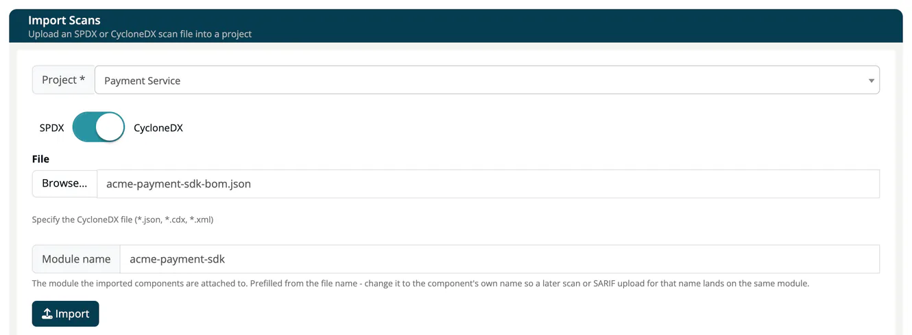

# Import Scans

> [!NOTE]
> **Required role:** Developer, Compliance manager, Manager or Account admin. Creating a new project during the import needs Manager or Compliance manager.

**Import Scans** uploads an existing SBOM into ***TrustSource CE*** without a build pipeline. Use it for an SBOM from a supplier, a file from a local scanner, or data exported from another tool. The import creates a scan on a module, exactly as a [CI/CD scan](03-cicd-scan.md) does, and the scan is analysed right away.

## Import a file

1. Open **Inbound (Scans) → Import Scans**.
2. Pick the **Project**. The field starts on **+ Create new project**, which creates one for you (named *New project*, with a number added if the name is taken). Only a Manager or Compliance manager can create a project this way; a Developer must pick an existing project, otherwise the import ends with *Access Denied*.
3. Set the switch to **SPDX** or **CycloneDX**.
4. Press **Browse...** and select the file.
5. Check the **Module name**. It is prefilled from the file name; change it to the component's own name, for example `nordwind-mobile-app`, so a later scan or SARIF upload for that name lands on the same module.
6. Press **Import**.

The app reminds you that you may check the import status under **Project settings → Imports** and takes you to the project's modules. See [Imports (Project)](../03-internal/01-projects/settings/11-module-import.md); a failed import shows its reason there.



## Supported files

| Switch | Accepted content | Notes |
|---|---|---|
| **CycloneDX** | CycloneDX **JSON** (`.json`, `.cdx`) | Spec versions 1.2 to 1.7. |
| **SPDX** | SPDX **JSON** and SPDX **RDF/XML** (`.json`, `.rdf`, `.xml`) | JSON and RDF/XML are told apart by the content, not by the file name. |

> [!WARNING]
> CycloneDX **XML** is not supported, even though the file picker lets you select an `.xml` file with the CycloneDX switch on. Such an import ends with the status *ERROR* and the reason *400 import file has invalid schema*. Convert the file to CycloneDX JSON first. SPDX tag-value files are not supported either.

Files up to 10 MB can be imported in the web interface. Through the API a file upload may be up to 50 MB by default (setting `TS_UPLOAD_MAX_MB`, see [Environment variables](../01-installation-setup/03-environment-variables.md)); a larger file is refused with `413`.

### What the import reads

- **SPDX** documents keep their dependency structure: the relationships that say what depends on or contains what are read, and a package mentioned in no relationship is still imported. The license the document declared is kept next to the license the app derives from it.
- **CycloneDX** components of the type *cryptographic asset* and *machine learning model* are attached to the components they belong to rather than shown as dependencies. They feed the module's crypto and AI / ML data.
- Dependency chains deeper than 40 levels continue as further top-level entries, so nothing is dropped.
- A file from which no component can be read is not imported: the import ends with *400 import file has no valid meta or components*.

## Module names

The module name decides where the data lands. TrustSource CE trims leading and trailing spaces, then matches the name exactly (no case folding) inside the project. If the module exists, the import adds a scan to it; otherwise it creates the module. A later scan or SARIF upload with the **same** name lands on the same module; see [SW Quality Scans](04-sw-quality-scans.md).

## Skipped dependencies

One unusable dependency does not stop an import. An entry without a usable identifier, or one that cannot be processed, is skipped and the rest of the file is imported. The scan records how many entries were skipped and keeps the first 100 with their reason and position, and [Audit logs](../06-administration/07-audit-logs.md) show one *Scan processed* entry per scan, for example *"12 dependencies skipped"*.

## Import with the API

Send the same files to the [import endpoints](../09-rest-api/endpoints/imports.md). The target project must already exist; project and module are passed as query parameters, the file as a multipart upload:

```bash
curl -X POST "https://<your-host>/api/v2/core/imports/scan/cyclonedx/json?projectName=Storefront&moduleName=nordwind-mobile-app" \
  -H "x-api-key: YOUR_API_KEY" \
  -F "file=@bom.json"
```

For SPDX use `/core/imports/scan/spdx/json` or `/core/imports/scan/spdx/rdf`. `project` and `module` are accepted as aliases of `projectName` and `moduleName`. An unknown project is answered with `404`.

For SPDX RDF, give the file part its content type explicitly:

```bash
curl -X POST "https://<your-host>/api/v2/core/imports/scan/spdx/rdf?projectName=Storefront&moduleName=nordwind-mobile-app" \
  -H "x-api-key: YOUR_API_KEY" \
  -F "file=@sbom.rdf;type=application/rdf+xml"
```

Without `;type=application/rdf+xml`, curl sends the file as `application/octet-stream`, which the app reads as JSON, and the upload is refused with `400`.

> [!TIP]
> If you import regularly, set up a scanner in your build pipeline so every build delivers its own scan. See [CI/CD Scan](03-cicd-scan.md).

## Related

- [CI/CD Scan](03-cicd-scan.md)
- [Mental Model](../00-getting-started/05-mental-model.md)
- [Background: SBOM formats](../../shared/background/10-sbom-formats.md)
