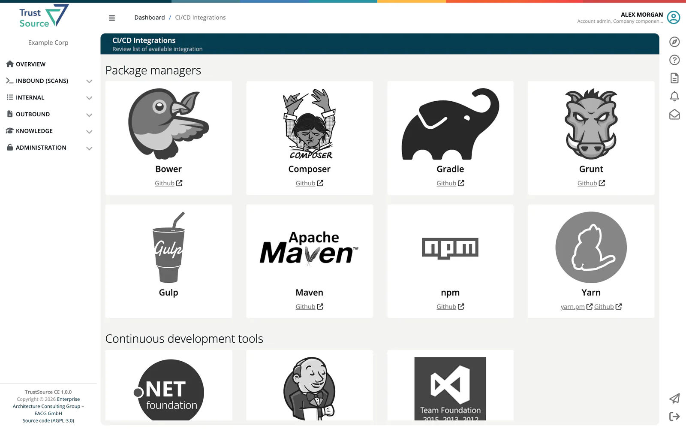
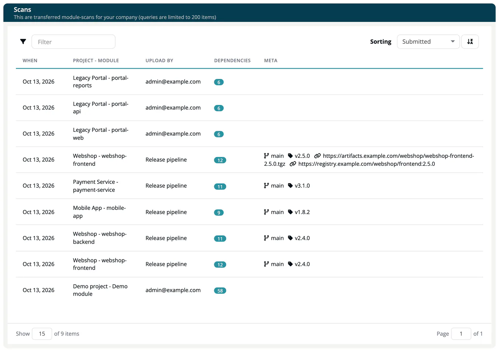
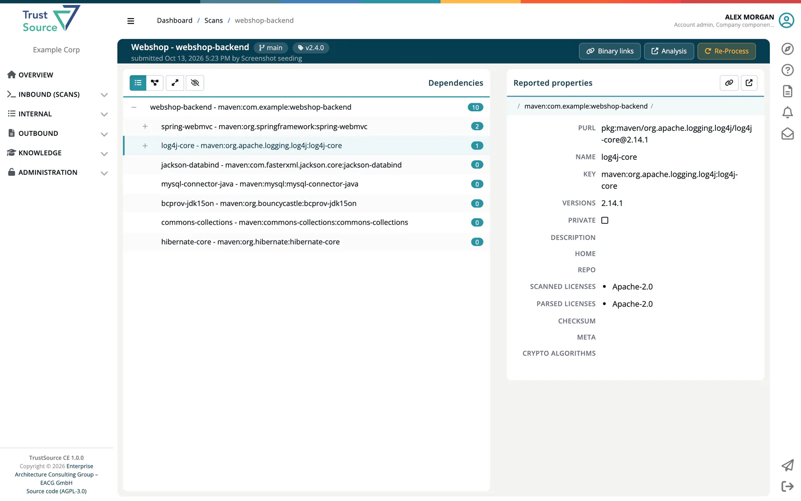

# CI/CD Scan

> [!NOTE]
> **Required role:** Developer, Compliance manager, Manager or Account admin to open the list. **Re-Process** needs Manager or Compliance manager.

A **scan** is a snapshot of a module's bill of materials at one point in time: every component with its versions, licenses and dependencies. Scans from your build pipeline are the main way data enters ***TrustSource CE***. Open the list from **Inbound (Scans) → CI/CD Scan**.

## How scans arrive

| Source | How |
|---|---|
| **Scanner in the pipeline** | A scanner such as `ts-scan` or one of the build plugins runs after each build and posts the result to `https://<your-host>/api/v2/core/scans` with your API key in the `x-api-key` header. |
| **REST API** | Post scan data to the [scans endpoint](../09-rest-api/endpoints/scans.md) yourself. |
| **SBOM import** | An uploaded SPDX or CycloneDX file creates a scan too. See [Import Scans](02-import-scans.md). |

To connect a scanner to your installation:

1. Create an API key under **Administration → API keys**. See [API keys](../06-administration/04-api-keys.md). A key with no scope at all passes every check; a scoped key needs the Developer or Manager scope to upload scans.
2. Create the target project in TrustSource CE. An upload that names a project that does not exist is answered with `404`; the module, in contrast, is created on the first upload.
3. Point the scanner at your installation instead of the TrustSource SaaS address, and give it the key and the project name.

With [ts-scan](https://github.com/TrustSource/ts-scan) 1.10, the base URL is your installation's address followed by `/api`; ts-scan adds the rest of the path:

```bash
ts-scan scan -o scan.json .
ts-scan upload --base-url "https://<your-host>/api" --project-name "Storefront" scan.json
```

`ts-scan upload` reads the key from the environment variable `TS_UPLOAD_API_KEY` (in a pipeline, fill it from the CI secret store). You can also pass `--api-key`, but then other users on the same host can see the key in the process list.

ts-scan names the module after the artefact it detected. Run `ts-scan upload --help` if your version differs. See [Recipe: CI/CD integration](../recipes/02-cicd-integration.md) for a complete pipeline.

Each scan belongs to exactly one module. Names are compared after removing every character other than letters, digits, `-`, `_` and `/` (case is kept), so a [SARIF upload](04-sw-quality-scans.md) or an [SBOM import](02-import-scans.md) with the same module name lands on the same module.

> [!WARNING]
> A mismatch in the module name, for example a package manifest name against a checkout folder name, silently creates a second module instead of adding to the first. See [SW Quality Scans](04-sw-quality-scans.md#import-with-the-api).

### Example upload

```bash
curl -X POST https://<your-host>/api/v2/core/scans \
  -H "x-api-key: YOUR_API_KEY" \
  -H "Content-Type: application/json" \
  -H "User-Agent: my-pipeline/1.0.0" \
  -d '{
        "project": "Storefront",
        "module": "billing-service",
        "branch": "main",
        "tag": "v1.4.0",
        "dependencies": [ ... ]
      }'
```

The answer `201` carries the id of the new scan and of the module. Processing and analysis run in the background.

### Limits and rejections

- A request without a `User-Agent` header is refused with `400`. Unknown user agents are accepted.
- A request without an API key is refused with `401`, an invalid key with `403`, a key whose scope does not allow uploads with `403` (*API-key scope is limited*).
- A dependency tree nested more than 80 levels is refused with `400`; the message names the limit and the component. The same check covers deeply nested content elsewhere in the upload.
- JSON request bodies are limited to 5 MB. File uploads to the import endpoints may be up to 50 MB by default (`TS_UPLOAD_MAX_MB`).
- One unusable dependency does not stop the scan: it is skipped and recorded. The scan keeps the count and the first 100 entries, and [Audit logs](../06-administration/07-audit-logs.md) show how many were skipped.

## Scanners and plugins

The **CI/CD Integrations** page lists the available scanners and plugins with links to their repositories and guides. It has no menu entry; open `https://<your-host>/scanners`.

| Group | Entries |
|---|---|
| **Package managers** | Bower, Composer, Gradle, Grunt, Gulp, Maven, npm, Yarn |
| **Continuous development tools** | .Net foundation, Jenkins, TFS |
| **Containers** | Docker scanner |
| **Development languages** | Java, JavaScript, NodeJS, C/C++, PHP, Python, Ruby |
| **IDE Plugins** | VisualStudio |



## The scan list

The page **Scans** shows the transferred scans of your company, newest first. Queries are limited to 200 items.

| Column | Meaning |
|---|---|
| **When** | Time the scan was received. |
| **Project - Module** | Where the scan belongs. |
| **Upload by** | The user the API key belongs to, or who imported the file. |
| **Dependencies** | Number of dependencies found. |
| **Meta** | Branch, tag and binary links of the scan. |

Select a row to open the scan.



## Scan details

The header shows project, module, branch, tag and the number of binary links, and who submitted the scan when. Buttons:

- **Binary links** opens the dialog to add or remove links to the built artifacts (**Link**, **Comment**, **Add link**). See [Binary Linking](../03-internal/06-approvals/04-binary-linking.md).
- **Analysis** opens the module analysis for this scan; it shows as *Analysis N/A* while no analysis exists.
- **Notices** appears when validation found unknown licenses (*Scan validation found Unknown licenses*); check that they do not affect your company.
- **Re-Process** (Manager and Compliance manager) runs processing and analysis of the scan again, for example after policies changed. Over the API the same is `POST /api/v2/core/scans/{id}/reprocess`.

The body shows the dependency tree. Switch between **List** and **Diagram**, **Expand** or **Collapse** all levels, and **Show linked** or **Hide linked** modules. Selecting a dependency opens **Reported properties** at its side: purl, name, key, versions, private flag, description, home, repo, scanned and parsed licenses, checksum, meta data and crypto algorithms. **Lake** opens the component in the [Component Lake](../05-knowledge/01-component-lake.md).



## Related

- [Import Scans](02-import-scans.md)
- [REST API → Scans](../09-rest-api/endpoints/scans.md)
- [Module Detail](../03-internal/02-modules/02-module-detail-tabs.md)
- [Recipe: CI/CD integration](../recipes/02-cicd-integration.md)
