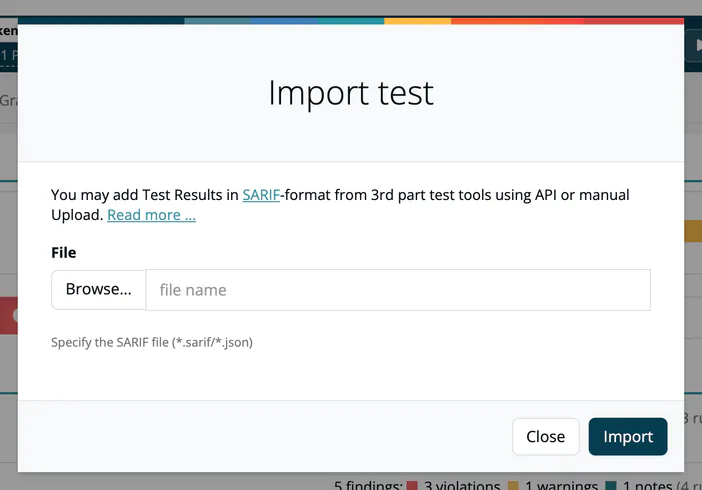
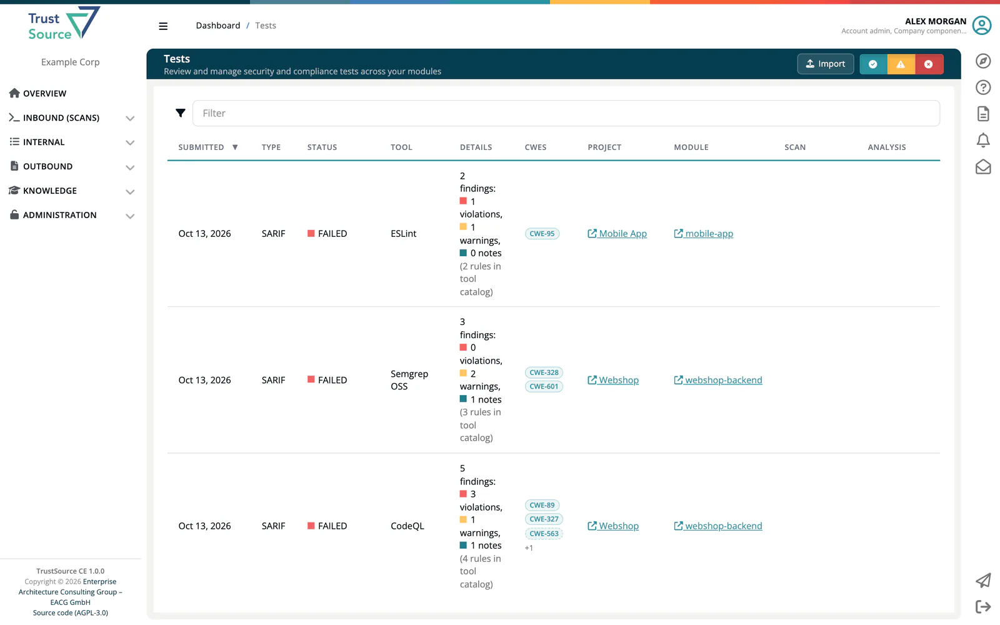
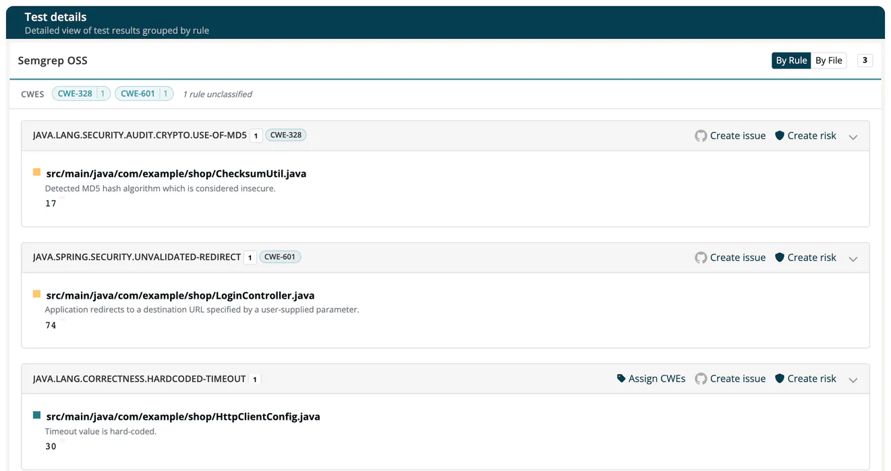

# SW Quality Scans (SARIF)

> [!NOTE]
> **Required role:** to import in the app: Developer, Manager, Compliance manager, Company security manager or Company component manager. Over the API, a key with the Portfolio manager scope may import as well.

***TrustSource CE*** reads results from static analysis tools in the SARIF format (Static Analysis Results Interchange Format, version 2.1.0). You see code quality and security findings next to the dependency and license data of the same module, and can turn findings into issues and risks.

Open **Inbound (Scans) → SW Quality Scans**. The page is titled **Tests** and lists every imported SARIF document of your company. The same list, filtered to one module, is on the module's **Quality** tab.

## Import a SARIF file

1. Open the module's **Quality** tab and click **Import**.
2. In the dialog **Import test**, click **Browse** and select a `.sarif` or `.json` file.
3. Click **Import**.

The file is checked against the SARIF schema before it is stored; an invalid file is refused with the validation messages. A successful import shows *File successfully uploaded.*

> [!WARNING]
> Import from the module's **Quality** tab to attach the results to that module. A file imported with **Import** on the **Tests** page itself is stored *without a module*: it shows in the list, but it is not part of any module and creates no risks. To import for a module without opening the app, use the API with a project and module name.



### Import with the API

Project and module are passed as query parameters; the file as a multipart upload:

```bash
curl -X POST "https://<your-host>/api/v2/core/tests/sarif/json?projectName=payment-platform&moduleName=billing-service" \
  -H "x-api-key: YOUR_API_KEY" \
  -F "file=@results.sarif"
```

The JSON variant `POST /api/v2/core/tests/sarif` takes the document as the request body, up to 5 MB. A file upload above the upload limit (50 MB by default, `TS_UPLOAD_MAX_MB`) is refused with `413`. Instead of names you can pass `moduleId`, `scanId` or `analysisId`. See [Tests (SARIF) API](../09-rest-api/endpoints/tests.md).

The response lists the ids of the stored test runs and the `moduleId`. If no module could be resolved, `moduleId` holds a message that the test is not attached to a module.

> [!WARNING]
> **Use the same module name on every upload path.**
> A dependency scan, an SBOM import and a SARIF upload that carry the same module name land on the same module, whichever arrives first. TrustSource CE matches the name character for character within the project: if the SARIF upload uses a different spelling than your scan (say `billing-service` instead of `@my-org/billing-service`), you get two modules, one with dependency data and one with test findings, and the upload response does not warn you.
>
> Duplicate modules are not merged automatically; merge or remove them by hand. To be safe, pass the module's `moduleId` instead of a name. `moduleName` and `projectName` work on all upload paths; `module` and `project` are accepted as aliases.

Reading the stored documents is possible too: `GET /api/v2/core/tests/sarif` lists them (newest first, 100 per page) and `GET /api/v2/core/tests/sarif/{id}` returns one with its run.

## The Tests list

| Column | Meaning |
|---|---|
| **Submitted** | Upload date. |
| **Type** | Analysis type. |
| **Status** | **Passed**, **Failed** or **Unfinished**; see below. |
| **Tool** | The tool that produced the run, with its logo for known tools. |
| **Details** | The findings and their severity; see below. |
| **CWEs** | The weaknesses the findings carry. See [SARIF Weaknesses and Risks](04a-sarif-weaknesses.md). |
| **Project**, **Module** | Where the results are attached. Click to open them. |
| **Scan**, **Analysis** | Links to the dependency scan and analysis of the same module, if there are any. |

Click a row to open the test. Use the buttons **Passed**, **Unfinished** and **Failed/Findings** to show or hide each status, and the filter box to search.



### How findings are counted

Only results that the tool reports as failures are counted. Results marked passed, informational, not applicable or similar are listed with the findings but shown in grey and not counted.

| Level reported by the tool | Counted as |
|---|---|
| `error` | Violation |
| `warning` | Warning |
| `note` | Note |
| No level stated | Warning (the SARIF default for an unstated severity) |

The **Details** column reads, for example, *14 findings: 2 violations, 9 warnings, 3 notes*, followed by the number of rules in the tool catalog. The catalog figure is the number of rules the tool declares, not the number it applied; SARIF does not report that.

### Passed, Failed, Unfinished

| Status | When |
|---|---|
| **Passed** | The run completed and reported no findings. |
| **Failed** | The tool reported an unsuccessful execution, or the run has findings. |
| **Unfinished** | The document holds no run to judge. |

A module's **Quality** bar shows one segment per test run, coloured by the worst finding in that run.

## The test page

The page **Test details** shows the run's findings, grouped by rule:

- **By Rule** or **By File** switches the grouping. Each group header shows the rule, the number of findings, the CWEs and a link to the rule description when the tool provides one.
- A finding lists the file, line, message and code snippet. Findings without a location say **No file location reported**.
- Per rule group: **Create issue** opens the dialog *Create new GitHub issue* (needs the GitHub integration, see [Integrations](../06-administration/08-integrations.md)), and **Create risk** adds a single risk to the register (Compliance manager or Manager).



## Required tests

Under **Quality** in the company, project or module settings you can list the tools whose results must exist before a release is requested. See [Project settings: Quality](../03-internal/01-projects/settings/04-quality.md).

## Related

- [SARIF Weaknesses and Risks](04a-sarif-weaknesses.md): CWEs, manual assignments and automatic risks
- [Import Scans](02-import-scans.md): dependency data from SBOM files
- [CI/CD Scan](03-cicd-scan.md): automate all inbound data
- [Risks](../03-internal/05-risks/index.md): the risk register
