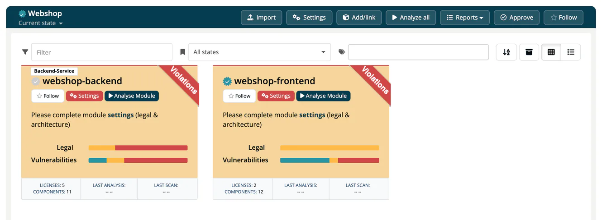

# Project Overview

> [!NOTE]
> **Required role:** Developer, Compliance manager, Manager or Account admin can open a project they can see. **Import**, **Add/link**, **Analyze all** and **Approve** are for Manager and Compliance manager.

The project page opens when you click a project in the [project list](01-create-and-list.md). It shows the project header and the list of the project's modules with their compliance status.

## Header

- **Title:** the project name with its approval badge and, if linked, the LeanIX icon.
- **Version selector:** below the title. **Current state** shows the modules as they are now; each approved version of the project (approval date and name) switches the list to the analyses that were approved then.
- **Visibility note:** if the project has modules you are not allowed to see, a red note such as *3 of 5 visible to you* appears next to the selector.

## Header actions

| Action | What it does |
|---|---|
| **Import** | Opens **Import module**: switch between **SPDX** and **CycloneDX**, choose the file and optionally set the **Module name** (prefilled from the file name). See [Import Scans](../../02-inbound/02-import-scans.md). Manager and Compliance manager. |
| **Settings** | Opens [Project Settings](settings/index.md). |
| **Add/link** | Opens **Add/link module**. See [Create & List Modules](../02-modules/01-create-and-list.md). Manager and Compliance manager. |
| **Analyze all** | Re-analyses every module of the project. Manager and Compliance manager. |
| **Reports** | Dropdown with the project-scoped reports, each opening in a new tab: **Licenses**, **Versioning**, **Algorithms**, **Vulnerability**, **Risks**, **Obligations**, **Credits** and **Modifications**. See [Reports](../04-reports.md). |
| **Approve** | Starts the project approval wizard (Settings, Pick modules, Select analysis, Confirm statuses, Finalization). See [Request Approval](../06-approvals/01-request-approval.md). Manager and Compliance manager. |
| **Follow** | Follow the project to receive notifications. |

A single module can also be approved from its own page with **Initiate approval**.

## Module list

The toolbar has a **Filter** box, the state filter (**All states**, **OK**, **Warnings**, **Violations**), a **Tags** filter, **Show archived** / **Hide archived**, and the **Grid** / **Table** switch. Grid view also has a sort-order toggle.

**Grid** cards show:

- the architecture type label, approval badge, name and status ribbon;
- **Follow**, **Settings** and, for managers and compliance managers, **Analyse Module** (or the label **Infrastructure Module** / **COTS Module** for those module types);
- the description, or *Please complete module settings (legal & architecture)* when legal or architecture settings are missing (the **Settings** button turns red in that case);
- status bars, and in the footer **Licenses**, **Components**, **Last Analysis** and **Last Scan**. Infrastructure and COTS modules show **License** and **Last Visit** instead.

**Table** rows show **State**, **Name**, **Tags**, **Releases**, **Components**, **Legal**, **Security** and **Quality**, plus a **Settings** and a follow button. A link icon before the name marks a module that links another project; an archive icon marks an archived module.

Click any module to open the [Module Detail](../02-modules/02-module-detail-tabs.md).

> [!NOTE]
> The **Unassigned Modules** entry in the project list opens the same page for modules without a project. It has no Import, Settings, Add/link, Reports, Approve or Follow; only **Analyze all** remains.

## Related

- [Project Settings](settings/index.md): configuring this project
- [Module Detail Tabs](../02-modules/02-module-detail-tabs.md): what you see inside a module
