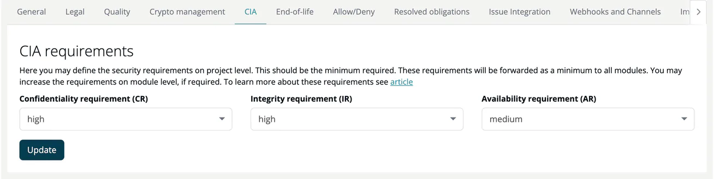

# CIA (Project)

> [!NOTE]
> **Required role:** everyone who can open the project settings reads the tab. Company security manager, and managers who are the project's default project manager or default compliance manager (or any manager while none is set), can edit the requirements and use **Import CIA requirements from...**. See the [Settings Permission Matrix](../../../10-roles-permissions/06-settings-permission-matrix.md).

The CIA tab sets the Confidentiality, Integrity and Availability requirements of the project. They apply to all modules of the project; a module can set its own values on its [CIA tab](../../02-modules/settings/08-cia.md), and a value set on the module replaces the project value.

## Fields

| Field | Options |
|---|---|
| **Confidentiality requirement (CR)** | not defined, low, medium, high |
| **Integrity requirement (IR)** | same |
| **Availability requirement (AR)** | same |

Click **Update** to save.

## Actions

- **Import CIA requirements from...**: copy the CIA requirements of another project.

> [!NOTE]
> The requirements are stored with every module analysis and are part of the environmental context that the REST API returns for projects and modules, next to the environmental CVSS vector set with **Env. settings** on the module page. See [Projects endpoints](../../../09-rest-api/endpoints/projects.md). TrustSource CE does not adjust the CVSS scores of findings with the CIA requirements; use them as context for your own assessment and for tools that read the environmental context.

## Related

- [CIA (Module)](../../02-modules/settings/08-cia.md)
- [Risks](../../05-risks/index.md)
