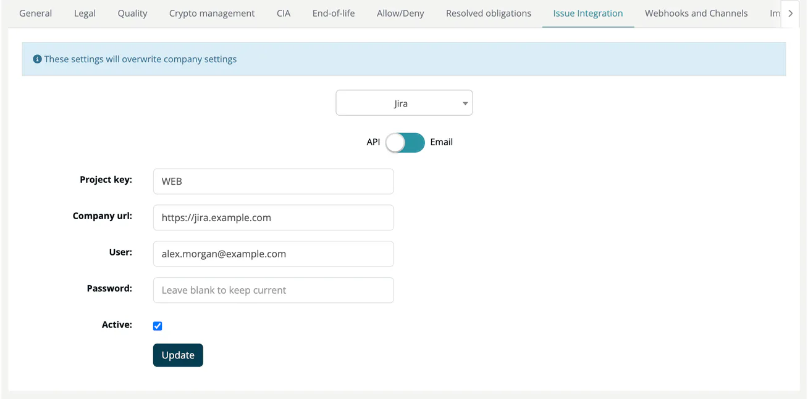

# Issue Integration (Project)

> [!NOTE]
> **Required role:** Developer, Compliance manager, Portfolio manager, Manager and Account admin see the tab. Account admin, and managers who are the project's default project manager or default compliance manager (or any manager while none is set), can change it. See the [Settings Permission Matrix](../../../10-roles-permissions/06-settings-permission-matrix.md).

The Issue Integration tab sets where ***TrustSource CE*** creates issues for this project. With an active integration, the **Tasks** section of the [component side panel](../../02-modules/04-component-detail.md) and problem rows on the module's Legal view offer a link to create an issue for a component with a problem.

## Choose the tracker

Select the tracker in the list at the top: **TFS**, **Jira** or **GitHub issues**. The info line *These settings will overwrite company settings* above the list reminds you that the project values take precedence over the company integration under [Integrations](../../../06-administration/08a-issue-trackers.md).

## Fields

| Tracker | Fields |
|---|---|
| **TFS** (Azure DevOps) | **Account or URL**, **Project**, **Access Token**, **Active**. |
| **Jira** | Switch **API** / **Email**. API: **Project key**, **Company url**, **User**, **Password**, **Active**. Email: **Project key**, **Email address** (the receiver address of your Jira email handler), **Active**. |
| **GitHub issues** | **Access Token** (required), **Repository** (optional), **Active** (required). |

Password and token fields stay empty after saving; leave them blank to keep the stored value. Stored credentials are encrypted with the installation's encryption key. Click **Update** to save.

> [!TIP]
> Use API tokens rather than passwords. Jira Cloud requires an API token; a GitHub token needs permission to create issues in the repository.

## Related

- [Issue Trackers](../../../06-administration/08a-issue-trackers.md): company-wide configuration
- [Integrations](../../../06-administration/08-integrations.md)
