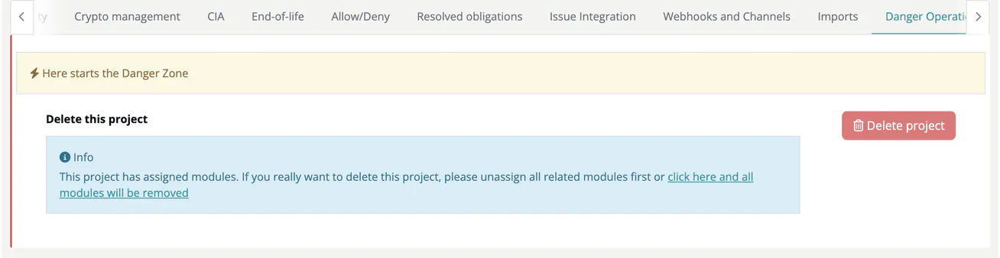

# Danger Operations (Project)

> [!NOTE]
> **Required role:** managers who are the project's default project manager or default compliance manager (or any manager while none is set). See the [Settings Permission Matrix](../../../10-roles-permissions/06-settings-permission-matrix.md).

The Danger Operations tab opens with the banner *Here starts the Danger Zone* and offers one operation: **Delete this project**.

## Delete project

- **Project without modules:** click **Delete project** and confirm *Are you sure you want to delete project ...?* with **Yes, delete it!**
- **Project with modules:** **Delete project** is disabled and an info box asks you to unassign all modules first, or to **click here and all modules will be removed**. That link asks *Are you sure you want to delete project ... and all modules?* and, after **Yes, delete it!**, deletes the project together with all its modules.

After deletion you return to the project list. The deletion is written to the [audit log](../../../06-administration/07-audit-logs.md).

> [!WARNING]
> Deleting a project is **permanent and cannot be undone**. All project settings and, when you delete the modules too, all module data, analyses and settings are lost. To keep modules, move them to another project in their [General settings](../../02-modules/settings/01-general.md) (**Assigned Project**) first, or archive modules you no longer need in their [Danger Operations](../../02-modules/settings/18-danger-zone.md).

