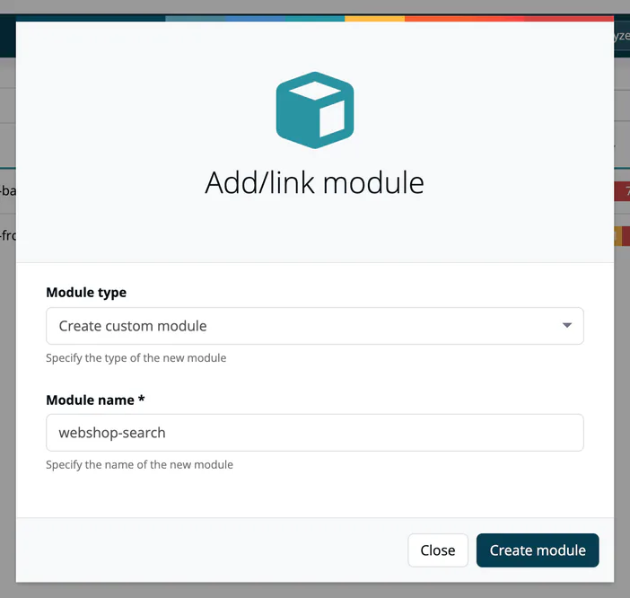

# Create & List Modules

> [!NOTE]
> **Required role:** Manager or Compliance manager to create, import or analyse modules. Other roles with access to the project can browse the list.

## Creating a module

1. Open a project (**Internal → Projects**, then click the project).
2. In the header, click **Add/link**.
3. In the **Add/link module** dialog, choose the **Module type** (see below).
4. Fill in the fields and click **Create module**.

| Module type | What you enter | Use case |
|---|---|---|
| **Create custom module** | **Module name** (required) | Your own software. Components arrive with scans. |
| **Link company project** | **Select version of available projects**: an approved version of another project of your company | Reuse an already approved project as a module. The module shows a link icon. |
| **COTS or Infrastructure component** | **Select pre-defined module** from the [Infrastructure Elements](../../05-knowledge/02-infrastructure-elements.md) or [3rd party (COTS)](../../05-knowledge/03-cots.md) catalog, its **Module version**, the **Type of architecture** and **Is open source module** | Third-party runtime or purchased software. See [Infrastructure Modules](03-infrastructure-modules.md). |

The architecture types are Frontend-UI-Module, Frontend-Endpoint, Frontend-Service, Backend-Service, Backend-Endpoint, System component, Infrastructure Service and Distributable Component.

> [!TIP]
> If the component you need is not in the catalog, click **Not finding what you are looking for?**, enter **Module name** and **Module version** yourself and click **Send request**. The module is created with the values you entered. The dialog's note that "our support" makes the component available does not apply to TrustSource CE; no request leaves your installation. To make the component available for selection next time, a company component manager adds it to the catalog; see [Component Manager](../../14-component-manager/index.md).

### Importing a module

**Import** in the project header opens **Import module**. Switch between **SPDX** and **CycloneDX**, choose the file and check the **Module name**, which is prefilled from the file name. See [Import Scans](../../02-inbound/02-import-scans.md).

### Auto-creation

A scan submitted through the REST API creates its module on the fly if it does not exist yet. See [CI/CD Scan](../../02-inbound/03-cicd-scan.md).

## The module list

The module list is part of the [project page](../01-projects/02-project-overview.md). The toolbar offers:

- **Filter**: search by module name.
- **All states / OK / Warnings / Violations**: filter by traffic-light state.
- **Tags**: select one or more company tags.
- **Show archived / Hide archived**: include or hide archived modules.
- **Grid / Table**: switch the presentation. Grid also has a sort-order toggle.

The version selector under the project name switches the list between **Current state** and the analyses of a past project approval.

**Grid** cards show the status ribbon, the architecture type, **Settings** and **Analyse Module**, and the counts of licenses and components with the dates of the last analysis and the last scan.

**Table** rows show **State**, **Name**, **Tags**, **Releases**, **Components**, **Legal**, **Security** and **Quality**, plus **Settings** and follow buttons. The Releases column links to the releases list.

Click a module to open the [Module Detail](02-module-detail-tabs.md). A module whose card is highlighted and whose **Settings** button is red asks you to complete its settings (legal and architecture).

## Related

- [Module Detail Tabs](02-module-detail-tabs.md)
- [Module Settings](settings/index.md)
- [Import Scans](../../02-inbound/02-import-scans.md)
