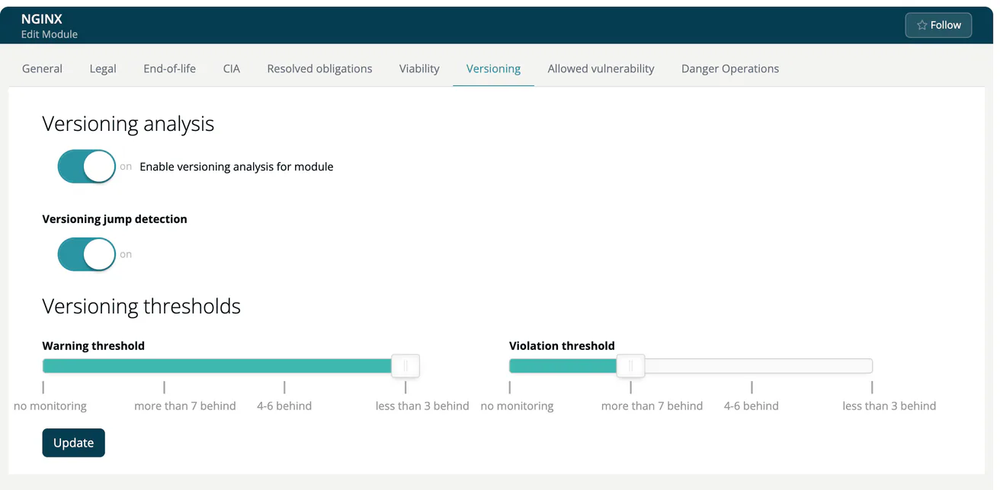

# Versioning (Module)

> [!NOTE]
> **Required role:** everyone who can open the module settings reads the tab. Editing and **Import settings from Module** are for developers who are members (or of a module without members) and for managers and compliance managers who are the module's default project manager or default compliance manager (or any of them while none is set). See the [Module Settings Permission Matrix](../../../10-roles-permissions/06a-module-settings-matrix.md).

Versioning checks how far the component versions in your module lag behind the newer versions known for the component. A module that still uses `spring-core 5.2.1` while `6.1.x` is known lags several releases.

> [!NOTE]
> TrustSource CE compares against the versions recorded in its own [Component Lake](../../../05-knowledge/01-component-lake.md), which grows with the scans of your installation and the entries of your component managers. It does not query package registries for new releases.

## Steps

1. Turn on **Enable versioning analysis for module**.
2. Confirm *Are you sure you want to update Versioning analysis settings?* with **Yes, update settings!** The module is analysed again.
3. Adjust the settings below and click **Update**. A toast confirms *Versioning settings changed!*.

## Fields

| Field | Meaning |
|---|---|
| **Versioning jump detection** | Switch that turns the detection of version jumps on or off. |
| **Warning threshold** | `no monitoring`, `more than 7 behind`, `4-6 behind` or `less than 3 behind`. |
| **Violation threshold** | Same scale. |

The warning threshold must not be lower than the violation threshold, unless it is `no monitoring`; otherwise the form shows *'Warning threshold' must not be lower than 'Violation threshold'*. If you may only read the tab, the same fields appear greyed out.

## Import from another module

**Import settings from Module** copies the versioning settings of another module.

> [!TIP]
> The result is listed in the Versioning report of the project (**Reports → Versioning** on the project page). See [Analysis Reports](../../04b-analysis-reports.md).

