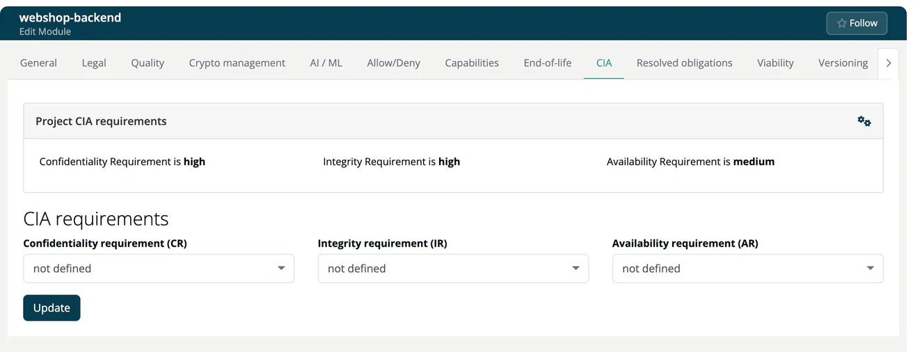

# CIA (Module)

> [!NOTE]
> **Required role:** everyone who can open the module settings reads the tab. The requirements and **Import CIA requirements from...** are for developers who are members (or of a module without members), Company security manager, and managers and compliance managers who are the module's default project manager or default compliance manager (or any of them while none is set). See the [Module Settings Permission Matrix](../../../10-roles-permissions/06a-module-settings-matrix.md).

CIA stands for Confidentiality, Integrity and Availability. Here you state how much each of the three matters for this module. Without values here, the module uses the project's values. A value you set here replaces the project's value, even when it is lower, so check the project panel before you lower a requirement.

## Project CIA requirements

Above the form, the panel **Project CIA requirements** shows the values of the project, with a cogs icon that opens its settings. If the project has none, a red note reminds you that the project still has to be completed for a full analysis.

## Requirements

| Field | Options |
|---|---|
| **Confidentiality requirement (CR)** | not defined, low, medium, high |
| **Integrity requirement (IR)** | same |
| **Availability requirement (AR)** | same |

Click **Update** to save. A payment service handling card data would typically get CR `high`, IR `high` and AR `medium`.

**Import CIA requirements from...** copies the values of another module.

For each analysis, the module's values are merged with the project's values. They are part of the environmental context that the REST API returns for the module, see [Modules endpoints](../../../09-rest-api/endpoints/modules.md). TrustSource CE does not adjust the CVSS scores of findings with the CIA requirements.

## Related

- [CIA (Project)](../../01-projects/settings/03-cia.md)
- [Risks](../../05-risks/index.md)

