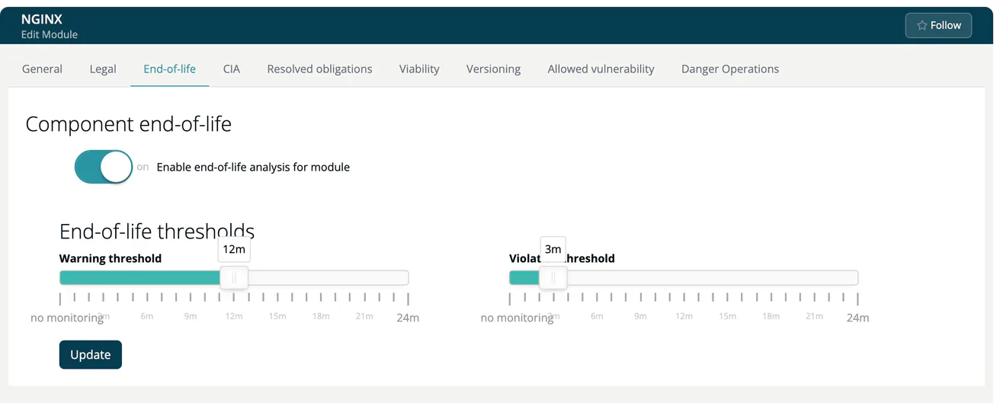

# End-of-life (Module)

> [!NOTE]
> **Required role:** everyone who can open the module settings reads the tab. Editing is for developers who are members (or of a module without members) and for managers and compliance managers who are the module's default project manager or default compliance manager (or any of them while none is set). See the [Module Settings Permission Matrix](../../../10-roles-permissions/06a-module-settings-matrix.md).

Software that has reached its end of life no longer gets security fixes. This tab (heading **Component end-of-life**) controls when ***TrustSource CE*** flags such components in this module, for example a `debian:11` base image or a Node.js 16 runtime.

## Steps

1. Turn on **Enable end-of-life analysis for module**.
2. Confirm *Are you sure you want to update end-of-life policy?* (*This will affect all future analysis!*) with **Yes, update settings!**
3. Under **End-of-life thresholds**, set the **Warning threshold** and the **Violation threshold**. Both are sliders from `no monitoring` to `24m` (months).
4. Click **Update**. A toast confirms *Module end-of-life policy successfully changed*.

The warning threshold must not be lower than the violation threshold, unless it is `no monitoring`. Otherwise the form shows *'Warning threshold' must not be lower than 'Violation threshold'*. The thresholds appear only while the switch is on.

> [!NOTE]
> End-of-life dates come from the component data stored in the installation. TrustSource CE has no end-of-life feed of its own; a component without end-of-life data is reported as OK.

## Where the result shows

The List view of the module shows an End-of-life badge for components with a status, and the side panel has an **End-of-life** section. The project-wide list is the End-of-life report, see [Analysis Reports](../../04b-analysis-reports.md).

The same policy exists on company level (**Administration → Policies → Component end-of-life**, see [Policies](../../../06-administration/05-policies.md)) and on project level ([End-of-life (Project)](../../01-projects/settings/06-end-of-life.md)).

