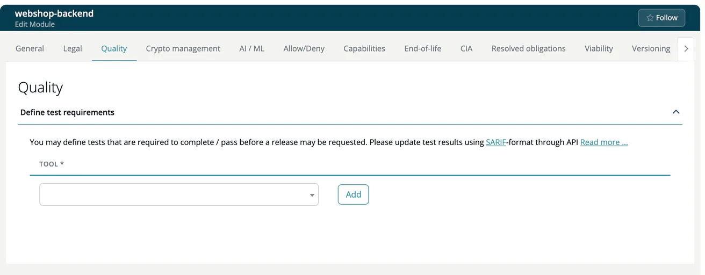

# Quality (Module)

> [!NOTE]
> **Required role:** everyone who can open the module settings reads the tab. Adding and removing tools is for developers who are members (or of a module without members) and for managers and compliance managers who are the module's default project manager or default compliance manager (or any of them while none is set). See the [Module Settings Permission Matrix](../../../10-roles-permissions/06a-module-settings-matrix.md).

Define which quality tests must be completed and passed before a release of this module may be requested. Tests are fed by tools that report in SARIF format, for example Semgrep, CodeQL or Bandit. The tab is not shown for infrastructure and COTS modules.

## Define test requirements

The panel **Define test requirements** has one row per required tool.

1. Select a **Tool** from the list.
2. Click **Add**.
3. To drop a requirement, click the trash icon at the end of its row.

Rows inherited from the project settings or from the company's quality list carry the label **in Project** or **in Company** instead of the trash icon. The label links to the place where you can change them.

## How it is used

Upload the test results of every required tool as SARIF, see [SW Quality Scans](../../../02-inbound/04-sw-quality-scans.md). The module's Quality view lists the results, and an approval evaluates them in its SW-Quality tab, see [Approval detail tabs](../../06-approvals/02-approval-detail-tabs.md). Whether SARIF weaknesses also create risks is a project setting, see [Quality (Project)](../../01-projects/settings/04-quality.md).

## Related

- [Quality (Project)](../../01-projects/settings/04-quality.md)

