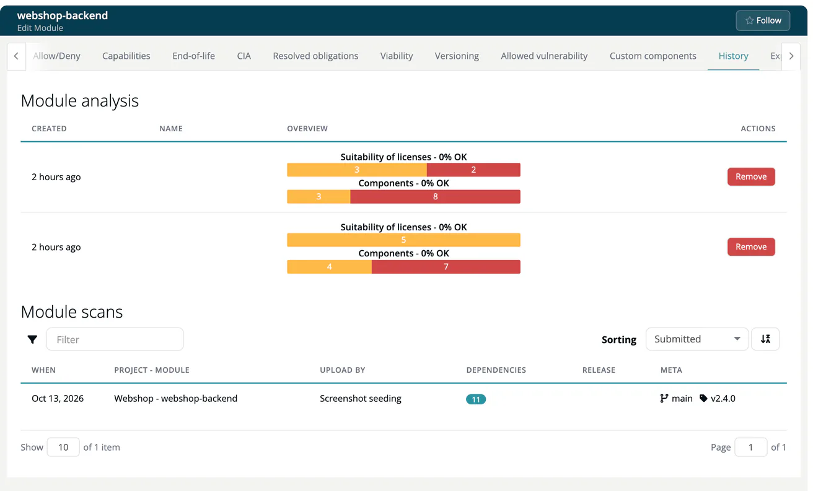

# History (Module)

> [!NOTE]
> **Required role:** Developer, Compliance manager, Portfolio manager and Manager see the tab. **Remove** on an analysis is for managers and compliance managers who are the module's default project manager or default compliance manager (or any of them while none is set). See the [Module Settings Permission Matrix](../../../10-roles-permissions/06a-module-settings-matrix.md).

The tab is called **History** in the app. It shows what has been analysed and uploaded for the module so far. Use it to check whether the latest scan arrived and to remove an analysis that should not count any more. The tab is not shown for infrastructure and COTS modules.

## Module analysis

Every analysis run leaves one row:

| Column | Content |
|---|---|
| **Created** | How long ago the analysis ran. |
| **Name** | The name attached to the analysis, see [Choosing an analysis](../02-module-detail-tabs.md#choosing-an-analysis). |
| **Overview** | Two bars: **Suitability of licenses** and **Components**. |
| **Actions** | **Remove**. |

**Remove** deletes that single analysis at once, without a confirmation. A toast confirms *Analysis successfully deleted*.

> [!WARNING]
> Removing an analysis cannot be undone. To delete all of them, use **Delete history** in the [Danger Operations](18-danger-zone.md) tab.

## Module scans

The **Module scans** table lists every scan uploaded for this module, newest first, with upload time, project and module, uploader, number of dependencies, release name and branch and tag, if the scan carried them. You can filter the table.

How scans get into a module is described in [Inbound](../../../02-inbound/index.md).

