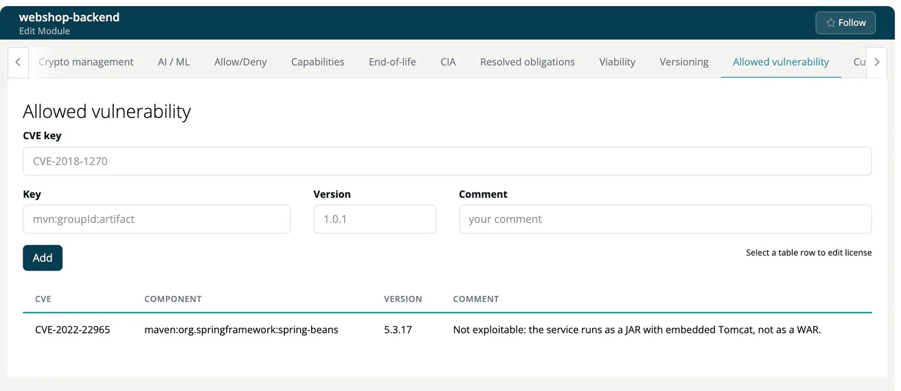

# Allowed vulnerability (Module)

> [!NOTE]
> **Required role:** everyone who can open the module settings reads the list. Adding, changing and removing entries is for developers who are members (or of a module without members) and for managers and compliance managers who are the module's default project manager or default compliance manager (or any of them while none is set). See the [Module Settings Permission Matrix](../../../10-roles-permissions/06a-module-settings-matrix.md).

This tab lists the vulnerabilities you have **muted** for this module: accepted risks, false positives and findings that are already handled. A muted CVE no longer counts against the module's status. The panel is called **List of muted vulnerability of module**.

## How entries get here

Normally you mute a CVE where you find it: the bell icon in the component side panel. You choose a reason, and the entry lands on this tab. See [Component details](../04-component-detail.md#actions-in-the-panel). The reason is kept with the entry and is used when the vulnerability is published in a CSAF document, see [CSAF](../../../04-outbound/04-csaf.md).

## Add an entry by hand

Use the form to mute a CVE without opening the component.

| Field | Example |
|---|---|
| CVE key | `CVE-2018-1270` |
| Component key | `mvn:org.springframework:spring-messaging` |
| Version | `4.3.14.RELEASE`, or `4.3.*` for all 4.3 versions |
| Comment | Required, up to 200 characters. Say why: *Not reachable, STOMP endpoint is disabled.* |

Click **Add**.

## Edit, remove, approve

Click a row to load it into the form; **Add** becomes **Update**, and **Cancel** and **Remove** appear. Removing an entry makes the CVE count again. Rows labelled **in Project**, **in User** or **in Company** come from higher levels and link to where you can change them.

Where the allow list is enforced, entries of users who are not compliance managers are saved as **Not approved** until a compliance manager clicks **Approve**, as described under [Allow/Deny](14-whitelists-blacklists.md#approval-of-entries).

