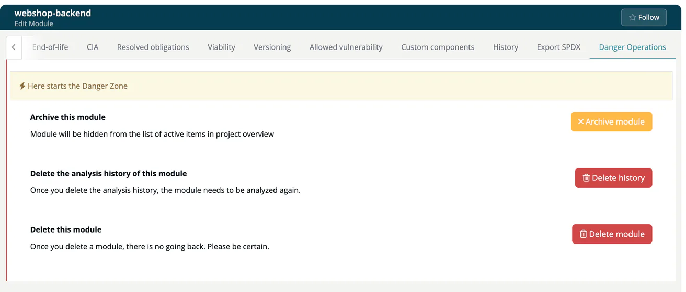

# Danger Operations (Module)

> [!NOTE]
> **Required role:** developers who are members (or of a module without members), and managers who are the module's default project manager or default compliance manager (or any manager while none is set). Other roles do not see the operations. See the [Module Settings Permission Matrix](../../../10-roles-permissions/06a-module-settings-matrix.md).

The tab opens with the banner *Here starts the Danger Zone* and offers three operations, from mild to final. Each one asks for confirmation.

## Archive this module

Hides the module from the list of active items in the project overview. Nothing is deleted, and you can bring the module back.

1. Click **Archive module**.
2. Confirm *Are you sure you want to archive module ...?* with **Yes, archive it!**

An archived module shows the button **Unarchived module** instead. Click it and confirm with **Yes, unarchive it!** to make the module visible again. The project page shows archived modules again with **Show archived**.

## Delete the analysis history

Removes all analyses of the module, which are listed on the [History](13-releases.md) tab. The module itself stays. This option is not shown for infrastructure and COTS modules.

1. Click **Delete history**.
2. Confirm *Are you sure you want to delete the analysis history of the module ...?* with **Yes, delete it!**

You will not be able to recover the history, so analyse the module again straight away. The server accepts this operation only from managers; for other roles it answers *Internal Error! Analysis history of: ... not deleted*.

## Delete this module

Click **Delete module** and confirm *Are you sure you want to delete module ...?* with **Yes, delete it!**

> [!WARNING]
> Deleting a module is final: *You will not be able to recover your module!* Archive the module if you may need it again, or if its releases and approvals must stay traceable.

