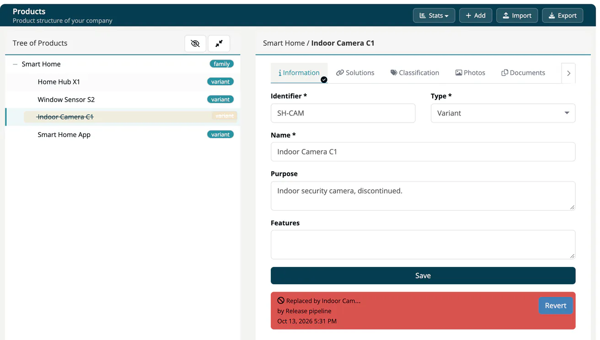

# Tab: Information

> [!NOTE]
> **Editing:** Developer, Compliance manager, Company security manager or Account admin. **Retire / Revert:** Compliance manager, Company security manager or Account admin.

The **Information** tab holds the basic data of a product in ***TrustSource CE***. The heading above the tabs shows the path through the tree (for example *Fridges / **Dual-sided***) and a *Draft* label for draft products.

## Fields

| Field | Description |
|---|---|
| **Identifier** * | Your unique key for the product, for example `FR-100`. Must not be used by another product of your company. |
| **Type** * | Class, Family, Variant, Version or Position. |
| **Name** * | Display name in the tree. |
| **Purpose** | What the product is for. |
| **Features** | Free text listing the product's features. |

Click **Save**. If the identifier is already taken, the app shows "product with same identifier already exists" and keeps the old data.

> [!WARNING]
> Sub-products refer to their parent by its identifier. If you change the identifier of a product that has sub-products, they keep the old identifier as parent and no longer appear below it in the tree. Keep identifiers stable.

## Retire and revert

A product that is no longer sold should be **retired** rather than deleted: its history stays.

1. Click **Retire** (top right of the form).
2. Enter a reason - it is mandatory - and confirm with **Yes, retire it!**.

A retired product disappears from the tree (use **Show all** to see it), is excluded from [exports](01-create-import.md#export-products), and shows the reason, the user and the date in the tab.

To bring it back, click **Revert**, enter a reason and confirm with **Yes, revert action!**. The last reason and user stay visible after a revert.

> [!NOTE]
> Retiring a product does not retire its sub-products.

Retire and revert are written to the company's [audit log](../../06-administration/07-audit-logs.md).

## Related

- [Products overview](index.md) - all eight product tabs
