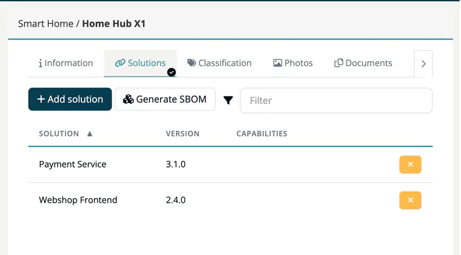

# Tab: Solutions

> [!NOTE]
> **Editing:** Developer, Compliance manager, Company security manager or Account admin.

A **solution** is an approved release that makes up the product. This is how a product in ***TrustSource CE*** connects to the software you build. The tab lists each solution with its **Solution** name, **Version** and **Capabilities** (the capabilities recorded for that approval).

## Add a solution

1. Click **Add solution**.
2. In the dialog, find the release by **Approved** date, **Name**, **Version** or **Contact** (the approver). Only approved releases of your company are listed.
3. Click **Add** next to it.

A confirmation "Solution successfully added" appears. See [Link with Release](10-link-with-release.md) for the background.

## Remove a solution

Click the **x** button at the end of the row. The release itself is not affected.

## Generate an SBOM

Click **Generate SBOM**, then **Generate SBOM** again in the **Generate SBOM by solutions** dialog. TrustSource CE merges the SBOMs of all listed solutions into one CycloneDX JSON file and stores it on the [Documents](06-tab-documents.md) tab as **SBOM file**, replacing a previous one. Finish your selection of solutions first. Without solutions, generation fails with "No solutions selected for product".

## Related

- [Products overview](index.md) - all eight product tabs
- [Releases](../07-releases.md) - the approved releases you can link
