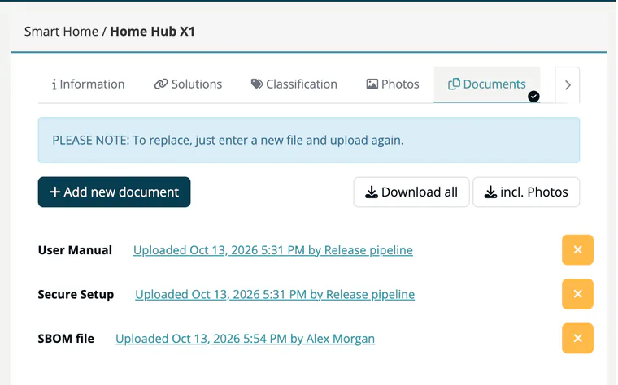

# Tab: Documents

> [!NOTE]
> **Editing:** Developer, Compliance manager, Company security manager or Account admin.

The **Documents** tab keeps the documents the CRA expects you to provide with a product. There is one slot per document type.

## Document types

| Type | Used for |
|---|---|
| **User Manual** | Instructions for users. |
| **Secure Setup** | Guidance for installing and operating the product securely. |
| **Product Description** | Description of the product. |
| **SBOM file** | Software bill of materials; can be [generated from the Solutions tab](03-tab-solutions.md#generate-an-sbom). |
| **CE mark declaration** | The declaration of conformity. |

## Upload a document

1. Click **Add new document**. The **Upload product document** dialog opens.
2. Choose the **Document type**.
3. Select the **File** and click **Upload**. Accepted formats: PDF, DOC, DOCX, XLS, XLSX, PPT, PPTX, TXT, RTF, ODT, ODP and ODS.

> [!TIP]
> To replace a document, upload a new file of the same type ("PLEASE NOTE: To replace, just enter a new file and upload again."). The old file is deleted.

Uploaded documents are listed with their type, upload date and uploader; click the entry to download the file. Click the **x** button on a row to remove the document.

## Download everything

**Download all** packs all documents into one ZIP archive. **incl. Photos** (shown when photos exist) adds the pictures from the [Photos](05-tab-photos.md) tab.

## Where documents are stored

***TrustSource CE*** stores product documents and photos on its own file storage: in the reference Docker Compose setup, the `ts-files` volume. Nothing is sent to an external storage service.

- Back up the `ts-files` volume together with the database; a database backup alone does not contain these files. See [Backups & Monitoring](../../01-installation-setup/07-backups-monitoring.md).
- Files are served under `/files/products/<company id>/<random file name>`. The download link does not require a login: anyone who has the exact link can fetch the file. The file name is a random identifier, so a link cannot be guessed, but treat shared links as confidential.

## Related

- [Products overview](index.md) - all eight product tabs
