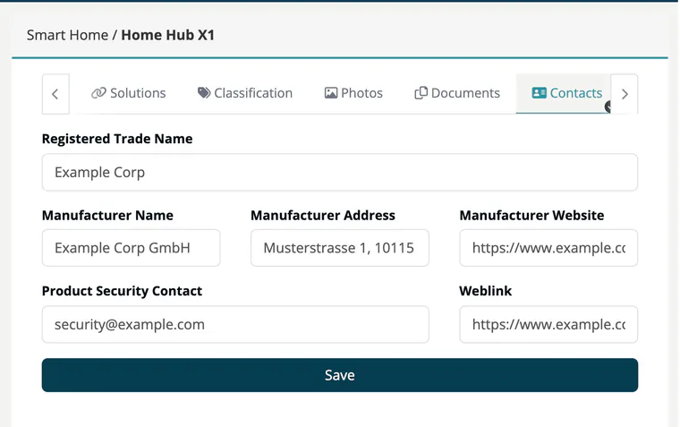

# Tab: Contacts

> [!NOTE]
> **Editing:** Developer, Compliance manager, Company security manager or Account admin.

The **Contacts** tab identifies the manufacturer and the contact for security reports. The CRA requires that the manufacturer can be identified on the product.

| Field | Description |
|---|---|
| **Registered Trade Name** | The company name as registered. |
| **Manufacturer Name** | Name of the manufacturer. |
| **Manufacturer Address** | Postal address. |
| **Manufacturer Website** | Web address of the manufacturer. |
| **Product Security Contact** | Where to report vulnerabilities, for example `psirt@example.com`. |
| **Weblink** | Link to your vulnerability disclosure policy or PSIRT page. |

Click **Save** to store the data. All fields are optional.

New products start with the data stored under **Administration → Settings → PSIRT contacts**, so you only adjust what differs per product. Later changes to the company settings do not update existing products. See [Settings](../../06-administration/02-settings.md).

## Related

- [Products overview](index.md) - all eight product tabs
