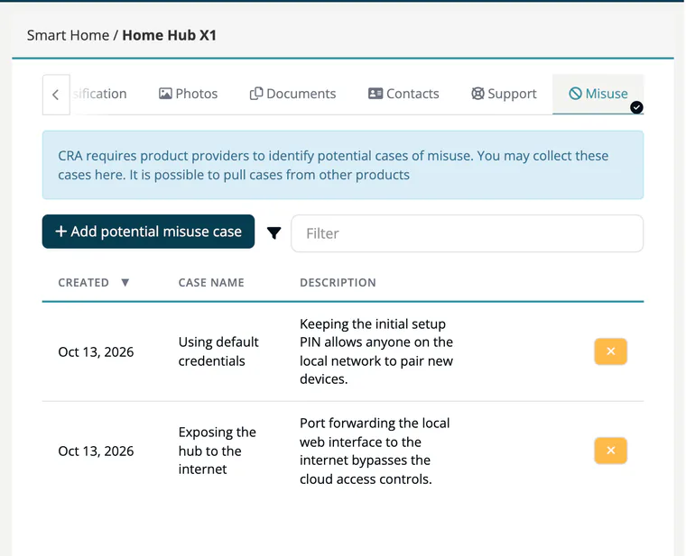

# Tab: Misuse

> [!NOTE]
> **Editing:** Developer, Compliance manager, Company security manager or Account admin.

The CRA requires you to identify how a product could be misused. Collect these **potential misuse cases** per product on this tab, for example *Default admin password left unchanged* or *Device used as a relay in a botnet*.

## Add a misuse case

1. Click **Add potential misuse case**.
2. Enter the **Name** (required) and, optionally, a **Description**.
3. Click **Add**.

The table lists **Created**, **Case name** and **Description**; filter and sort as in other lists. Remove a case with the **x** button at the end of its row.

> [!NOTE]
> Misuse cases are plain records on the product. They are not linked to risks. To track a technical threat with impact, countermeasures and tasks, record it in the [risk register](../05-risks/index.md), where the [Threat model](../05-risks/10-threat-model-fields.md) tab holds STRIDE and CWE details.

You can read and write misuse cases through the [Products API](../../09-rest-api/endpoints/products.md) as well.

## Related

- [Products overview](index.md) - all eight product tabs
