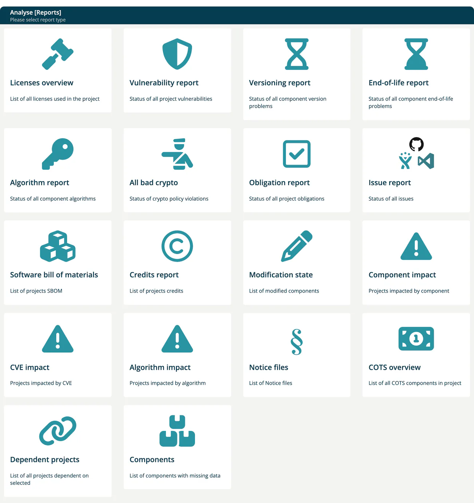

# Reports

> [!NOTE]
> **Menu:** **Internal → Reports** is shown to Developer, Compliance manager and Manager. Some tiles need a further role, marked below.

The Reports page (titled **Analyse [Reports]** in the app) is the hub of the reports in ***TrustSource CE***. Each tile opens a report. The **Software bill of materials** and **Notice files** tiles lead to the same lists as the [Outbound chapter](../04-outbound/index.md).

## Report tiles

| Tile | Shows |
|---|---|
| **[Licenses overview](04b-analysis-reports.md#licenses-overview)** | All licenses used in a project. |
| **[Vulnerability report](04a-vulnerability-report.md)** | Status of all vulnerabilities of a project or module. |
| **[Versioning report](04b-analysis-reports.md#versioning-report)** | Component version problems. |
| **[End-of-life report](04b-analysis-reports.md#end-of-life-report)** | Component end-of-life problems. |
| **[Algorithm report](04b-analysis-reports.md#algorithm-report)** | Cryptographic algorithms used by components. |
| **[All bad crypto](04c-impact-and-portfolio-reports.md#all-bad-crypto)** | Crypto policy violations. Roles: Company security manager, Compliance manager, Portfolio manager. |
| **[Obligation report](04b-analysis-reports.md#obligation-report)** | Obligations of a project or module. |
| **[Issue report](04c-impact-and-portfolio-reports.md#issue-report)** | Tasks from your issue tracker (Jira, GitHub, TFS). |
| **Software bill of materials** | List of SBOMs; see [SBOM + CBOM](../04-outbound/01-sbom-cbom.md). |
| **[Credits report](04b-analysis-reports.md#credits-report)** | Copyrights of the components of a project. |
| **[Modification state](04b-analysis-reports.md#modification-state)** | Modified components. |
| **[Component impact](04c-impact-and-portfolio-reports.md#impact-reports)** | Projects impacted by a component. Roles: Compliance manager, Manager, Portfolio manager. |
| **[CVE impact](04c-impact-and-portfolio-reports.md#impact-reports)** | Projects impacted by a CVE. |
| **[Algorithm impact](04c-impact-and-portfolio-reports.md#impact-reports)** | Projects impacted by an algorithm. |
| **Notice files** | List of Notice files; see [Notice Files](../04-outbound/02-notice-files.md). |
| **[COTS overview](04c-impact-and-portfolio-reports.md#cots-overview)** | Commercial (COTS) components in a project. |
| **[Dependent projects](04c-impact-and-portfolio-reports.md#dependent-projects)** | Projects that depend on a selected project. |
| **[Components](04c-impact-and-portfolio-reports.md#components)** | Components with missing data. Role: Company component manager. |

A project's and a module's own **Reports** dropdown opens a report with that project or module preselected.

CSAF documents are not part of this hub; find them under [Outbound → CSAF](../04-outbound/04-csaf.md). The risk register has its own menu entry; see [Risks](05-risks/index.md).

> [!NOTE]
> The hub has no Viability report tile; the viability data is available through the REST API with `GET /core/reports/viability`. The OpenSSF Scorecard and Vulnerability activity reports of the SaaS edition are not part of TrustSource CE. See [CE and SaaS compared](../13-ce-vs-saas.md).

## Details

- [Vulnerability Report](04a-vulnerability-report.md) - CVSS vs. EPSS chart, confidence filter, treatments
- [Analysis Reports](04b-analysis-reports.md) - single project or module: licenses, versioning, end-of-life, algorithms, obligations, credits, modification state
- [Impact and Portfolio Reports](04c-impact-and-portfolio-reports.md) - impact of a component, CVE or algorithm, bad crypto, COTS, dependent projects, components with missing data, issues

## Related

- [Outbound chapter](../04-outbound/index.md) - SBOM, Notice files, CSAF
- [Approvals](06-approvals/index.md) - reports are often used as part of the approval workflow
