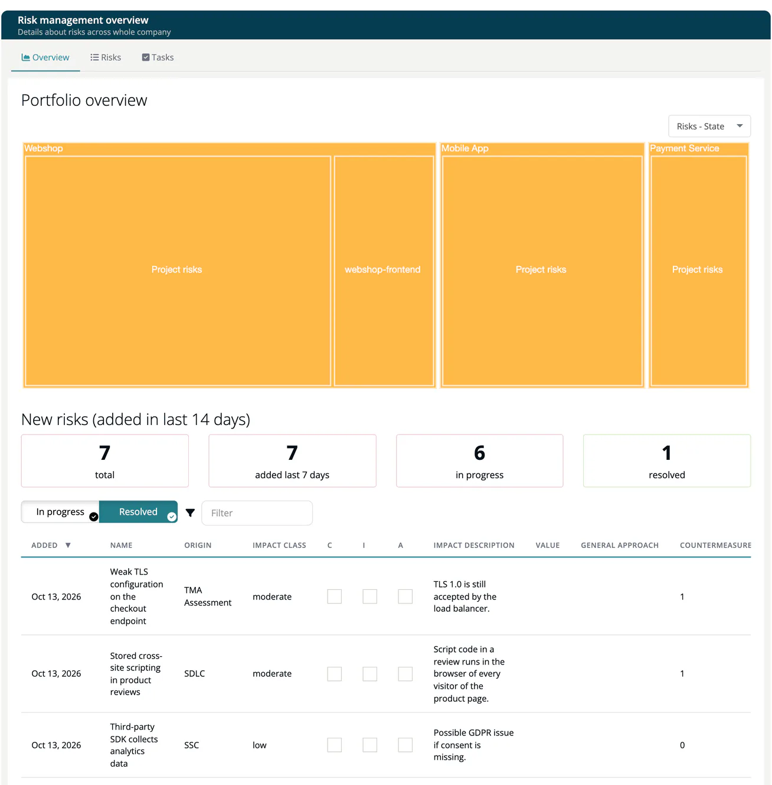

# Risk Overview

> [!NOTE]
> **Menu:** **Internal → Risks** is shown to Developer, Compliance manager and Manager.

The **Overview** tab (*Risk management overview*, "Details about risks across whole company") answers two questions for the whole company in ***TrustSource CE***: which projects and modules carry risks that need attention, and which risks are new or unattended. It opens when you choose **Risks** in the menu.

If the register is still empty, the page shows *No risks tracked yet* and lists what it will show once risks exist.

## Portfolio overview

A treemap of projects and modules, sized by the number of risks and coloured by state or impact. See [Portfolio Views](04-portfolio-views.md).

## New risks (added in last 14 days)

All risks of the company created in the last 14 days, with the tiles **total**, **added last 7 days**, **in progress** and **resolved**. Which states count as resolved is explained in [Treatment and State](05-treatment-and-state.md#resolved-and-in-progress).

## Unattended risks

Risks that nobody has started to work on: risks without any countermeasure whose mitigation strategy is not `ignore`. The same four tiles are shown above the list.

Both lists are read-only. Use the link button at the end of a row to open the risk in the [Risks List](02-risks-list.md) in a new browser tab, where you can edit it.

## Related

- [Risks List](02-risks-list.md) - the register behind these lists
- [Portfolio Views](04-portfolio-views.md) - the treemap in detail
