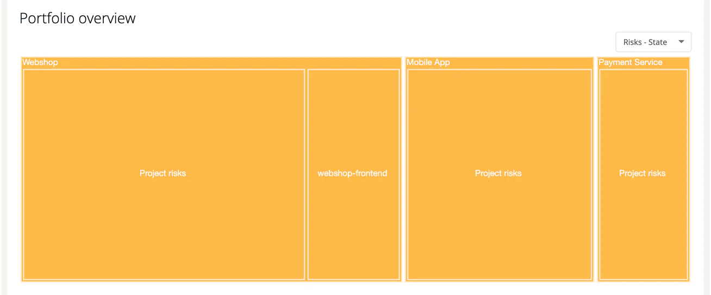

# Portfolio Views

> [!NOTE]
> **Menu:** **Internal → Risks** is shown to Developer, Compliance manager and Manager.

The **Portfolio overview** on the [Overview](01-overview.md) tab is a treemap of your projects and modules in ***TrustSource CE***. The size of a rectangle is the number of risks; its colour tells you where to look first. Risks recorded on a project itself (not on one of its modules) appear as a rectangle named **Project risks**.

## Choose the colouring

Use the **View type** selector above the chart:

| View | Red | Amber | Teal |
|---|---|---|---|
| **Risks - State** | At least one risk in state `deferred` or `expired` | A risk in state identified, assessed, approved, planned, implementing, monitored or escalated | All other states (for example accepted, closed, eliminated, transferred, out-of-scope) or no state |
| **Risks - Impact** | A critical or existential risk | A high or moderate risk | Low or no impact class only |

A project is coloured by the worst of its modules.

## Explore

- **Hover** a rectangle for the number of risks and, on a module, the number of red and amber risks.
- **Click a project** to zoom into its modules. **Back to all** returns to the whole portfolio.
- **Click a module** to open its risks in a new browser tab.

With more than 100 entries the chart shows projects only until you zoom in.

## Related

- [Risk Overview](01-overview.md) - the rest of the Overview tab
- [Treatment and State](05-treatment-and-state.md) - the risk states
