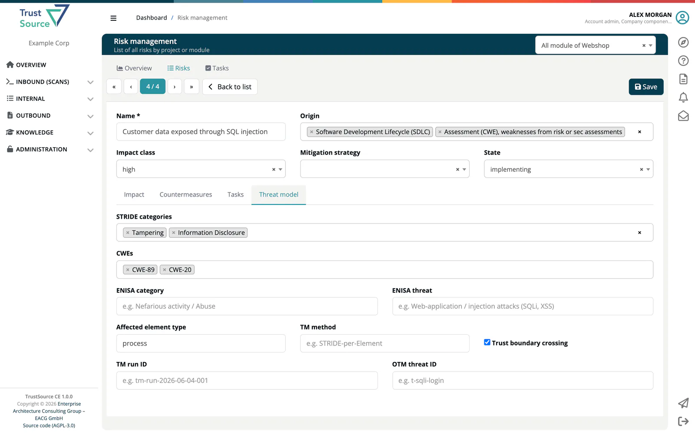

# Threat Model Fields

> [!NOTE]
> **Menu:** **Internal → Risks** is shown to Developer, Compliance manager and Manager. Every user who can open a risk can edit these fields.

The **Threat model** tab of the risk editor in ***TrustSource CE*** records where a risk comes from in terms of threat modelling: which STRIDE categories apply, which weaknesses (CWEs) are involved, how it maps to the ENISA threat landscape, and which threat-model run and element it belongs to. Use it to link a risk to a threat model you maintain in another tool, or simply to classify risks consistently.

TrustSource CE does not generate threat models and has no **Threat Models** menu; you fill these fields by hand, through the [Risks API](../../09-rest-api/endpoints/risks.md), or they are set by [automatic risks](08-automatic-risks.md) (the CWE of a SARIF weakness).

## Where to find the fields

- In the **Risk capture** form when you add a risk, under **Threat model context**.
- In the risk editor, on the **Threat model** tab.

All fields are optional. Click **Save** in the editor to store them. If you clear every field, the threat-model data is removed from the risk.

## Fields

| Field | What to enter |
|---|---|
| **STRIDE categories** | One or more of Spoofing, Tampering, Repudiation, Information Disclosure, Denial of Service, Elevation of Privilege. |
| **CWEs** | Weakness ids. Type an id such as `CWE-89` and press Enter; add as many as needed. |
| **ENISA category** | The ENISA threat category, up to 200 characters, for example *Nefarious activity / Abuse*. |
| **ENISA threat** | The ENISA threat, up to 300 characters, for example *Web-application / injection attacks (SQLi, XSS)*. |
| **Affected element type** | The kind of model element the threat applies to, up to 100 characters, for example *process*. |
| **TM method** | The threat-modelling method used, up to 200 characters, for example *STRIDE-per-Element*. |
| **Trust boundary crossing** | Tick it when the threat crosses a trust boundary. |
| **TM run ID** | The id of the threat-model run or session the risk came from, up to 200 characters, for example *tm-run-2026-06-04-001*. |
| **OTM threat ID** | The id of the threat in an Open Threat Model (OTM) file, up to 200 characters, for example *t-sqli-login*. |

A countermeasure can carry the matching **OTM mitigation ID**; see [Risk Tasks](03-risks-tasks.md#countermeasures).

## How the fields are used

- A risk created from a SARIF weakness starts with that weakness in **CWEs**. You can add or remove CWEs; later imports do not overwrite your list.
- **Create risk** on a SARIF finding pre-fills **CWEs** with the weaknesses of that finding.
- The fields are stored with the risk and returned by the [Risks API](../../09-rest-api/endpoints/risks.md). They do not change the impact class, the state or any calculation.

## Related

- [Risks List](02-risks-list.md) - the risk editor
- [Automatic Risks](08-automatic-risks.md) - risks from SARIF weaknesses
- [Vulnerability Lake](../../05-knowledge/04-vulnerability-lake.md) - look up a CWE with **Find CWE**
