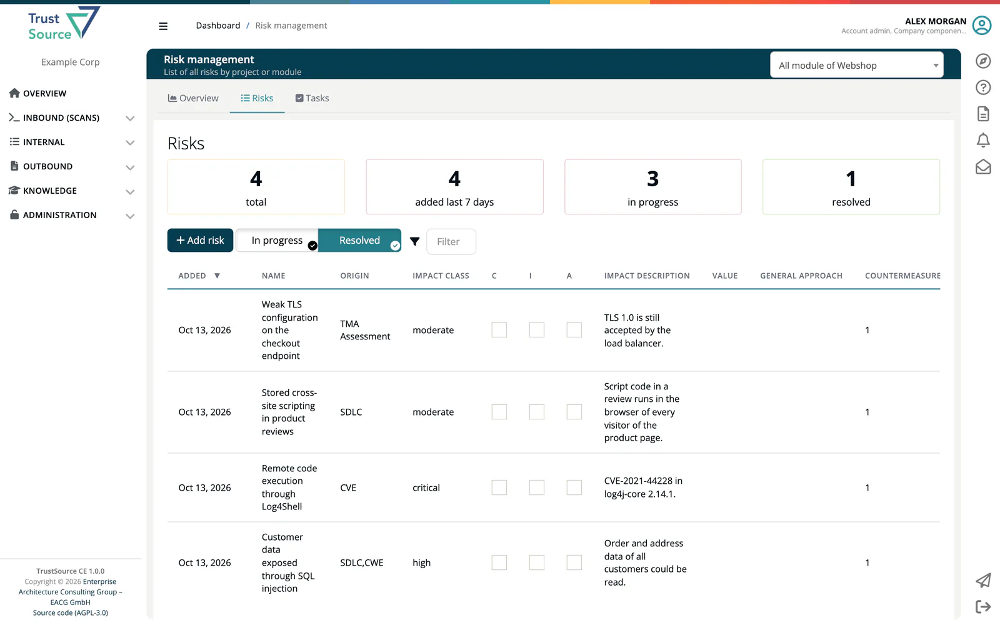

# Risks

> [!NOTE]
> **Menu:** **Internal → Risks** is shown to Developer, Compliance manager and Manager. Adding a risk in the register needs Compliance manager or Manager.

The Risks module is the **risk register** of ***TrustSource CE***. It lets you document a risk, assess its impact, choose a mitigation strategy, assign countermeasures and tasks, and see where risks pile up across your projects. Risks can be entered by hand, created from findings (SARIF weaknesses, vulnerabilities, a manually set license) or kept up to date automatically from SARIF imports.

Open **Risks** in the menu. The page has three tabs: **Overview** (*Risk management overview*), **Risks** and **Tasks**. Risks belong to a project or to a module; the **Risks** and **Tasks** tabs always work on one project or module that you select at the upper right. A project's and a module's **Reports** dropdown also has a **Risks** entry that opens the register for it.

## Where to start

| I want to... | Go to |
|---|---|
| See which projects and modules need attention | [Overview](01-overview.md) |
| Find, create or edit a risk | [Risks List](02-risks-list.md) |
| Follow up on countermeasures and tasks | [Risk Tasks](03-risks-tasks.md) |
| Compare projects and modules at a glance | [Portfolio Views](04-portfolio-views.md) |
| Understand mitigation strategy, state and "resolved" | [Treatment and State](05-treatment-and-state.md) |
| Record why a risk is accepted or transferred | [Decisions](06-decisions.md) |
| Know the scales risks are assessed on | [Risk Assessment Scheme](07-risk-assessment-scheme.md) |
| Let TrustSource CE create risks from SARIF findings | [Automatic Risks](08-automatic-risks.md) |
| See who created or removed a risk | [Risk History](09-risk-history.md) |
| Record STRIDE, CWE and other threat-model details | [Threat Model Fields](10-threat-model-fields.md) |

## In this section

| Page | What it covers |
|---|---|
| [Overview](01-overview.md) | Portfolio treemap, new risks, unattended risks. |
| [Risks List](02-risks-list.md) | The register: tiles, filters, the risk editor and its tabs. |
| [Risk Tasks](03-risks-tasks.md) | Countermeasures, tasks, due dates, the Tasks tab. |
| [Portfolio Views](04-portfolio-views.md) | The treemap by state or impact, drill-down per project. |
| [Treatment and State](05-treatment-and-state.md) | Mitigation strategy, the risk states and which count as resolved. |
| [Decisions](06-decisions.md) | How to document a decision in TrustSource CE. |
| [Risk Assessment Scheme](07-risk-assessment-scheme.md) | The fixed impact classes and value scales. |
| [Automatic Risks](08-automatic-risks.md) | Risks from SARIF weaknesses, vulnerabilities and manually set licenses. |
| [Risk History](09-risk-history.md) | What the audit log records about risks. |
| [Threat Model Fields](10-threat-model-fields.md) | The **Threat model** tab of the risk editor. |

> [!NOTE]
> TrustSource CE has no threat model generation and no **Threat Models** menu. You record threat-model details by hand on the **Threat model** tab of a risk. See [CE and SaaS compared](../../13-ce-vs-saas.md).

## Related

- [Risks API](../../09-rest-api/endpoints/risks.md) - read and write risks, countermeasures and tasks from your own tools
- [SW Quality Scans](../../02-inbound/04-sw-quality-scans.md) - SARIF imports that feed automatic risks
