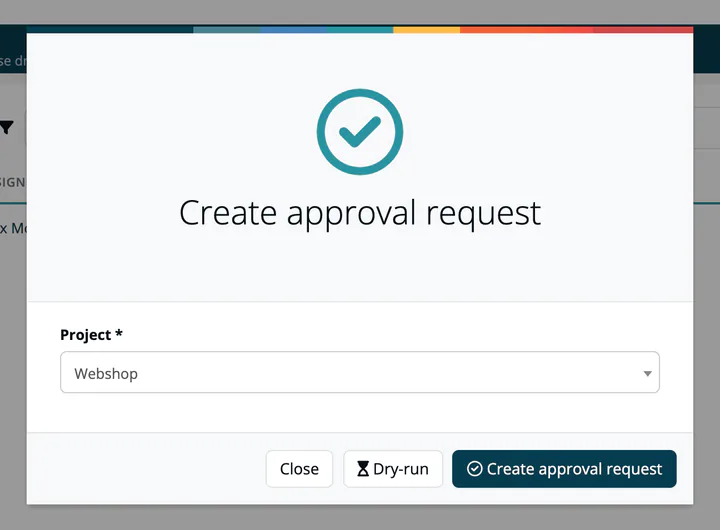
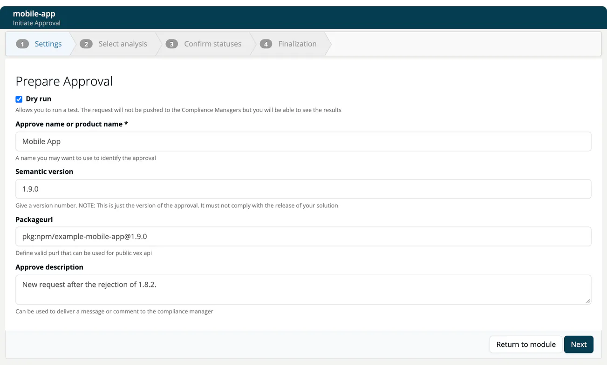

# Requesting an Approval

> [!NOTE]
> **Required role:** the project wizard is offered to Manager and Compliance manager (**Approve** on the project page and **Create** on the approvals list). The module wizard (**Initiate approval** on the module page) is also shown only to Manager and Compliance manager.

You request an approval for a project, or for a single module, and choose which analysis of each module goes into it. ***TrustSource CE*** guides you through a wizard: five steps for a project, four for a module.

## Start the wizard

- **From the approvals list:** click **Create**, choose the **Project** and click **Create approval request**, or **Dry-run** to try it out. The project wizard opens; with **Dry-run** the option **Dry run** is already ticked.
- **From a project:** click **Approve** in the project header.
- **From a module:** click **Initiate approval** in the module header. The module wizard opens for that module.

## The project wizard (five steps)

| Step | What you do |
|---|---|
| **1 Settings** | Under *Prepare Approval*: tick **Dry run** to see the results without sending the request to the compliance managers. Enter the **Approval Name** (required), an optional **Semantic version** (only the version of the approval, not of your product), a **Packageurl** (a valid package URL for the release) and an **Approve description**, a message for the compliance manager. |
| **2 Pick modules** | Tick the modules of the project that belong to the release. All modules are preselected. The table shows each module's state, name, components, legal, security and quality figures. |
| **3 Select analysis** | Choose the analysis of each module, listed by date (and release name, if the analysis was frozen). The search button finds analyses by branch or tag. |
| **4 Confirm statuses** | Check state, analysis and the figures once more. **Next** creates the request. |
| **5 Finalization** | The request exists at once; its documents are generated in the background. |

## The module wizard (four steps)

The module wizard is the same without the module selection: **1 Settings**, **2 Select analysis**, **3 Confirm statuses**, **4 Finalization**. The name field is labelled **Approve name or product name**.

## Finalization

The last step, *Finalizing your approval request*, shows one row per document in this order: **Compliance Report**, **Notice** and **SBOM**. Each row has its own progress bar and, as soon as the document is ready, a link to open it. The SBOM is built from the analyses pinned in the approval.

- **Done:** *Great! You made it!* A real request has been forwarded to the compliance managers of your organisation; the default compliance manager of the project, if one is set, is assigned and notified. For a dry run, the text points you to **Internal → Approvals**, where you see what the compliance manager would have seen.
- **Failed:** *Report generation did not finish*, with the stage that failed. The approval request itself was created and is still available; open the reports that were generated, or jump to the Compliance Report.

Use **Jump to Compliance Report** to open the approval, or **Return to project** (**Return to module** in the module wizard).

## What the approval contains

When the request is created, TrustSource CE generates and attaches:

- the **compliance report**: the data behind the review tabs;
- the **notice file**: the attribution document for all components, listed under [Outbound → Notice Files](../../04-outbound/02-notice-files.md);
- the **SBOM**: a snapshot of the bill of materials, listed under [Outbound → SBOM + CBOM](../../04-outbound/01-sbom-cbom.md).

Binary links recorded on the selected analyses are copied into the approval and its notice file. See [Binary Linking](04-binary-linking.md).

Notifications: compliance managers who have approval events enabled in their [communication preferences](../../08-personal/03-profile.md) receive an inbox message (and an email, if enabled). Followers of the project are informed too.

## Turn a dry run into a request

Open the dry run from the approvals list. A Compliance manager sees **Create approval request** in the header, which creates a real request from it and removes the dry run. **Remove DRAFT** deletes the dry run (Manager and Compliance manager).

Over the API, a key with the Manager scope can create an approval for one scan: `POST /api/v2/compliance/approvals`. See [Compliance approvals](../../09-rest-api/endpoints/compliance-approvals.md).

## Related

- [Approval Detail Tabs](02-approval-detail-tabs.md): what the reviewer sees
- [Approve / Reject](03-approve-reject-workflow.md): the decision workflow
- [Binary Linking](04-binary-linking.md): links to the built artifacts
