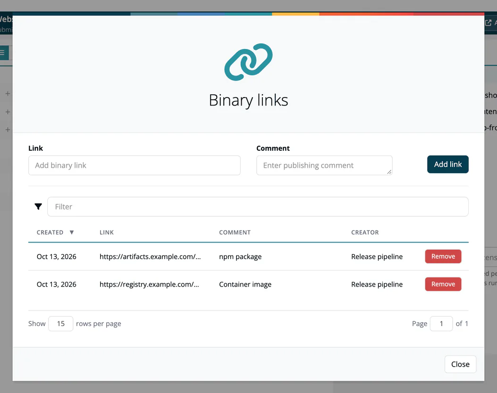

# Binary Linking

> [!NOTE]
> **Required role:** on a scan: Developer, Compliance manager or Manager. On an approval or a notice file: Compliance manager or Manager.

A **binary link** points to a built artifact, for example a container image, a JAR in your repository manager or a download URL. It connects the source-level bill of materials to the artifact you actually ship. Each link has a **Link** (the reference itself) and an optional **Comment**; ***TrustSource CE*** records who created it and when.

## Where links come from

Binary links travel with the data, from the scan to the approval:

1. **Scan.** A scanner can send links with the upload (`binaryLinks`, a list of objects with `name` and `comment`). You can also add them on the scan page: **Binary links** opens the dialog with **Link**, **Comment** and **Add link**, and a table (**Created**, **Link**, **Comment**, **Creator**) with **Remove** per row. See [CI/CD Scan](../../02-inbound/03-cicd-scan.md#scan-details).
2. **Analysis.** When a scan is analysed, its links are copied into the analysis. Links you add to a scan after its analysis reach the analysis when you run **Re-Process** on the scan.
3. **Approval.** When an approval is created, the links of the selected analyses are copied into the approval and into its notice file.

## On an approval

The approval header shows **Manage binary links**. The dialog lists the links of the approval; until the approval is approved you can add links and remove them (removing asks for confirmation). After approval the list is read-only. On a release, **Binary links** shows the same list read-only.

## On a notice file

The notice file of an approval carries the same links, and its detail page has its own binary links dialog while the notice file is not frozen. The links are printed in the notice file exports (PDF and TXT). See [Notice Files](../../04-outbound/02-notice-files.md).

## With the API

| Request | What it does |
|---|---|
| `GET /api/v2/core/scans/{scan_id}/binaryLinks` | Lists the links of a scan (`name`, `comment`, `userName`). |
| `POST /api/v2/core/scans/{scan_id}/binaryLinks` | Replaces the links of a scan with the list in the body, for example `{"binaryLinks": [{"name": "registry.example.com/shop/api:1.4.0", "comment": "release image"}]}`. Needs a key with the Developer, Manager or Compliance manager scope. |
| `GET /api/v2/compliance/approvals/{approval_id}` | Returns, among other data, the binary links of an approval. |

See [REST API → Scans](../../09-rest-api/endpoints/scans.md).

## Related

- [Requesting an Approval](01-request-approval.md): which analyses go into an approval
- [CI/CD Scan](../../02-inbound/03-cicd-scan.md): scan details and Re-Process
- [Releases](../07-releases.md)
