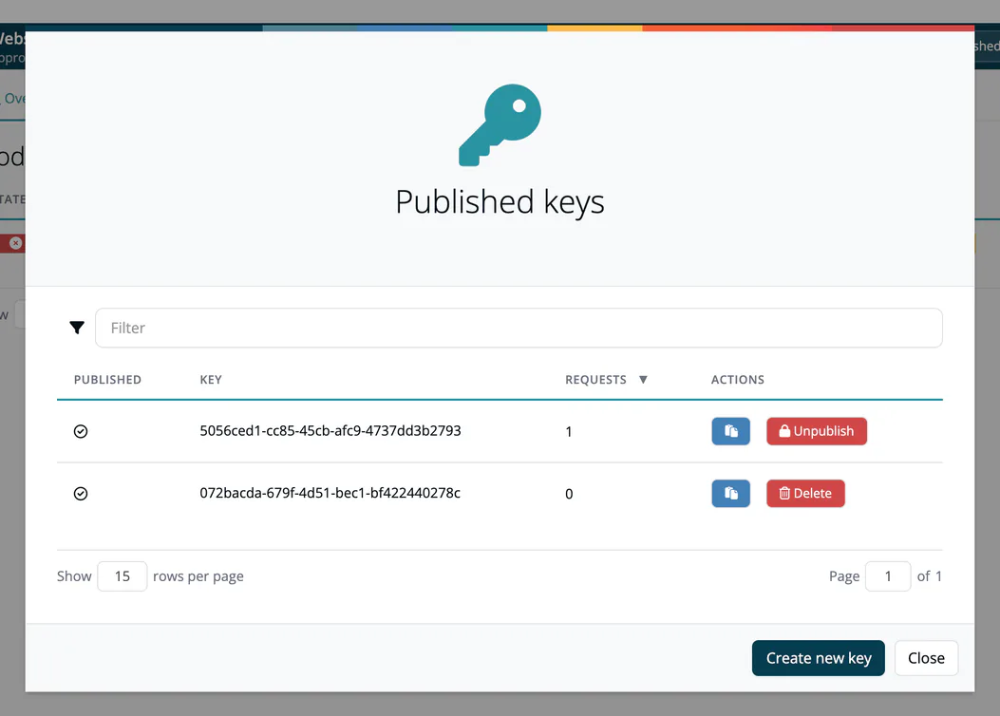

# Public Approves

> [!NOTE]
> **Required role:** Compliance manager, Manager or Account admin to create, publish, unpublish or delete release keys

Public approves let you share the documents of an approved release with **external stakeholders** (customers, auditors, partners) without giving them a ***TrustSource CE*** login or an API key. Access works through a **release key**: a random key bound to one release.

## How it works

1. Approve the request in the app. See [Approve / Reject](03-approve-reject-workflow.md).
2. TrustSource CE creates a release key for the approval and publishes it.
3. Give the key to the external party, or ship it with your product. They fetch the documents from your installation:

| Request | Returns |
|---|---|
| `GET https://<your-host>/api/v2/compliance/releases/{release_key}/sbom` | The bill of materials of the release (name, description, components) as JSON. |
| `GET https://<your-host>/api/v2/compliance/releases/{release_key}/notice` | The licenses and components of the release's notice file as JSON. |
| `GET https://<your-host>/api/v2/compliance/releases/{release_key}/csaf` | A CSAF VEX document for the vulnerabilities of the release. |
| `GET https://<your-host>/api/v2/compliance/releases/{release_key}/csaf-changes` | A CSAF VEX document for the vulnerability changes since the release. |

No `x-api-key` header is needed. Every document carries an HMAC integrity check (`signatures` in the JSON) derived from `TS_ENCRYPTION_KEY`. It is not a public signature: only your installation can check it, under [Outbound → Verify](../../04-outbound/05-verify.md), which needs a login. A recipient who wants a document confirmed has to ask you. An unknown, unpublished or out-of-scope key is answered with `404`.

You do not have to mark an approval as public: the key alone grants access.

> [!WARNING]
> Anyone who holds the key can read what it serves. Treat it like a password. The key is part of the URL, so it also appears in the app log and in reverse proxy access logs; restrict who can read them. When a recipient relationship ends, create a new key for those who keep access and unpublish the old one. The routes are only reachable for people who can reach your installation; see [HTTPS and reverse proxy](../../01-installation-setup/05-https-reverse-proxy.md).

## Manage the keys of a release

On the release page, **Published keys** opens the list of keys of that release:

| Column | Meaning |
|---|---|
| **Published** | Whether the key is active. |
| **Key** | The key itself, or *Key available after publish*. |
| **Requests** | How often the key was used. |
| **Actions** | Copy the key, **Publish** it, **Unpublish** it (a key that was already used) or **Delete** it (a key never used). |

**Create new key** adds a further key, for example one per recipient, so you can withdraw access for one recipient without affecting the others. A new key must be published before it works.

To limit what a key serves (SBOM, notice, CSAF), see [Release keys](../../06-administration/04b-release-keys.md) under **Administration → API keys**.

## Packageurl

The **Packageurl** you enter in the [approval wizard](01-request-approval.md) is stored with the approval and shown in its header.

This is useful for CRA compliance: you can give customers proof of your software composition without exposing your internal tooling.

## Related

- [Approve / Reject](03-approve-reject-workflow.md): approving creates the first key
- [Release keys](../../06-administration/04b-release-keys.md): scope and all keys of the company
- [REST API → Public routes](../../09-rest-api/05-public-routes.md): the routes behind release keys
- [Recipe: Share an SBOM publicly](../../recipes/08-share-sbom-publicly.md)
