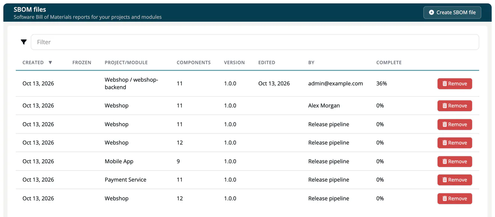
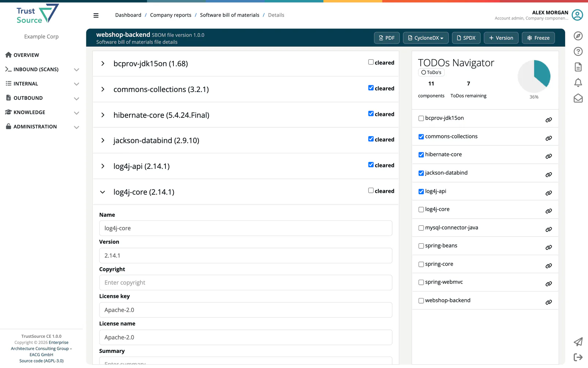

# SBOM + CBOM

> [!NOTE]
> **Required role:** Compliance manager, Manager or Account admin to open the list. Editing, versioning and freezing need Compliance manager or Manager.

***TrustSource CE*** keeps **SBOM files**: editable bills of materials for a project or a module. From one SBOM file you download the Software Bill of Materials, the Cryptography Bill of Materials (CBOM) and the AI / ML Bill of Materials (AIBOM). Open **Outbound → SBOM + CBOM**.

## The SBOM files list

The page **SBOM files** lists every SBOM file of your company, including the ones created by approvals.

| Column | Meaning |
|---|---|
| **Created** | When the file was created. |
| **Frozen** | When it was frozen, if it was. |
| **Project/Module** | What the file describes. |
| **Components** | Number of components. |
| **Version** | Version of the file. |
| **Edited**, **By** | Last change and who made it. |
| **Complete** | How many components are cleared, in percent. |
| (last column) | **Remove**. |

## Create an SBOM file

1. Click **Create SBOM file**.
2. Choose the **Project or module**: **All module of ...** for a whole project, or one module.
3. Click **Create SBOM file**.

The file is built from the current analyses. An [approval](../03-internal/06-approvals/01-request-approval.md) creates an SBOM file for its release in the same way, from the analyses it pins.

## Work on an SBOM file

Click a row to open the file. The left side lists the components; open one to edit its fields: **Name**, **Version**, **Copyright**, **License key**, **License name**, **Summary**, **Package file name**, **Source info**, **Originator**, **Supplier**, **Download location**, **Hash of executable**, **Homepage url**, **Repo url**, **Source url**, **Hash of source**, **Binary url**, **Other**. **Save component** stores the changes. Tick **cleared** once a component is reviewed.

The **TODOs Navigator** on the right counts components and remaining ToDos, shows the completion in percent, and jumps to a component. **ToDo's** / **Show all** switches between open and all components.

## Versions and freezing

- **Version** increments the version of the file (dialog *Increment version*, **Save version**).
- **Freeze** locks the file. A frozen file cannot be changed; a copy with an increased version is created for further work. The header then shows *Frozen* with the date.

If the project or module of a file was removed, the file is marked *DEPRECATED*.

## Download

| Button | Format |
|---|---|
| **PDF** | A PDF report of the file, with your company logo from **Administration → Settings → General info**. |
| **CycloneDX → SBOM (components)** | CycloneDX 1.7 JSON with the components. |
| **CycloneDX → CBOM (cryptography)** | CycloneDX 1.7 JSON with the cryptographic assets. |
| **CycloneDX → AIBOM (AI / ML)** | CycloneDX 1.7 JSON with the AI / ML models. |
| **CycloneDX → Full BOM (components + crypto + AI)** | All of the above in one CycloneDX 1.7 JSON document. |
| **SPDX** | SPDX JSON (`.spdx.json`). |

Further ways to get a bill of materials:

- **SPDX RDF** of one module: module settings, tab **Export SPDX**. See [Export SPDX](../03-internal/02-modules/settings/17-spdx-export.md).
- **REST API**: `GET /api/v2/core/projects/{project_id}/sbom` (and the same for modules) returns the bill of materials in TrustSource's own tree and list format; `/cbom` and `/aibom` return CycloneDX 1.7. See [Projects](../09-rest-api/endpoints/projects.md) and [Modules](../09-rest-api/endpoints/modules.md).
- **Release key**: external parties read the SBOM of a release, with an HMAC integrity check, from `/api/v2/compliance/releases/{release_key}/sbom`. See [Public Approves](../03-internal/06-approvals/05-public-approves.md).

SPDX tag-value and CycloneDX XML are not produced.

## Related

- [Import Scans](../02-inbound/02-import-scans.md): how component data enters
- [Approvals](../03-internal/06-approvals/index.md): SBOM files of releases
- [Recipe: Crypto inventory and PQC](../recipes/07-crypto-inventory-pqc.md)
- [Background: SBOM formats](../../shared/background/10-sbom-formats.md)
