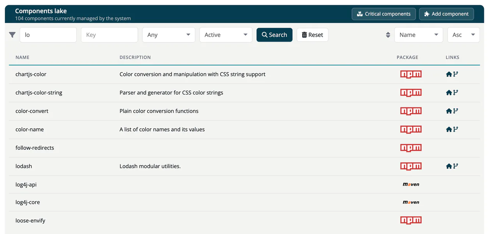
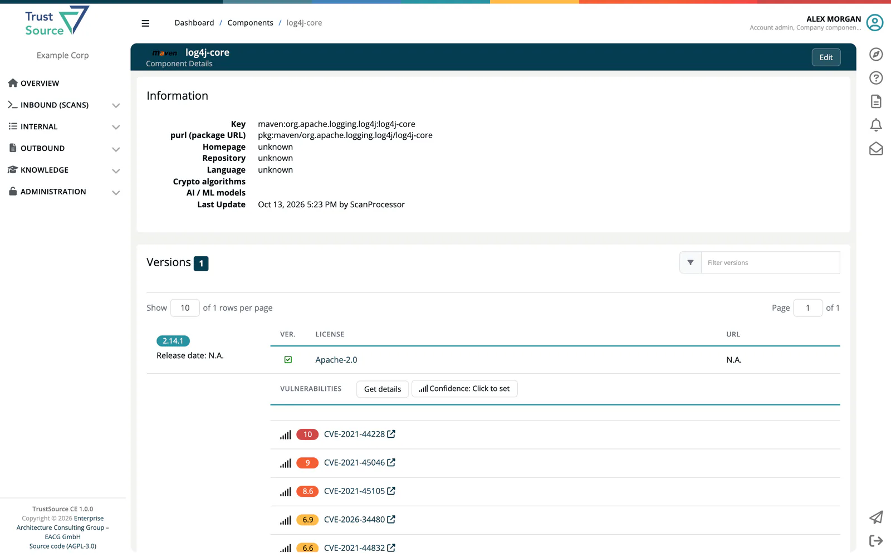

# Component Lake

The Component Lake is the component catalog of ***TrustSource CE***. Use it to look up a package, check its licenses, versions and vulnerabilities, or to see whether it is on your company's deny list. Open it from **Knowledge → Component Lake**; the page is titled **Components lake** and shows how many components the system currently manages.

## Where the data comes from

The catalog holds every component this installation has seen: when an analysis meets a component that is not in the catalog yet, TrustSource CE creates it from the data in the scan (name, key, versions, licenses, URLs, description). Users with the **Company component manager** role can add and correct components. The catalog is shared by all companies of the installation.

## Search

Combine the criteria in the filter bar and press **Search**:

| Criterion | Meaning |
|---|---|
| **Name** | Part of the component name. |
| **Key** | Part of the component key, for example `npm:lodash`. |
| Language | **Any** or one programming language, for example Java or Python. |
| Status | **Active** or **Removed** (soft-deleted components). |

Sort by **Name**, **Key**, **Language** or **Description**, **Asc** or **Desc**. **Reset** clears the criteria. Until you search, the page asks you to set criteria.

Results show **Name**, **Description**, **Package** (ecosystem icon) and **Links** to the homepage and repository. A red **B** marks a component on your company's deny list. Select a row to open the component.

## Component page

A component page shows the **Information** (key, purl, homepage, repository, language, crypto algorithms, AI / ML models, last update), a **Comment** if one exists, the commercial terms if any were recorded, and the **Versions**. For each version you see the release date, the purl, the licenses (with a link to the [license page](06-licenses.md)), checksums, copyright and the vulnerabilities reported for it. *Key missing* or *Key and Name missing* marks incomplete license data. Type part of a version into the version filter to narrow the list.

Company component managers see **Add component** on the lake page, an **Edit** button on a component, and a **Critical components** button that opens the [Components report](../03-internal/04c-impact-and-portfolio-reports.md#components). See [Component Manager](../14-component-manager/index.md).

## Related

- [Vulnerability Lake](04-vulnerability-lake.md)
- [Licenses](06-licenses.md)
- [Critical Components](../14-component-manager/03-critical-components.md)
