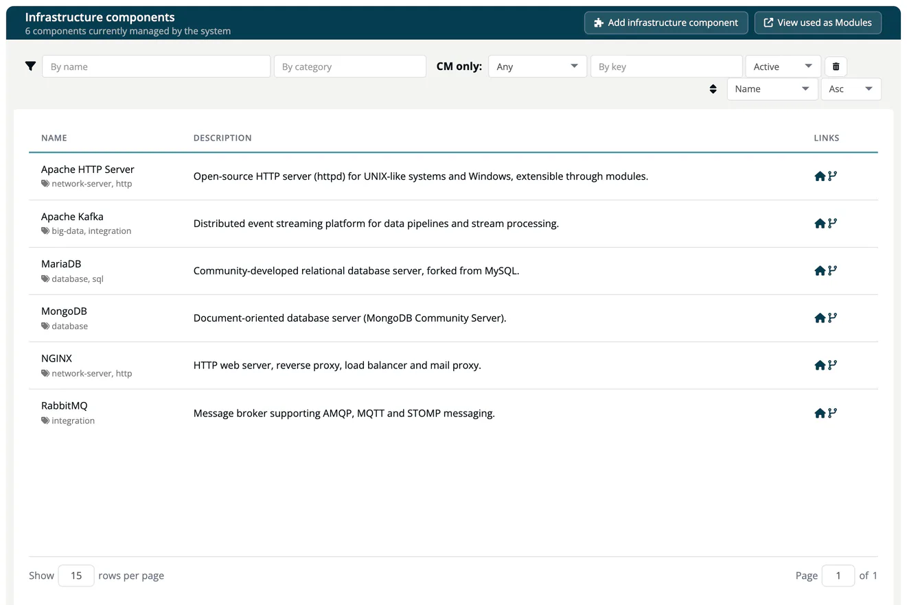

# Infrastructure Elements

The Infrastructure Elements catalog lists the infrastructure components ***TrustSource CE*** knows: operating systems, base images, database servers, web servers, message brokers and similar. You link them to [infrastructure modules](../03-internal/02-modules/03-infrastructure-modules.md). Open it from **Knowledge → Infrastructure Elements**; the page is titled **Infrastructure components**.

## Where the data comes from

On its first start, TrustSource CE fills the catalog with a set of common infrastructure components. Later starts only add entries that are missing; components you edited or soft-deleted are not touched. Users with the **Company component manager** role can add and edit components. The catalog is shared by all companies of the installation.

## Browse the catalog

The header shows how many components are managed. Use the filter bar to narrow the list. Each row shows the component name with its categories, a short description and links to the homepage and repository. A red **B** means that the component is on your company's deny list.

Select a component to open its page: the **Information** panel (key, purl, homepage, repository, language, last update), the **Comment**, the commercial terms if any were recorded, and the **Versions** with licenses, checksums, copyright and reported vulnerabilities. A filter above the versions narrows long lists.

## Maintain the catalog

> [!NOTE]
> **Required role:** Company component manager. Everyone else sees the catalog read-only.

Company component managers see **Add infrastructure component**, **View used as Modules** and an **Edit** button.

To add a component, press **Add infrastructure component**, enter the **Name** (required) and optionally the **Key** (for example `im:mysql`; leave it empty to build it from the name), the **Versions** separated by commas, the **Homepage** and the **Repository**, and press **Create component**.

To change a component, select it and press **Edit**. The page has two tabs, **Info** and **Logs**. On **Info** you maintain:

| Area | Fields |
|---|---|
| **Information** | Key and purl (read-only), **Category**, **Homepage**, **Repository**, **Issues**, **Release notes**, **Provider**, **Provider url**, **Provider address**, **Language**, **Declared licenses**, **Effective licenses**, **Concluded licenses**, **Declared copyright**. Crypto algorithms and AI / ML models are shown read-only. |
| Text panels | **Short description**, **Description**, **Comment**. |
| **Commercial terms** | **Right to re-sell**, **Right to distribute**, **Right to host/operate as SaaS**, **Right to modify**, each *unlimited*, *limited* or *no*. |
| **Versions** | New versions as a comma-separated list with **Create versions**; bulk changes with **Set to selected**. |

Changes are saved as soon as you leave a field or change a selection. To change several versions at once, select them (or use the select-all box), choose licenses, a license text URL and a copyright line, and press **Set to selected**. Changing the version filter clears the selection, so a bulk change only reaches versions you can see. **Logs** lists who changed what, with date, person, version and message.

The header offers **Soft-delete**, which marks the component as removed, and **Revert-delete** to restore it. **Delete** removes it for good after a confirmation. **View used as Modules** on the list shows the modules of type infrastructure that use these components (*Components used as Modules*).

> [!WARNING]
> The catalog is shared by all companies of the installation. A change takes effect for every later analysis of every company that uses the component.

## Related

- [Infrastructure modules](../03-internal/02-modules/03-infrastructure-modules.md)
- [3rd party (COTS)](03-cots.md)
