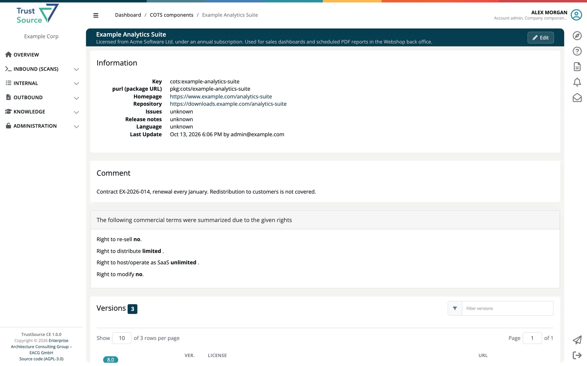

# 3rd party (COTS)

The COTS (Commercial Off-The-Shelf) catalog holds commercial software components: products you license rather than build. Unlike open source components found by scans, they are maintained by hand. Open it from **Knowledge → 3rd party (COTS)**; the page is titled **COTS components**.

The catalog starts empty. Users with the **Company component manager** role add and maintain the entries; the catalog is shared by all companies of the installation.

## Browse the catalog

Filter the list and select a component to open its page. Each row shows the name with its categories, a short description and links to the homepage and repository; a red **B** marks a component on your company's deny list.

The component page shows the **Information** (key, purl, homepage, repository, language, last update), the **Comment**, the **Versions** and the component's commercial terms: **Right to re-sell**, **Right to distribute**, **Right to host/operate as SaaS** and **Right to modify**, each *unlimited*, *limited* or *no*. In this view the terms are read-only.

> [!NOTE]
> Everyone can read the catalog. Company component managers also see **Add COTS component**, **View used as Modules** and an **Edit** button. See [Manage COTS Components](../14-component-manager/02-manage-cots.md).

COTS components are added to projects as modules of the COTS type (**Add/link module → COTS or Infrastructure component** on the project page); see [Create and List Modules](../03-internal/02-modules/01-create-and-list.md). The [COTS overview](../03-internal/04c-impact-and-portfolio-reports.md#cots-overview) report lists the COTS components of a project with their terms.

## Related

- [Infrastructure Elements](02-infrastructure-elements.md)
- [Manage COTS Components](../14-component-manager/02-manage-cots.md)
