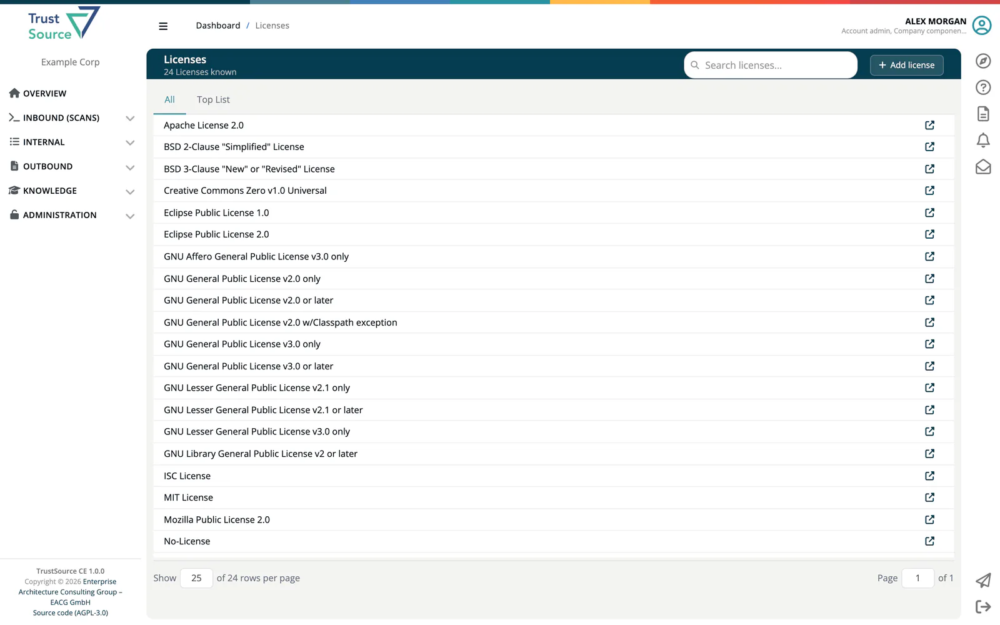

# Licenses

The license catalog lists every license ***TrustSource CE*** knows, with its text where one is stored. Use it to read what a license says, or to find the identifier to use when you assign a license by hand. Open it from **Knowledge → Licenses**.

## What the catalog contains

The catalog holds metadata only: key, name, URL, aliases, a default copyright line and the license text. It carries no legal assessment of the licenses. Whether a license fits a project, and which obligations apply, is evaluated during analysis by the legal check service; see [External Services](../01-installation-setup/04-external-services.md).

On its first start, TrustSource CE fills the catalog with the popular licenses and their texts, and with the three special identifiers `NO-LICENSE` (no explicit license), `PUBLIC-DOMAIN` and `UNKNOWN` (license could not be determined). Use the special identifiers when you assign a license by hand to a component the scan could not match. Later starts only add what is missing; entries you edited are not overwritten.

## Find a license

The header shows how many licenses are known (*N Licenses known*). Type into **Search licenses...** to filter by name; matches are highlighted. Two tabs organise the list:

- **All** lists every license alphabetically, with paging.
- **Top List** lists the licenses most used by the components in this installation's [Component Lake](01-component-lake.md), with their share in percent.

Each row shows the license name and a link to the license homepage. Select a row to open it.

## License details

The detail page is titled with the license name and its identifier in brackets, for example *MIT License [MIT]*. It shows the **License text** with the creation and update dates. **Search in license text...** highlights a phrase in the text.

If the catalog holds no text for the license, the page reads "The text of this license is not stored in TrustSource CE." and links to the license URL when one is known.

## Edit the catalog

> [!NOTE]
> **Required role:** Company component manager.

Company component managers see two extra buttons:

- **Add license** on the list opens a dialog with **License key** (the SPDX identifier where one exists, for example `MIT` or `Apache-2.0`; it cannot be changed later), **Name**, **URL** and **License text**.
- **Edit** on a license opens **Edit license** with these fields:

| Field | Meaning |
|---|---|
| **License key** | Read-only. |
| **Name** | Display name. |
| **URL** | Link to the official text. |
| **Aliases** | One alias per line. License matching also recognises a license by these names. |
| **Copyright** | Used in Notice and SBOM files when a component carries no copyright of its own. |
| **License text** | The full text. |

Click **Save**. **Back** returns to the license page.

> [!WARNING]
> The license catalog is shared by all companies of the installation. A change affects license matching, Notice files and SBOMs of every company. When self sign-up is enabled (`REGISTRATION_ENABLED=true`), every user who signs up gets all roles in their new company, including Company component manager, and can therefore edit the shared catalog. Keep registration off on installations that serve several organisations, or review catalog changes regularly. See [Environment Variables](../01-installation-setup/03-environment-variables.md).

Company-specific licenses that should not go into the shared catalog belong under **Administration → Settings → Private licenses**; see [Settings](../06-administration/02-settings.md).

## Related

- [Open Source Policy](07-open-source-policy.md) - your company's policy document
- [Manual License Resolution](../03-internal/02-modules/06-manual-license-resolution.md) - assigning a license by hand
- [Settings → Legal templates](../06-administration/02-settings.md#legal-templates) - presets for the legal requirements of projects and modules
