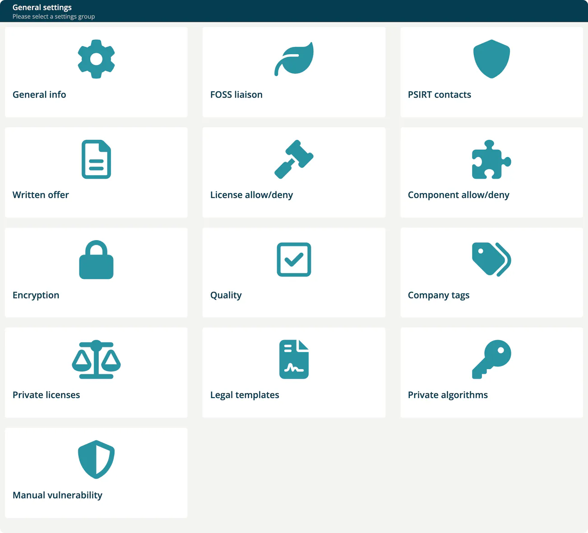
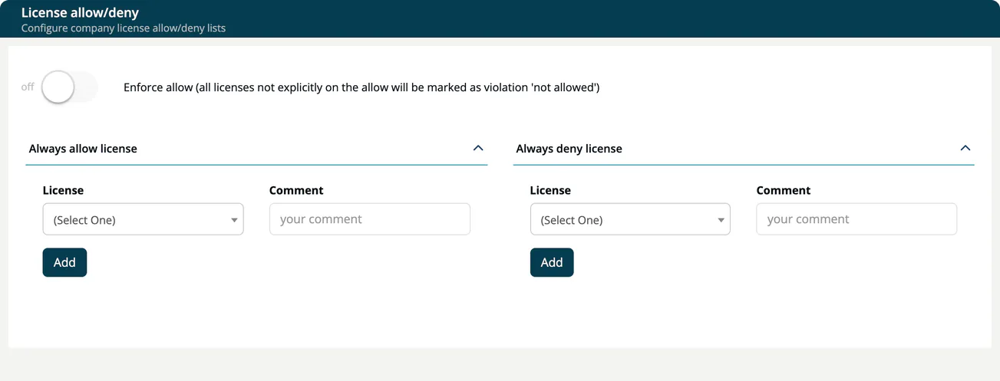
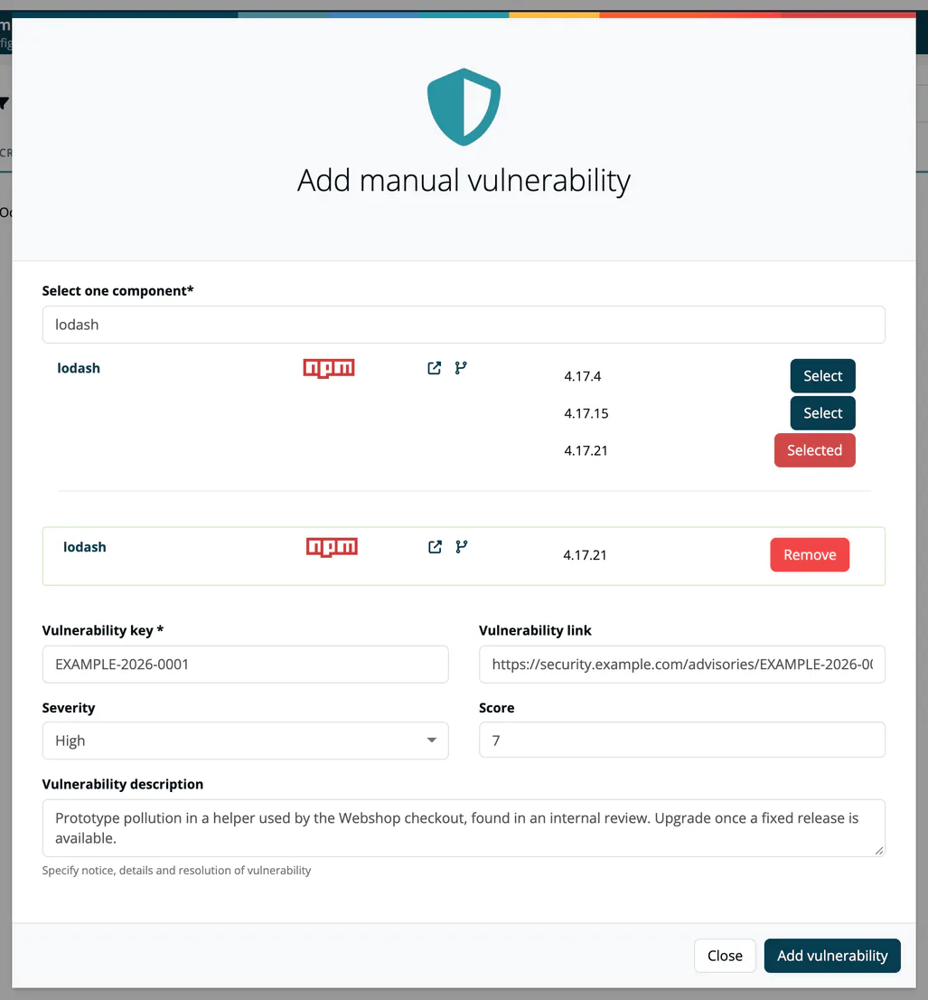

# Settings

> [!NOTE]
> **Required role:** Account admin, Compliance manager, Company security manager, Company component manager, Portfolio manager or Manager
>
> Each card is only visible to the roles that own it. Users without any of these roles do not see **Administration → Settings**.

The **Settings** page ("General settings", "Please select a settings group") is the entry point for company-wide configuration in ***TrustSource CE***. It shows one card per settings group. Account admins see every card; other roles see only the cards that belong to their work.

## Cards

| Card | What it configures | Card shown to | Details |
|---|---|---|---|
| **General info** | Company name, email and logo; distribution email and currency. | Account admin | [Company details](02a-company-details.md) |
| **FOSS liaison** | Contact for open source questions. | Account admin, Compliance manager | [Company details](02a-company-details.md) |
| **PSIRT contacts** | Manufacturer and product security contact data. | Account admin, Company security manager | [Company details](02a-company-details.md) |
| **Written offer** | Text of your GPL/LGPL written offer. | Account admin, Compliance manager | [Company details](02a-company-details.md) |
| **License allow/deny** | Company-wide license allow and deny lists, and the **Enforce allow** switch. | Account admin, Compliance manager | [below](#license-allowdeny) |
| **Component allow/deny** | Company-wide component allow and deny lists. | Account admin, Compliance manager, Company security manager, Company component manager | [below](#component-allowdeny) |
| **Encryption** | Export controls management for cryptographic algorithms. | Account admin, Compliance manager, Company security manager | [below](#encryption) |
| **Quality** | Test tools whose results are required before a release. | Account admin, Compliance manager, Company security manager | [below](#quality) |
| **Company tags** | The tag list for projects and modules. | Account admin, Portfolio manager, Manager, Company security manager, Compliance manager | [Company tags](02b-company-tags.md) |
| **Private licenses** | Your own license keys and the default license for root components. | Account admin, Compliance manager | [below](#private-licenses) |
| **Legal templates** | Reusable legal settings for projects and modules. | Account admin, Compliance manager | [below](#legal-templates) |
| **Private algorithms** | The cryptographic algorithms your company works with. | Account admin, Company security manager | [below](#private-algorithms) |
| **Manual vulnerability** | Vulnerabilities you record yourself for a component version. | Account admin, Company security manager, Company component manager | [below](#manual-vulnerability) |

> [!NOTE]
> Seeing a card does not always mean you can change what is behind it. The **General info**, **FOSS liaison**, **PSIRT contacts** and **Written offer** forms are only shown to Account admins. Other restrictions are listed in the sections below.

## License allow/deny

Company-wide license lists that apply to every project and module.

- **Always allow license** and **Always deny license**: choose a **License**, add a comment and save. Select a table row to edit or remove an entry.
- **Enforce allow (all licenses not explicitly on the allow will be marked as violation 'not allowed')**: when on, every license that is not on an allow list counts as a violation. Changing the switch asks for confirmation and then re-analyses all modules of the company.

Entries made here appear in project and module lists with the label **in Company**. Lists on project and module level are described in [Allow/Deny (Project)](../03-internal/01-projects/settings/07-whitelists-blacklists.md).

> [!NOTE]
> The **Enforce allow** switch is only enabled for Compliance managers, and the server accepts the change only from an Account admin or Manager. In practice, the person who switches it needs the Compliance manager role together with Account admin or Manager.

## Component allow/deny

Company-wide component lists: **Always allow component** and **Always deny component**.

| Field | Description |
|---|---|
| **Key** | The component key, for example `mvn:groupId:artifact`. A `*` wildcard is allowed as the last character of each `:`-separated part, for example `mvn:my.groupId:*` or `*:mycompany:*`. |
| **Version** | The version, for example `1.0.*`. Only one `*` is allowed, as the last character. Use `*` for all versions. |
| **Comment** | Why the component is on the list. |

Allowed components are left out of the result evaluation; denied components always fail it. The **?** icon next to each list title shows these rules in the app.

## Encryption

**Export controls management** records, per algorithm, the countries for which import and export are **Strict**, **Weak** or **Irrelevant**.

1. Choose the algorithm in the first column. The list offers only the algorithms defined under [Private algorithms](#private-algorithms), so add them there first.
2. Select the countries in the **Import** and **Export** columns.
3. Select **Create**.

The trash button removes a row. Rows defined here show **in Company** on project and module level. See [Crypto management (Project)](../03-internal/01-projects/settings/05-encryption.md).

## Quality

**Define test requirements** lists the test tools whose results must be available before a release may be requested. Results are uploaded as SARIF, see [SW Quality Scans](../02-inbound/04-sw-quality-scans.md).

1. Choose the **Tool**.
2. Select **Add**.

The trash button removes a tool. Tools added here show **in Company** on project and module level. See [Quality (Project)](../03-internal/01-projects/settings/04-quality.md).

## Private licenses

Licenses your organisation created itself. Components with such a license key are not evaluated by the legal check and get a green legal status.

> [!WARNING]
> A private license does not check what your package actually contains. If you are unsure about its contents, assess it separately.

- **Create private license** opens a dialog with **Name** (required) and **Description**.
- **Usage stats** shows, per private license, in how many analyses it occurs.
- Each row has a copy button for the key and **Delete**.
- **Default Root-Component License**: choose a private license under **Default license**. It is applied to the root component of newly scanned modules that have no license yet. Users can override it per module. Choose **- none -** to clear it.

> [!NOTE]
> **Create private license** and **Usage stats** are only shown to Compliance managers. Account admins can view and delete entries.

## Legal templates

Legal templates are presets for the **legal requirements** of a project or module: how it is sold, operated and distributed, and what intellectual-property protection it needs. They belong to your company. The **Legal templates** card opens **Company legal settings templates**. When you set up the legal settings of a project or module, **Import settings from Template** copies a template's answers; see [Project Settings → Legal](../03-internal/01-projects/settings/02-legal.md) and [Module Settings → Legal](../03-internal/02-modules/settings/02-legal.md).

The list shows each template's **order**, **Type** (*project* or *module*) and **Name**. Select a row to open it; **Remove** deletes a template after a confirmation. To add one, press **Create template**, enter a **Name**, choose the **Type** (*Project* or *Module*) and optionally an **Order**, then press **Create Rule**.

On a template, change name and order under **Update template information** and press **Update template**. Below, set the requirements with **Start wizard** (a questionnaire, **Legal settings wizard**, that ends with **Finish**) or **View all** (all questions in one form), and press **Update legal requirements** to save. For a **Project** template the questions cover the *Commercial Aspects* (if unsure, choose *usage fee*, the most restrictive), the *Operating Model* (if unsure, choose the *embedded model*) and *Intellectual Property Aspects* (inbound protection against contributor claims and outbound protection when you defend your rights). For a **Module** template they cover *Trade Secret Aspects*, the *Licensing Strategy* and the *Distribution of the module*.

Creating, changing and removing templates is written to the company's audit log.

> [!NOTE]
> The card is shown to Account admins and Compliance managers. Only Account admins can create, change and remove templates.

## Private algorithms

The list of cryptographic algorithms your company uses. TrustSource CE ships no algorithm catalog, so the algorithm pickers in [Encryption](#encryption) and in [Crypto algorithms](05-policies.md#crypto-algorithms) offer only what you add here.

1. Enter a **Name** and a numeric **Strength**, for example `256`.
2. Select **Create New**.

Each row shows the algorithm with its strength, a copy button and **Delete**.

> [!NOTE]
> The card is shown to Account admins and Company security managers, but the list and the form are only displayed to Account admins, Managers and Compliance managers. A Company security manager without one of these roles sees an empty page.

## Manual vulnerability

**Company manual vulnerabilities** records vulnerabilities that are not in public feeds, for a specific component version. They are shown together with the component's other vulnerabilities.

1. Select **Add vuln.**.
2. Under **Select one component** (required), search the component and select the version.
3. Enter the **Vulnerability key** (required), and optionally **Vulnerability link**, **Severity** (Critical, High, Moderate, Low), **Score** (1 to 10) and **Vulnerability description**.
4. Select **Add vulnerability**.

The table shows **Created**, **Severity**, **Component**, **Key**, **Description** and **Creator**. **Remove** deletes an entry.

> [!NOTE]
> The card is shown to Account admins, Company security managers and Company component managers. Adding and removing entries is accepted from Account admins, Compliance managers and Managers.

## Related

- [Project Settings](../03-internal/01-projects/settings/index.md): settings for one project
- [Module Settings](../03-internal/02-modules/settings/index.md): settings for one module
- [Policies](05-policies.md): open source policy, crypto algorithms and end-of-life
- [Settings Permission Matrix](../10-roles-permissions/06-settings-permission-matrix.md)
