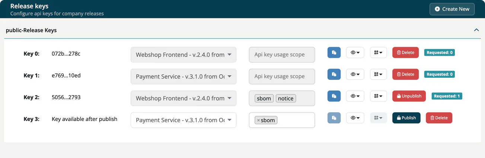

# Release keys

> [!NOTE]
> **Required role:** Account admin, Manager or Compliance manager. The **API keys** menu entry is shown to Account admins only; Managers and Compliance managers open the page at `/settings/company/api/releases`.

A **release key** lets someone fetch the documents of one approved release of ***TrustSource CE*** without a login or API key. Use it to ship the key with your product, for example as a QR code on a device or in a customer portal.

Anyone who holds the key can read what it serves. Treat it like a password. Because the key is part of the URL, it also appears in the app log and in reverse proxy access logs; restrict who can read them. See [Public routes](../09-rest-api/05-public-routes.md).

## Before you start

You need at least one **approved release**. Without one, **Create New** stays disabled and the page shows "No approved releases available to start publish". See [Approve / Reject](../03-internal/06-approvals/03-approve-reject-workflow.md).

## Which documents a key serves

A release key serves the documents of its release under `https://<your-host>/api/v2/compliance/releases/<release_key>/...`:

| Scope | Route | Content |
|---|---|---|
| `sbom` | `/sbom` | The SBOM of the release, with a signature. |
| `notice` | `/notice` | The notice file, with a signature. |
| `csaf` | `/csaf`, `/csaf-changes` | The CSAF VEX document of the release, and the changes since the release. |

The scope decides which of these routes answer. A key without a scope serves all of them. A route outside the scope, or an unpublished key, answers with `404`.

The signatures are HMAC integrity checks made with `TS_ENCRYPTION_KEY`. Only the installation that issued them can check them, under **Outbound → Verify**, which needs a login. Recipients cannot verify them on their own; they are not public signatures. See [Verify](../04-outbound/05-verify.md).

## Create and publish a key

1. Open **Administration → API keys** and select the **Release keys** card.
2. Select **Create New**. A new unpublished row appears.
3. Choose the **release** in the first drop-down. Each entry shows the name, version and approval date.
4. Choose the **scope**: any of `sbom`, `notice`, `csaf`.
5. Select **Publish**.

While a key is published, its release and scope are locked. To change them, unpublish the key first.

## Preview, URL and QR code

- The eye button opens a preview of the **SBOM**, the **Notice** or the **CSAF** document.
- The QR button, available for a published key, shows the URL and a QR code for the SBOM, the notice or the CSAF document. The URL is built from `ROOT_URL`, so it must be the public address of your installation.
- The green badge **Requested** counts how often the key was used.

## Unpublish and delete

The red button depends on usage. A key that was requested at least once shows **Unpublish**; a key that was never requested shows **Delete**. A deleted key cannot be restored. An unpublished key can be published again.

> [!TIP]
> When a relationship with a customer or partner ends, or a key may have leaked, rotate it: create a new key for the same release, hand it to the recipients who should keep access, then unpublish the old one.

## Keys created by releasing an approval

When the documents of an approval are released, TrustSource CE creates a published release key without a scope for that approval, so all four routes answer. You find it in this list like any other key.

## Related

- [Public routes](../09-rest-api/05-public-routes.md)
- [Compliance releases endpoints](../09-rest-api/endpoints/compliance-releases.md)
- [Releases](../03-internal/07-releases.md)
- [API keys](04-api-keys.md)
