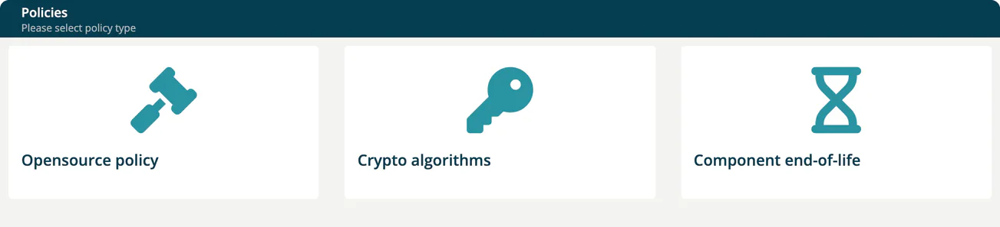

# Policies

> [!NOTE]
> **Required role:** Account admin, Company security manager or Compliance manager. The **Opensource policy** list is limited to Compliance managers.

**Administration → Policies** collects the company-wide rules that projects and modules of ***TrustSource CE*** are measured against. The page ("Please select policy type") shows three cards.

| Card | What it holds |
|---|---|
| **Opensource policy** | The policy documents your company publishes to its users. |
| **Crypto algorithms** | Algorithms your company denies. |
| **Component end-of-life** | The company default for end-of-life monitoring. |

## Opensource policy

Compliance managers upload the policy document here. Users then see the active policy under **Knowledge → Open source policy**. See [Open Source Policy](../05-knowledge/07-open-source-policy.md).

1. Select **Upload new policy**.
2. Enter the **Policy name** with its version.
3. Choose the **Document** (PDF or PPTX, up to 20 MB).
4. Under **Notify users**, choose the roles that must be informed about the policy.
5. Add a **Summary of changes** and select **Create Policy**.

The list shows **Active**, **Active from**, **Created**, **Updated**, **Policy name**, **Document**, **Notify**, **Presented**, **Viewed** and **Confirmed**, so you can follow who has read and confirmed the policy.

## Crypto algorithms

"Configure crypto algorithms denied for your company". Each row shows **Created**, **Key**, **Strength**, **Comment** and **Added by**.

1. Select **Deny algorithm**.
2. Choose the **Name**. The list offers the algorithms defined under [Private algorithms](02-settings.md#private-algorithms), so add them there first.
3. Enter the **Strength (numeric value like 256 or 1024)** and an optional **Comment**.
4. Select **Add**.

The trash button in a row removes the entry.

## Component end-of-life

Switch **Enable end-of-life analysis for all modules** on to monitor end-of-life dates company-wide. A confirmation asks you to approve the change, because it affects all future analyses.

While it is on, two sliders under **End-of-life thresholds** set the thresholds in months, from 0 to 24 (the sliders show values such as `12m`). Select **Update** to save them.

| Slider | Meaning |
|---|---|
| **Warning threshold** | The threshold in months at which an end-of-life component is reported as a warning. |
| **Violation threshold** | The threshold in months at which an end-of-life component is reported as a violation. |

The value `0` shows "no monitoring". The violation threshold may not be larger than the warning threshold. Projects and modules can set their own values; see [End-of-life (Project)](../03-internal/01-projects/settings/06-end-of-life.md).

> [!NOTE]
> Saving the end-of-life policy is accepted from Account admins, Managers and Compliance managers. A Company security manager can open the page but cannot save changes without one of these roles.

## Related

- [Settings](02-settings.md)
- [Open Source Policy](../05-knowledge/07-open-source-policy.md)
- [Crypto management (Project)](../03-internal/01-projects/settings/05-encryption.md)
