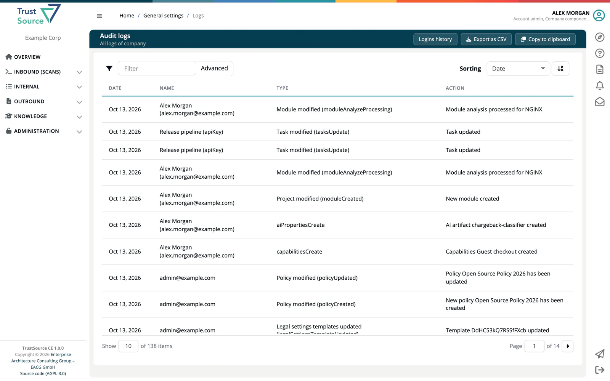

# Audit Logs

> [!NOTE]
> **Required role:** Account admin

The **Audit logs** page ("All logs of company") is your company's audit trail in ***TrustSource CE***: who did what and when. It lists the recorded actions of all users and API keys, newest first.

Open **Administration → Audit logs**, or select **View all logs** on the dashboard's activity panel.

## Read the table

| Column | Meaning |
|---|---|
| **Date** | When the action happened. |
| **Name** | The user, the name of the API key, or *unknown* if the actor no longer exists. |
| **Type** | A group label followed by the event key, for example *Risk modified (riskPropertiesUpdate)*. |
| **Action** | A sentence describing the change. |

## Find an entry

- Type in the **Filter** box to search the user name, the event label and the message at once.
- Select **Advanced** to combine filters: **User name**, **Event**, **Message** and **Event type**. Event type is a list of all event keys, which is the most exact way to narrow down.

## Export

- **Export as CSV** downloads the entries that match the current filter and sorting as `export_logs_<date>_<user>.csv`, with the columns Date, Name, Type and Action, separated by semicolons.
- **Copy to clipboard** copies the same table.

## What is logged

The Type column groups events by label. Examples:

| Group | Examples |
|---|---|
| **Scan added**, **Scan processed**, **Scan deleted** | Dependency scans and their processing. |
| **Project modified**, **Module modified**, **Project deleted** | Create, delete and settings changes. |
| **Approval created**, **Project approval**, **Module approval** | The approval workflow. |
| **User modified**, **User removed**, **User imported**, **Account modified** | Invitations, role changes, removals, CSV imports and company settings. |
| **Policy modified**, **Allow/deny-list modified**, **License modified** | Policies and lists. |
| **Private licenses modified**, **Private algorithms modified**, **Tags modified**, **Manual vulnerability modified** | Company settings cards. |
| **Integration modified**, **Webhook created**, **Webhook removed** | Integration settings. |
| **API activity recorded** | API key and release key activity, such as creating, publishing or copying a key. |
| **CSAF created**, **CSAF updated**, **CSAF published** | CSAF documents. |
| **Risk modified**, **Task modified** | Risks and their tasks. |

## Logins

Sign-ins are not part of this table. Select **Logins history** at the top right to open the [Login History](09-login-history.md).

## Related

- [Login History](09-login-history.md): sign-ins and users who have not logged in
- [User Management](03-user-management.md)
