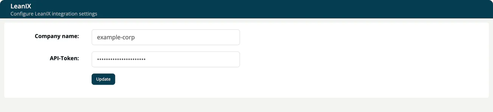

# LeanIX and SCANOSS

> [!NOTE]
> **Required role:** Account admin

## LeanIX

Link your projects and modules with the applications in your LeanIX workspace. Select the **LeanIX** tile on **Administration → Integrations** in ***TrustSource CE***.

| Field | Description |
|---|---|
| **Company name** | The name of your LeanIX workspace. |
| **API-Token** | The LeanIX API token. It is hidden while you type and never shown again. Leave empty to keep the stored value. |

Select **Update** to save. Afterwards, the **General** settings of a project or module offer the LeanIX link. Without the integration, that field shows a link to these settings instead.

## SCANOSS

The **SCANOSS** tile ("Configure SCANOSS integration settings") stores an **Access Token** and an **Active** switch. The token is kept encrypted and is never shown again; leave the field empty to keep the stored value.

> [!NOTE]
> In TrustSource CE nothing uses these settings. No scan, analysis or other function calls SCANOSS, so saving a token has no effect. Repository scans, which use SCANOSS in the hosted TrustSource service, are not part of CE. See [CE and SaaS compared](../13-ce-vs-saas.md).

## Related

- [Integrations](08-integrations.md)
- [Project General settings](../03-internal/01-projects/settings/01-general.md)
