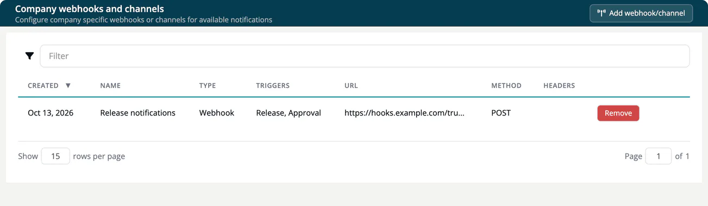

# Webhooks and channels

> [!NOTE]
> **Required role:** Account admin, Manager or Compliance manager. Only these roles can see and create webhooks, because URLs and header values can act as credentials. The **Integrations** page itself is shown to Account admins; Managers and Compliance managers use a project's **Webhooks and Channels** tab, or open the company page at `/settings/company/webhooks`.

A **webhook** or **channel** sends a message to another system when something happens in ***TrustSource CE***: a Slack channel, a Microsoft Teams channel or any HTTP endpoint such as your ticketing or chat bridge.

There are two places to manage them:

- **Company-wide:** **Administration → Integrations → Webhooks and Channels** ("Company webhooks and channels"). Receivers created here apply to every project in your company.
- **Per project:** the **Webhooks and Channels** tab in the project settings. Receivers created there apply to that project only. See [Webhooks and Channels (Project)](../03-internal/01-projects/settings/13-webhooks-channels.md).

## Add a webhook or channel

1. Select **Add webhook/channel**.
2. Enter a **Name**, for example "Security channel".
3. Select one or more **Trigger** values.
4. Choose the **Type** and fill in the fields below it.
5. Select **Add webhook**.

### Types

| Type | Fields | Notes |
|---|---|---|
| **Webhook** | **Method** (POST, PUT, PATCH, DELETE, GET), **Url**, optional **Headers** | Enter headers as `Key: value` pairs separated by `;`, for example `Authorization: Bearer abc123; X-Team: security`. Deliveries are not signed, so use a secret header like this one, or a secret URL path, to let the receiver reject requests that do not come from TrustSource CE. |
| **Microsoft Teams Workflow** | **"Workflow" url** of a "Post to a channel when a webhook request is received" workflow | |
| **Slack** | **"Incoming Webhook" url** from your Slack app | |
| **Microsoft Teams O365 (Deprecated - October 1st, 2024)** | **"Incoming Webhook" url** of a Teams connector | Use the workflow type instead. |
| **Gitter (Under development)** | | Cannot be selected. |

### Triggers

| Trigger | Sends a message when |
|---|---|
| **Analysis** | A module analysis has finished. |
| **Release** | The documents of an approval are released. |
| **Vulnerability** | New vulnerabilities match a component: one message per component. |
| **Vulnerabilities by module** | New vulnerabilities match: one message per module. |
| **Vulnerabilities by project** | New vulnerabilities match: one message per project. |
| **Vulnerabilities in releases** | New vulnerabilities match the frozen components of a release: one message per release. |
| **Approval** | An approval is approved or rejected. |
| **Task** | An issue is created in Jira, TFS or GitHub. |

You can select several triggers per receiver. Choosing two vulnerability triggers delivers the same findings twice, at two levels of detail.

## Vulnerability alerts

The four vulnerability triggers turn a receiver into an alert channel for newly matched vulnerabilities. The trigger you choose is the whole configuration. A receiver on the company page watches all projects; a receiver on a project's tab watches that project.

- TrustSource CE checks for new matches in a background sweep: the first run starts 5 minutes after the server starts, then every 60 minutes. Operators can change or switch off the sweep with the settings `TS_VULN_ALERT_SWEEP` and `TS_VULN_ALERT_INTERVAL_MIN`, which the reference Docker Compose file does not pass through, so they need a compose override. See [Environment variables](../01-installation-setup/03-environment-variables.md).
- Vulnerability data comes from OSV during module analysis. With `TS_OSV_ENABLED=false`, no new vulnerabilities are found and no alerts are sent.
- Only new matches are sent. Existing findings are not replayed when you add a receiver.

> [!WARNING]
> Review your receivers before you turn alerts on. A day with many new vulnerabilities can produce one large message, and some receivers reject messages above a size limit.

## The list and removal

The list shows **Created**, **Name**, **Type**, **Triggers**, **URL**, **Method** and the number of **Headers**. Select **Remove** in a row to delete a receiver.

> [!WARNING]
> Webhook URLs must be public. A URL with a private, loopback, link-local or CGNAT address is refused on save with "Invalid integration URL", and each delivery is refused if the host name resolves to such an address. Deliveries run in the background; a failed delivery never fails the action that triggered it.
>
> TrustSource CE does not sign webhook deliveries. Treat the URL and the headers of a receiver as credentials: anyone who knows them can send messages that look like they come from TrustSource CE. Make the receiver require a secret header or a secret URL path, and use `https://` targets only, so the secret is not sent in clear text.

## Related

- [Integrations](08-integrations.md)
- [Post-release vulnerabilities](../03-internal/06-approvals/06-post-release-vulnerabilities.md)
