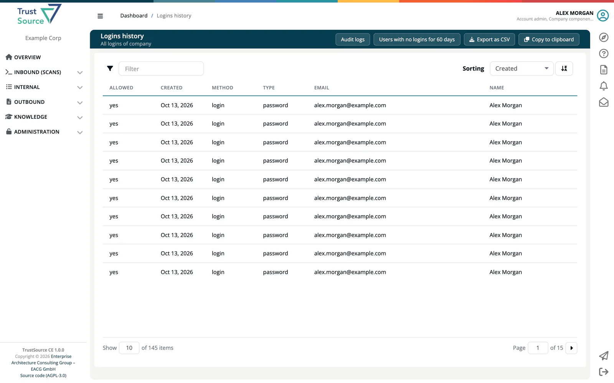

# Login History

> [!NOTE]
> **Required role:** Account admin, Manager or Compliance manager

The **Logins history** page ("All logins of company") lists the sign-in attempts of your company in ***TrustSource CE***. Use it for security audits and to investigate a login problem.

## How to open it

Select **Logins history** at the top right of the [Audit Logs](07-audit-logs.md) page (**Administration → Audit logs**). The page has no menu entry of its own, and the Audit logs page needs the Account admin role; Managers and Compliance managers open the Logins history at `/settings/company/loginsHistory`.

## The table

| Column | Meaning |
|---|---|
| **Allowed** | *yes* if the login succeeded, *no* if it was refused. |
| **Created** | Date and time. |
| **Method** | The sign-in method used. |
| **Type** | The kind of login. |
| **Email** | The account's email address. |
| **Name** | The user's name. |

Use the **Filter** box to search by method, type, email and name. Newest entries come first.

## Buttons

- **Audit logs**: back to the audit trail.
- **Users with no logins for 60 days**: lists the users who have not signed in during the last 60 days, a quick way to find accounts you may want to remove. **All logins history** returns to the full table.
- **Export as CSV** and **Copy to clipboard**: take the table with you, separated by semicolons.

## Related

- [User Management](03-user-management.md): manage members and their roles
- [Audit Logs](07-audit-logs.md): the company-wide activity trail
- [REST API: Users](../09-rest-api/endpoints/users.md): `GET /core/users/nologin` returns users without logins
