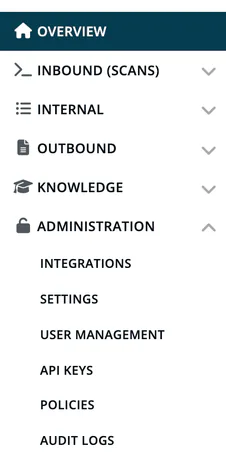

# Administration

Company-wide settings and management in ***TrustSource CE***. Open them from **Administration** in the left navigation. The entries you see depend on your roles: most pages are for the Account admin, while **Settings** and **Policies** are also shown to other roles for the cards that belong to their work.

| Page | What it covers | Menu entry shown to |
|---|---|---|
| [Integrations](08-integrations.md) | Github, Jira, TFS, SCANOSS, webhooks and channels, LeanIX. | Account admin |
| [Settings](02-settings.md) | Company settings cards: general info, FOSS liaison, PSIRT contacts, written offer, allow/deny lists, encryption, quality, tags, private licenses, legal templates, private algorithms, manual vulnerabilities. | Account admin, Compliance manager, Company security manager, Company component manager, Portfolio manager, Manager (cards depend on role) |
| [User Management](03-user-management.md) | Invite, import, assign roles, remove users. | Account admin |
| [API keys](04-api-keys.md) | API keys, release keys and CSAF feed keys. | Account admin |
| [Policies](05-policies.md) | Opensource policy, crypto algorithms, component end-of-life. | Account admin, Company security manager, Compliance manager |
| [Audit logs](07-audit-logs.md) | Company-wide audit trail. | Account admin |
| [Login History](09-login-history.md) | Sign-in attempts and users without logins, opened from the Audit logs page. | No menu entry (Account admin, Manager, Compliance manager) |

More detail pages:

- [Company details](02a-company-details.md): General info, FOSS liaison, PSIRT contacts, Written offer
- [Company tags](02b-company-tags.md): add, import, remove and re-activate tags
- [Release keys](04b-release-keys.md) and [CSAF feed keys](04c-csaf-feed-keys.md)
- [Issue trackers](08a-issue-trackers.md), [LeanIX and SCANOSS](08b-leanix-scanoss.md), [Webhooks and channels](08c-webhooks-channels.md)

> [!NOTE]
> TrustSource CE has no billing, account types, enterprise companies, identity provider integration (SSO) or API usage statistics. Every feature is available and gated by role only. See [CE and SaaS compared](../13-ce-vs-saas.md).

## Related

- [Roles & Permissions](../10-roles-permissions/index.md)
- [Functions by Area](../10-roles-permissions/04-functions-by-area.md)
