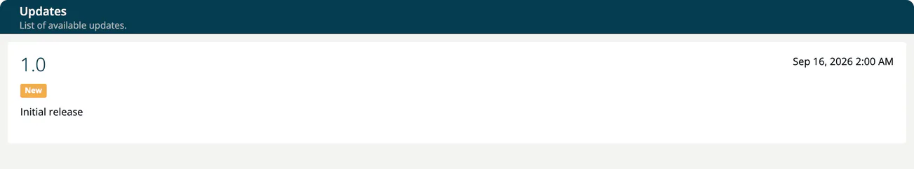

# Updates

The **Updates** page ("List of available updates.") shows the release notes that ship with your ***TrustSource CE*** installation. Open it with the bell icon **Updates** in the right bar. A dot on the icon ("Unread updates available") marks release notes you have not opened yet.

Each entry shows the version, the release date and its items, grouped under **New**, **Improvement** and **Fix**. An item can link to more information with **View details**. Opening the page marks the entries as read for you.

## Where the entries come from

The release notes are part of the application. When the server starts, it adds the notes of its own version and of every earlier version that are missing in the database. Existing entries are never changed. The first release is **1.0** ("Initial release"). See [Release notes](../12-release-notes/index.md).

The page does not fetch news from the internet, so it only shows new entries after you have installed a newer version. See [Upgrade](../01-installation-setup/08-upgrade.md).

## Version check

At every start, the server sends one request to GitHub (`raw.githubusercontent.com`, the README of the TrustSource CE repository) with an anonymous installation id, to look for a newer version. The result is only written to the server log (`=> Version check: ...`, or `=> Version check was unsuccessful` when the request fails); nothing is shown in the app. The check cannot be switched off by a setting, and a failed check does no harm. See [External services](../01-installation-setup/04-external-services.md).
