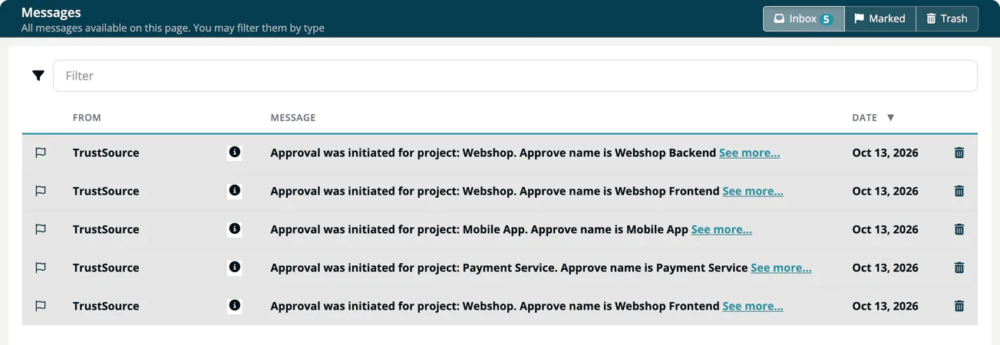

# Messages

The **Messages** page collects the notifications ***TrustSource CE*** sends to you, for example about analyses, approvals, allow-list decisions and new vulnerabilities. Open it with the envelope icon **Messages** in the right bar. An open envelope ("Unread messages available") means you have unread messages.

## Folders

| Folder | What it holds |
|---|---|
| **Inbox** | New messages and marked messages. |
| **Marked** | Messages you flagged. |
| **Trash** | Messages you moved to the trash. |

A badge on a folder button shows its number of unread messages.

## Work with messages

- Select a row to mark the message as read. Unread messages are highlighted.
- The flag icon moves a message to **Marked**, or back to the inbox.
- The trash icon moves a message to **Trash**; in the trash, the undo icon moves it back to the inbox.
- In **Trash**, **Empty Trash now** deletes all messages in it.
- **See more...** next to a message opens the related module, project, approval or report.

The table shows **From**, a type icon, **Message** and **Date**. Use the **Filter** box to search.

## Filter by type

The second button group filters the folder by message type. Only types that occur in your messages are shown: Events, Approvals, Change component status, Reset component status, New vulnerability introduced, Component comment, Alarms and News.

## Which messages you get

What reaches your inbox, and whether a copy is also sent by email, depends on your **Communication preferences** in the [profile](03-profile.md#communication-preferences). Emails need a working SMTP server on your installation.
