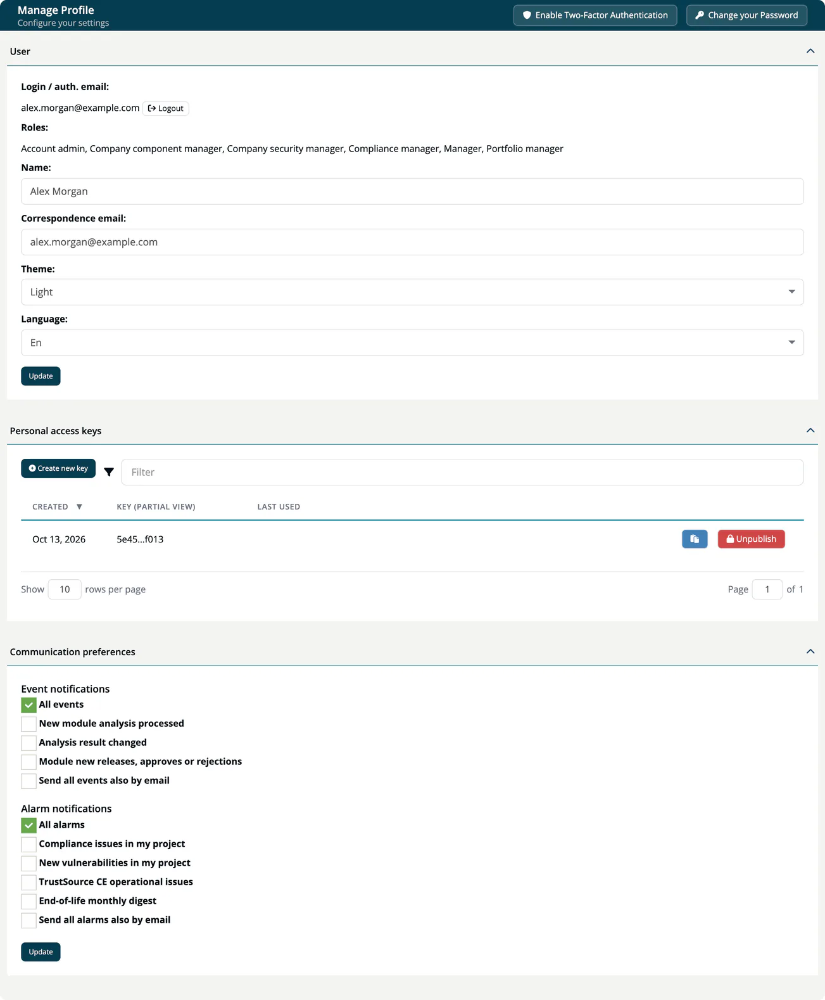

# Your Profile

The **Manage Profile** page ("Configure your settings") holds your personal settings in ***TrustSource CE***. Open it by selecting your name and roles in the header.

The page header has two buttons: **Enable Two-Factor Authentication** (or **Disable Two-Factor Authentication**) and **Change your Password**.

## Two-factor authentication

Two-factor authentication (2FA) adds a time-based code from an authenticator app to your sign-in.

**Enable it:**

1. Select **Enable Two-Factor Authentication**. The dialog **Two-Factor Authentication** opens.
2. Scan the QR code with your authenticator app ("Scan this QR code with your authenticator app"), or type the key shown under "Or enter this key manually".
3. Enter the 6-digit code from the app under **Authentication Code**.
4. Select **Verify & Enable**.

While 2FA is on, the header shows a green **2FA** label, and every sign-in asks for a code after the password.

**Disable it:** select **Disable Two-Factor Authentication** and confirm with **Yes, disable it**.

> [!NOTE]
> Keep a way to recover access. TrustSource CE has no admin action to reset another user's 2FA, so an Account admin cannot reset it for you if you lose the authenticator app. Ask your operator for help.

## Change your password

Select **Change your Password**, enter the **Old Password**, the **New Password** and **Repeat new Password**, then select **Change password**. A new password must be at least 12 characters long and contain a capital letter, a special character and a number.

To reset a forgotten password, use **I forgot my password** on the sign-in page. See [First login](../00-getting-started/03-first-login.md).

## User

| Field | Description |
|---|---|
| **Login / auth. email** | The address you sign in with. It cannot be changed here. **Logout** signs you out. |
| **Roles** | Your roles in the current company. Only an Account admin can change them. |
| **Name** | Your display name. |
| **Correspondence email** | The address notifications are sent to. |
| **Theme** | **Light** or **Dark**. |
| **Language** | The interface language. TrustSource CE offers **En** only. |

Select **Update** to save.

## Personal access keys

Personal access keys let you call the [REST API](../09-rest-api/index.md) with your own permissions, for example from a script on your machine.

1. Select **Create new key**. The key is created unpublished.
2. Select **Publish** in its row to activate it.
3. Use the clipboard button to copy the full key. It is only available while the key is published.

| Column | Meaning |
|---|---|
| **Created** | When the key was created. |
| **Key (partial view)** | A masked form of the key, or "Key available after publish". |
| **Last used** | The day of the last request with this key. |

- The key takes your roles in the current company at creation time as its scope. You cannot choose or change the scope. If your roles change later, or you leave the company, the key keeps its original scope and keeps working until it is unpublished or deleted. Unpublish keys you no longer need.
- **Unpublish** switches the key off; **Publish** switches it on again. The profile has no delete; an Account admin can delete the key under **Administration → API keys**.

See [API keys](../06-administration/04-api-keys.md#personal-access-keys).

## Communication preferences

Choose which notifications you receive in [Messages](02-inbox-messages.md) and whether they are also sent by email. Select **Update** to save.

**Event notifications**

- All events
- New module analysis processed
- Analysis result changed
- Module new releases, approves or rejections
- Send all events also by email

**Alarm notifications**

- All alarms
- Compliance issues in my project
- New vulnerabilities in my project
- TrustSource CE operational issues
- End-of-life monthly digest
- Send all alarms also by email

Emails need a working SMTP server on your installation. See [External services](../01-installation-setup/04-external-services.md).
