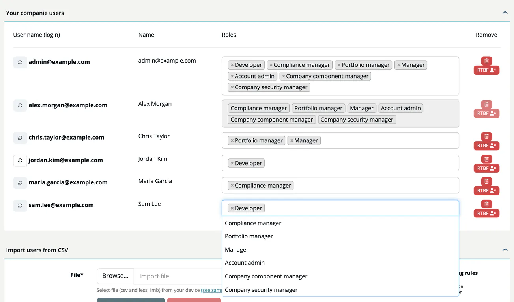

# The 7 Roles

***TrustSource CE*** knows seven roles. Account admins assign them per company, and a user can hold several at once; the rights add up.

| Role | Key | Focus |
|---|---|---|
| **Developer** | `developer` | Works with scans and modules. Edits module settings such as name, tags, thresholds, allow/deny lists, CIA and crypto management, and maintains products. |
| **Compliance manager** | `compliance_manager` | Owns the compliance workflow: approvals, the company license lists and their enforcement, approval of allow-list entries, outbound documents, private licenses, legal templates and the open source policy. |
| **Portfolio manager** | `portfolio_manager` | Organises the portfolio: assigns the default project manager and default compliance manager, maintains module tags and capabilities, and sees the company portfolio view on the dashboard. |
| **Manager** | `manager` | Leads projects: creates projects, starts and decides approvals, maintains tags and webhooks, and has broad rights on the projects and modules they manage. |
| **Account admin** | `account_admin` | Administers the company: users, integrations, API keys, company settings, policies and audit logs. |
| **Company component manager** | `company_component_manager` | Maintains company-wide component knowledge: infrastructure elements, COTS, critical components, license entries and component allow/deny lists. |
| **Company security manager** | `company_security_manager` | Maintains security settings: CIA and capabilities, PSIRT contacts, encryption, crypto policies and CSAF documents. |

For what each role sees and can change, see [Functions by Role](05-functions-by-role.md) and [Functions by Area](04-functions-by-area.md).

## Assigning roles

- **Who:** Account admins use **Administration → User Management**. They change roles in the user list or set them in a CSV import. See [User Management](../06-administration/03-user-management.md).
- **Invited users** start with the role Developer.
- **At least one role.** A user must keep one role; remove the user instead of clearing all roles.
- **Your own roles** cannot be changed in the list.
- **Per company.** Roles belong to one company. A user who is a member of several companies on the same installation can hold different roles in each and switches the company in the sidebar header.
- **The initial admin** created at installation, and every user who registers a new company when self sign-up is enabled, receives all seven roles in that company.

> [!WARNING]
> Holding every role gives a user all privileges. The app warns when you tick all roles for a user, and such a user sees "ATTENTION! You are using all roles. This is not intended for production use." in the header. Compliance duties are meant to be shared between people; give the initial admin's daily work to accounts with fewer roles.

## Related

- [Permission Model](03-permission-model.md)
- [Roles cheat sheet](../00-getting-started/06-roles-cheatsheet.md)
