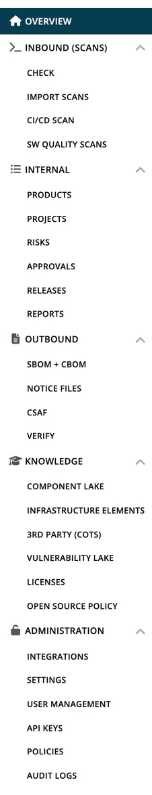

# Functions by Area

Which role sees which part of ***TrustSource CE***, grouped by the sections of the left navigation. The tables list menu visibility and page access. For field-level rights inside project and module settings, see the [Settings Permission Matrix](06-settings-permission-matrix.md).

## How access works

- **Section first.** A menu entry only appears when its section is visible to you, and then when your role matches the entry. For example, **Projects** also names Account admin, but the **Internal** section it sits in is shown to Developers, Compliance managers and Managers only, so a user who is only Account admin does not see it.
- **OR-combination.** If any of your roles grants access, you have it. See [Permission Model](03-permission-model.md).
- **Direct links.** Several pages also check your role when you open their address and show "access denied" otherwise. They are listed at the end of this page.

Role abbreviations: **Dev** Developer, **CM** Compliance manager, **PM** Portfolio manager, **Mgr** Manager, **AA** Account admin, **CCM** Company component manager, **CSM** Company security manager.

## Overview and Knowledge

Visible to every signed-in user.

| Entry | Notes |
|---|---|
| **Dashboard** | Widgets depend on the role: **Company portfolio view** for PM, **Incoming approval requests** for CM. Users without a matching widget see "No widgets are available for your role". **Load demo project** and **Remove demo data** are offered to Mgr and CM. |
| **Component Lake**, **Infrastructure Elements**, **3rd party (COTS)**, **Vulnerability Lake**, **Licenses**, **Open source policy** | All roles can read. Editing components, infrastructure elements, COTS, critical components and license entries needs CCM. |

## Inbound (Scans)

Section visible to: **Dev, CM, Mgr, AA**.

| Entry | Visible to |
|---|---|
| **Check**, **Import Scans**, **CI/CD Scan**, **SW Quality Scans** | Dev, CM, Mgr, AA |

## Internal

Section visible to: **Dev, CM, Mgr**.

| Entry | Visible to |
|---|---|
| **Products**, **Projects**, **Risks**, **Releases**, **Reports** | Dev, CM, Mgr |
| **Approvals** | CM, Mgr |

The analysis views of a module (dependencies, graphs, vulnerabilities, licenses) are open to Dev, Mgr, CM and AA. Creating a project needs Mgr or CM.

## Outbound

Section visible to: **CM, Mgr, AA**.

| Entry | Visible to |
|---|---|
| **SBOM + CBOM**, **Notice Files**, **CSAF**, **Verify** | CM, Mgr, AA |

## Administration

| Entry | Visible to | Notes |
|---|---|---|
| **Integrations** | AA | |
| **Settings** | AA, CM, CSM, CCM, PM, Mgr | Cards depend on role, see below. |
| **User Management** | AA | |
| **API keys** | AA | The page also opens for Mgr and CM by address; release keys are managed by AA, Mgr and CM. |
| **Policies** | AA, CSM, CM | The Opensource policy list is for CM only. |
| **Audit logs** | AA | The Logins history is opened from here, and also opens for Mgr and CM by address. |

### Settings cards

| Card | Visible to |
|---|---|
| General info | AA |
| FOSS liaison, Written offer, License allow/deny, Private licenses, Legal templates | AA, CM |
| PSIRT contacts, Private algorithms | AA, CSM |
| Component allow/deny | AA, CM, CSM, CCM |
| Encryption, Quality | AA, CM, CSM |
| Company tags | AA, PM, Mgr, CSM, CM |
| Manual vulnerability | AA, CSM, CCM |

Some forms behind a card are restricted further; see [Settings](../06-administration/02-settings.md).

## Pages with their own role check

| Page | Roles |
|---|---|
| Module dependencies, graphs, vulnerabilities, licenses | Dev, Mgr, CM, AA |
| Settings (card page) | AA, CM, CSM, CCM, PM, Mgr |
| General info | AA |
| FOSS liaison, Written offer, License allow/deny, Private licenses, Legal templates | AA, CM |
| PSIRT contacts, Private algorithms | AA, CSM |
| Encryption, Quality | AA, CM, CSM |
| Component allow/deny | AA, CM, CSM, CCM |
| Manual vulnerability | AA, CSM, CCM |
| Company tags | AA, PM, Mgr, CSM, CM |
| Policies, Crypto algorithms, Component end-of-life | AA, CSM, CM |
| Opensource policy list and details | CM |
| Scanners & API keys (card page), Logins history, Users with no logins | Mgr, CM, AA |
| User Management, Audit logs, Integrations and each integration page | AA |
| Critical components report, license editing, infrastructure and COTS management | CCM |

## Related

- [Functions by Role](05-functions-by-role.md)
- [Permission Model](03-permission-model.md)
