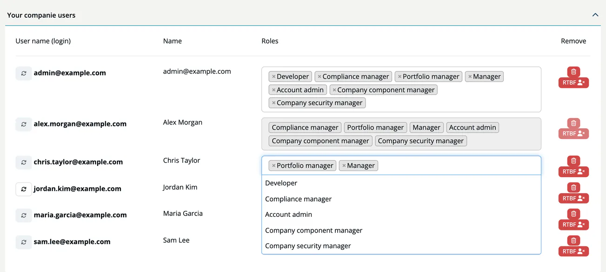

# Functions by Role

What each role can do in ***TrustSource CE***, one role at a time. Use it to decide which roles a person needs. Menu details are on [Functions by Area](04-functions-by-area.md); field-level rights in project and module settings are in the [Settings Permission Matrix](06-settings-permission-matrix.md) and the [Module Settings Matrix](06a-module-settings-matrix.md).

Roles add up: a person with several roles can do everything any of them can do.

## Developer (`developer`)

- **Menu:** Overview, Inbound (Check, Import Scans, CI/CD Scan, SW Quality Scans), Internal (Products, Projects, Risks, Releases, Reports), Knowledge.
- **Module settings:** edit General (name, version, description, project, tags), Viability, Versioning, CIA, Capabilities, Crypto management, End-of-life, Quality, Allow/Deny lists, Allowed vulnerability and Custom components; export SPDX; delete a module and its history.
- **Project settings:** read only.
- **Products:** create and change products.
- **Context:** the member and non-member rights in the [module matrix](06a-module-settings-matrix.md) apply in the interface.

## Compliance manager (`compliance_manager`)

- **Menu:** everything a Developer sees, plus Approvals, Outbound (SBOM + CBOM, Notice Files, CSAF, Verify), Settings and Policies.
- **Approvals:** approve, reject, update and remove approval requests and release their documents. See [Approve / Reject](../03-internal/06-approvals/03-approve-reject-workflow.md).
- **Projects:** create projects; load and remove the demo project.
- **Project settings:** edit Allow/Deny lists, enforce them and approve license and component allow-list entries.
- **Module settings:** edit Capabilities, export SPDX.
- **Company settings:** the cards FOSS liaison, Written offer, License allow/deny, Component allow/deny, Encryption, Quality, Company tags (read), Private licenses (with **Create private license** and **Usage stats**) and Legal templates. The FOSS liaison and Written offer forms are shown to Account admins only.
- **Policies:** Opensource policy (upload and track), Crypto algorithms, Component end-of-life.
- **Other:** webhooks and channels, release keys, CSAF documents, products, the Login history page.
- **Context:** gets default-owner rights in the interface on projects and modules where they are the default compliance manager or none is set.

## Portfolio manager (`portfolio_manager`)

- **Menu:** Overview, Knowledge, Settings with Company tags (read only).
- **Dashboard:** the **Company portfolio view** widget.
- **Project and module settings:** assign the default project manager and default compliance manager; edit module tags and Capabilities; export SPDX.

## Manager (`manager`)

- **Menu:** Inbound, Internal with Approvals, Outbound, Knowledge, Settings with Company tags.
- **Approvals:** approve, reject, update and remove approval requests and release their documents.
- **Projects:** create projects; load and remove the demo project.
- **Company data:** add, remove and import company tags; webhooks and channels; release keys; the Login history page.
- **Project and module settings:** read only, plus Capabilities and SPDX export on modules.
- **Products:** read only; changing products needs Developer, Compliance manager, Company security manager or Account admin.
- **Context:** gets default-owner rights, which are broad, on projects and modules where they are the default project manager or none is set. These include editing nearly every tab, running imports and deleting the project or module. Context rights shape the interface only; see [Permission Model](03-permission-model.md#four-layers-of-checks) and the [project matrix](06-settings-permission-matrix.md#rights-that-depend-on-your-relationship-to-the-project).

## Account admin (`account_admin`)

- **Menu:** Inbound, Outbound, Knowledge and the whole Administration section: Integrations, Settings, User Management, API keys, Policies, Audit logs. The Internal section is not shown to a user who holds only this role.
- **Company data:** invite, import and remove users and change their roles; integrations and webhooks; API keys, release keys and CSAF feed keys; all Settings cards and forms; company tags; audit logs and login history.
- **Project settings:** Issue Integration (Jira, TFS, GitHub) and the LeanIX link; read access elsewhere.
- **Module settings:** read access to most tabs; no access to Legal, Resolved obligations, Allow/Deny, History, Export SPDX and Danger Operations.

## Company component manager (`company_component_manager`)

- **Menu:** Overview, Knowledge, Settings with Component allow/deny and Manual vulnerability.
- **Knowledge:** create and edit components in the Component Lake, manage infrastructure elements and COTS, edit license entries, and the critical components report. See [Infrastructure Elements](../05-knowledge/02-infrastructure-elements.md#maintain-the-catalog), [3rd party (COTS)](../05-knowledge/03-cots.md#maintain-the-catalog) and [Components report](../03-internal/04c-impact-and-portfolio-reports.md#components).
- **Project settings:** read access to most tabs; no Issue Integration and no Imports.
- **Module settings:** read access to most tabs; no Legal, Resolved obligations, Allow/Deny, History or Export SPDX.

## Company security manager (`company_security_manager`)

- **Menu:** Overview, Knowledge, Settings with PSIRT contacts, Component allow/deny, Encryption, Quality, Company tags, Private algorithms and Manual vulnerability; Policies with Crypto algorithms and Component end-of-life.
- **Project and module settings:** edit CIA and Capabilities and run their imports.
- **Other:** create CSAF documents and products.

> [!NOTE]
> Several pages shown to the Company security manager accept changes only from other roles: the PSIRT contacts and Private algorithms forms (Account admin), saving the Component end-of-life policy and adding manual vulnerabilities (Account admin, Compliance manager or Manager). The Outbound section, where CSAF documents live, is not in this role's menu. Combine the role with another one where a person needs these functions.

## Approvals

- **Approve, reject, update, remove, release documents:** Compliance manager, Manager.
- **Over the REST API:** creating a request needs a key with scope `manager`; approving or rejecting needs `compliance_manager`. See [API Scopes](09-api-scopes.md).

## Related

- [The 7 Roles](01-roles-overview.md)
- [Roles cheat sheet](../00-getting-started/06-roles-cheatsheet.md)
